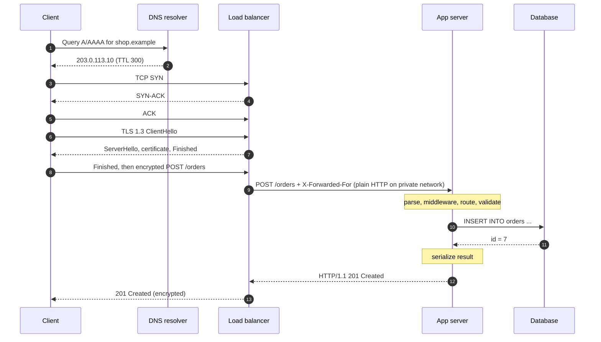
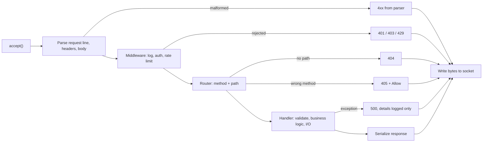

# 001 · What a backend is: the request → response lifecycle end to end

> **One-line summary:** a backend is a program that waits on a socket, turns incoming bytes into a request, decides what that request means, does the work, and turns the result back into bytes. Everything else is detail inside one of those steps.
> **Track:** BE · **Prerequisites:** none

## 1. The problem

A user clicks "Place order". A second later they see "Order #7 confirmed". Between those two moments, at least five independent systems cooperated: a DNS resolver, the operating system's TCP stack on both machines, a TLS implementation, usually a load balancer, and the application process, which itself talks to a database.

When that click fails, the error message rarely names the step that failed. "It's slow" might be DNS, the TLS handshake, a full accept queue, a slow SQL query, or a 2 MB JSON response. "It returned 400" might be the proxy rejecting a header before the application ever ran. "It hung" might be a server with no read timeout, waiting for bytes that will never arrive.

You can't debug, scale or secure a backend without a precise model of where a request is at every moment of its life. This entry builds that model from the bottom up, then implements the server side in about 300 lines of Java so that no step is hidden inside a framework.

## 2. From first principles

### 2.1 What "backend" means

A **backend** is a long-running process that:

1. owns a **listening socket** on some port,
2. accepts **connections** from clients,
3. reads **requests** from those connections, in a protocol both sides agree on (almost always HTTP),
4. maps each request to **application logic**, which usually reads or writes shared state such as a database,
5. writes a **response** back on the same connection.

Two properties follow from this shape:

- **It serves many clients at once.** A browser renders for one user. A backend handles requests from all users concurrently, so concurrency, shared state and resource limits are central concerns, not edge cases.
- **It is the trust boundary.** The client is code running on someone else's machine. Anything it sends can be forged, so validation, authentication and authorization have to happen on the server.

### 2.2 Before the first byte of HTTP: name, connection, encryption

Take `https://shop.example/orders` and follow it.

**Step 1: name resolution (DNS).** The client has a hostname, but IP packets need an address. The OS stub resolver asks a recursive resolver, which walks the DNS hierarchy (root → `example` TLD servers → the zone's authoritative servers) and returns `A` (IPv4) or `AAAA` (IPv6) records (RFC 1034, RFC 1035). Answers carry a TTL and are cached at several layers, so most lookups never leave the machine or the local network. This is also why a DNS change "takes time to propagate": old answers live until their TTL expires.

**Step 2: a TCP connection.** The client opens a TCP connection to `IP:443`. TCP establishes it with a three-way handshake: the client sends SYN, the server replies SYN-ACK, the client sends ACK (RFC 9293 §3.5). That costs one round trip before any application data moves. What TCP gives you afterwards is a reliable, ordered, bidirectional **byte stream**. It does not give you messages. If the client writes 500 bytes, the server may receive them in one `read()` or in five. Any message boundaries have to be added by the protocol on top.

On the server, the kernel does the handshake, not your code. Once the process has called `bind()` and `listen()`, the kernel completes handshakes on its own and queues finished connections in a **backlog**. The application's `accept()` call takes the next already-established connection off that queue. If the application accepts slower than connections arrive, the queue fills and new connection attempts start failing or timing out before any of your code runs.

**Step 3: TLS.** For `https`, the client and server run a TLS handshake over the TCP connection. In TLS 1.3 a full handshake takes one round trip (RFC 8446 §2). It authenticates the server with its certificate, which must match the hostname, and agrees on keys. From then on, everything HTTP sends is encrypted and integrity-protected. The certificate check is what stops a machine in the middle from impersonating the server.

TLS is often **terminated** before the application: a load balancer or reverse proxy holds the certificate, decrypts, and forwards plain HTTP (or re-encrypted HTTP) to the application servers behind it. In that setup, the application sees the proxy's IP address as the peer, not the user's. That is why proxies add headers such as `Forwarded` (RFC 7239) or the de facto `X-Forwarded-For`, and why an application must trust those headers only when they come from its own proxy.

So before the server reads one byte of HTTP, the client has spent roughly one round trip on TCP and one on TLS 1.3, plus a DNS lookup if the answer wasn't cached. Keeping connections open and reusing them avoids paying these costs on every request. HTTP/1.1 connections are persistent by default for this reason (RFC 9112 §9.3).

### 2.3 The request on the wire

HTTP/1.1 turns the byte stream back into messages. A request is (RFC 9112 §2.1):

```
POST /orders HTTP/1.1\r\n                   ← request line: method, target, version
Host: shop.example\r\n                       ← header fields, one per line
Content-Type: application/json\r\n
Content-Length: 27\r\n
\r\n                                          ← empty line: end of the head
{"sku":"A-100","quantity":2}                 ← body: exactly Content-Length bytes
```

Three framing rules do all the work:

- **Lines end in CRLF.** The head is a sequence of lines.
- **An empty line ends the head.** Everything before it is metadata. Everything after it is body.
- **The body length is declared up front**, by `Content-Length` or by `Transfer-Encoding: chunked`, which sends the body in length-prefixed pieces (RFC 9112 §6). Without one of those, a request has no body.

`Host` is mandatory in HTTP/1.1. A server must answer 400 to an HTTP/1.1 request without it (RFC 9112 §3.2). It exists so that one IP address can serve many hostnames: the TCP connection says *which machine*, `Host` says *which site*.

The response has the same structure with a status line in place of the request line:

```
HTTP/1.1 201 Created\r\n
Content-Type: application/json\r\n
Content-Length: 25\r\n
\r\n
{"id":7,"status":"placed"}
```

The **meaning** of methods, status codes and headers is defined separately from this wire format, in RFC 9110 (HTTP Semantics). HTTP/2 (RFC 9113) and HTTP/3 (RFC 9114) replace the text framing with binary frames and multiplex many requests on one connection, but a request still has a method, a target, header fields and a body, with the same meanings. The lifecycle in this entry applies to all three versions. Entry 002 covers the differences.

### 2.4 Inside the server: from bytes to a handler and back

Once the connection is accepted and decrypted, every backend does the same sequence, whether it's hand-written, Spring Boot on Tomcat, Node.js, or a Next.js route handler:

1. **Read and parse.** Read bytes until the empty line, parse the request line and headers, then read exactly as many body bytes as the framing says. Reject anything malformed with a 4xx *before* application code sees it.
2. **Cross-cutting steps (middleware).** Logging, request IDs, authentication, rate limiting, compression. These apply to many routes, so they wrap the handlers instead of living in them. (Entry 013.)
3. **Route.** Choose a handler from the method and path. No path match means 404. A path match with the wrong method means 405, which must include an `Allow` header listing the valid methods (RFC 9110 §15.5.6).
4. **Deserialize and validate.** Turn the body into a typed object, then check it against business rules. Bad input is the client's fault: 400 or 422, not 500. (Entries 007–008.)
5. **Business logic and I/O.** Usually most of the time is spent here: database queries, calls to other services, a model API.
6. **Serialize and write.** Turn the result into a status code, headers and body bytes, and write them to the socket.
7. **Finish the connection.** Either keep it open for the next request, or close it.

Two properties of this pipeline matter for everything later in the journal:

- **Each request is handled independently.** Nothing about request *N* is available to request *N+1* unless it's stored somewhere both can reach: a database, a cache, or a token the client sends back. This is HTTP's statelessness (RFC 9110 §3.3), and it's why you can add more server instances behind a load balancer. (Entry 002.)
- **Concurrency comes from handling connections in parallel.** A server either gives each connection its own thread (Tomcat's classic model, and this entry's code using Java 21 virtual threads) or multiplexes many connections on a few threads with an event loop (Node.js, Netty). Either way, the slow part, waiting on I/O, must not block other users' requests. (Entry 026.)

### Self-check

- A user reports that the first request to your API takes 300 ms but later ones take 40 ms. Name two lifecycle steps that only the first request pays for.
- Your application logs show no record of a failing request at all. List the steps where it could have died before reaching your code.
- Why can't the server use "one `read()` call = one request" to find request boundaries?

<details>
<summary>Answers</summary>

- A DNS lookup (if the answer wasn't cached) and connection setup: the TCP handshake plus the TLS handshake. Later requests on a reused, persistent connection skip all of them. Application-level warm-up, such as JIT compilation, lazy initialization or a cold connection pool, can also make only the first request slow.
- DNS (wrong or stale address), TCP connect (port closed, accept backlog full, firewall), TLS (certificate mismatch or expiry), the load balancer or proxy (no healthy upstream, request rejected for size or headers), or the server's own HTTP parser rejecting malformed bytes before invoking a handler.
- TCP is a byte stream with no message boundaries. A request may arrive split across several reads, and with persistent connections, one read may contain the end of one request and the start of the next. Only HTTP's own framing (the empty line, then `Content-Length` or chunking) says where a message ends.

</details>

## 3. Diagram

The full round trip for a first request on a new connection, with TLS terminated at a load balancer:



What happens inside the app server between steps 9 and 12 above, as a pipeline. Every arrow out to the right is an early exit that never reaches the handler:



## 4. Code

The example is an HTTP/1.1 server on raw `java.net` sockets. It's small enough to read in one sitting and covers steps 1, 3, 6 and 7 of §2.4: accept, parse, route, handle, serialize, write. It skips TLS, persistent connections and chunked bodies.

| File | Lifecycle step |
|---|---|
| [`MiniHttpServer.java`](../../code/src/main/java/foundations/e001_request_lifecycle/MiniHttpServer.java) | listen, accept, one virtual thread per connection, timeouts, error → status mapping, write |
| [`RequestParser.java`](../../code/src/main/java/foundations/e001_request_lifecycle/RequestParser.java) | bytes → `HttpRequest`, enforcing RFC 9112 framing rules |
| [`Router.java`](../../code/src/main/java/foundations/e001_request_lifecycle/Router.java) | method + path → handler, 404 vs 405 |
| [`HttpResponse.java`](../../code/src/main/java/foundations/e001_request_lifecycle/HttpResponse.java) | `HttpResponse` → bytes |
| [`LifecycleDemo.java`](../../code/src/main/java/foundations/e001_request_lifecycle/LifecycleDemo.java) | the "application": two routes |

Tests: [`RequestParserTest.java`](../../code/src/test/java/foundations/e001_request_lifecycle/RequestParserTest.java) checks the parser against hand-written wire bytes. [`MiniHttpServerTest.java`](../../code/src/test/java/foundations/e001_request_lifecycle/MiniHttpServerTest.java) starts the server on an OS-chosen port and talks to it over real TCP, both with the JDK `HttpClient` and with raw bytes.

The connection handler is the whole lifecycle in one method:

```java
private void handle(Socket client) {
    try (client) {
        // Without a timeout, a client that connects and never sends a byte would hold this
        // connection open forever. That is the idea behind slow-client (Slowloris) attacks.
        client.setSoTimeout(READ_TIMEOUT_MILLIS);
        InputStream in = new BufferedInputStream(client.getInputStream());
        OutputStream out = client.getOutputStream();

        HttpResponse response;
        try {
            HttpRequest request = RequestParser.parse(in);   // bytes -> meaning
            response = handler.apply(request);                // route + application logic
        } catch (RequestParser.BadRequestException e) {
            // A malformed request never reaches application code.
            response = HttpResponse.text(e.status(), e.reason(), e.getMessage() + "\n");
        } catch (RuntimeException e) {
            // A handler bug becomes a 500 for this request only; details stay in the server log.
            System.err.println("handler failed: " + e);
            response = HttpResponse.text(500, "Internal Server Error", "internal error\n");
        }

        out.write(response.toBytes());                        // meaning -> bytes
        out.flush();
    } catch (IOException e) {
        // Timeout or client disconnect: nothing useful can be sent back.
    }
}
```

And the part of the parser that restores message boundaries on top of TCP's byte stream:

```java
long length = Long.parseLong(contentLength);
if (length > MAX_BODY_BYTES) {
    throw new BadRequestException(413, "Content Too Large", "body of " + length + " bytes");
}
// readNBytes loops until it has the full count or hits end of stream. A single read()
// may return fewer bytes, because TCP segments do not line up with HTTP messages.
byte[] body = in.readNBytes((int) length);
```

The parser rejects some inputs that a lenient parser might accept, such as two `Content-Length` headers, whitespace between a header name and its colon, or any `Transfer-Encoding`. That's deliberate. If a proxy and a server disagree about where a request ends, an attacker can hide a second request inside the first one's body. This is **HTTP request smuggling**, and RFC 9112 §11.2 calls out exactly this framing ambiguity as its cause. Refusing to guess is the safe default.

Run it yourself:

```bash
cd code
./gradlew test --tests 'foundations.e001_request_lifecycle.*'
# or start the demo server and use curl -v to see the raw heads:
./gradlew compileJava && java -cp build/classes/java/main foundations.e001_request_lifecycle.LifecycleDemo
curl -v -X DELETE http://localhost:8080/hello
```

### Self-check

- What happens if you remove `client.setSoTimeout(...)` and a client opens 10,000 connections without sending anything?
- `HttpResponse.toBytes()` always writes `Content-Length`. What would the client have to do to find the end of the body if it didn't, and what would that cost?
- In `Router.apply`, why are routes keyed by path first and method second, instead of by a single `"GET /hello"` string?

<details>
<summary>Answers</summary>

- Each connection's virtual thread blocks in `read()` forever, and each open socket holds a file descriptor and buffers. Virtual threads are cheap, but file descriptors and memory are not unlimited. Eventually the process hits its descriptor limit, `accept()` starts failing, and legitimate users can't connect. The timeout bounds how long an idle client can hold resources.
- It would have to read until the server closes the connection, because close is the only remaining end-of-body signal for a response without `Content-Length` or chunked encoding (RFC 9112 §6.3). That rules out reusing the connection for another request, and the client can't tell a complete body from one cut off by a network failure.
- Because "this path exists but not for this method" (405, with `Allow`) is a different answer from "this path doesn't exist" (404). With a single combined key, the router could only ever say 404.

</details>

## 5. Trade-offs and failure modes

**Where time goes.** On a new HTTPS connection, the client pays DNS (if not cached), one round trip for TCP and one for TLS 1.3 before the request is even sent. For a user far from the server, that setup alone can rival the handler's own time. The standard mitigations all attack setup cost: persistent connections and connection pools, HTTP/2 multiplexing (many requests, one connection), TLS session resumption, and terminating TLS close to users at a CDN or edge.

**Where requests die without a log line.** Failures before the handler are invisible to application logs: DNS pointing at an old IP, a full accept backlog, an expired certificate, the proxy rejecting an oversized header, the HTTP parser rejecting framing. When "the API is down" but the app logs are clean, look at proxy and load-balancer logs, and at connection-level metrics.

**Limits are part of correctness.** Every unbounded read is a denial-of-service vector: line length, header count, body size, idle time. The example caps all four. Production servers expose them as configuration, and the right values depend on the API.

**Thread per connection vs event loop.** Thread-per-connection code is simple to write and debug because it's sequential. Platform threads are expensive (each reserves stack memory), which is why event loops became popular for high connection counts. Java 21 virtual threads (JEP 444) make the blocking style cheap again for I/O-bound work. They don't help with CPU-bound work, and they don't remove other limits such as database connection pools.

**Errors must be classified at the boundary.** Malformed input is a 4xx. A bug or a dependency failure is a 5xx. Mixing these up breaks clients: a client may retry a 503 but should not blindly retry a 400. Leaking exception messages in a 500 hands internal details to attackers, so details go to logs and the client gets a generic message.

**The client is not trusted.** Every byte from the client, including headers like `X-Forwarded-For`, can be forged. Validation, authentication and authorization belong on the server, after parsing and before business logic.

## 6. In the real world

**Callwise.** Callwise runs on Next.js deployed to Vercel. The platform handles DNS, TLS and the HTTP server, so application code starts at the pipeline in §2.4 with an already-parsed Web `Request`:

- [`src/proxy.ts`](https://github.com/sanjaysathyarapu/callwise/blob/main/src/proxy.ts) is middleware (Next.js 16 calls it "proxy"). It runs before matching pages and redirects signed-out users to `/login`, an early exit before any handler.
- [`src/app/api/chat/route.ts`](https://github.com/sanjaysathyarapu/callwise/blob/main/src/app/api/chat/route.ts) is the handler for `POST /api/chat`. Its first lines follow the lifecycle order: rate-limit by client IP (429), parse and validate the JSON body with a zod schema (400 on failure), check message sizes, then do the I/O (database, vector retrieval, model call) and stream the response.

**A typical Spring Boot service.** Embedded Tomcat owns the listening socket, accepts connections and parses HTTP. Servlet filters are the middleware layer (Spring Security is a chain of filters). `DispatcherServlet` is the router: its handler mappings choose a `@RestController` method from method and path. `HttpMessageConverter`s deserialize the body (Jackson for JSON) and serialize the return value. A `@ControllerAdvice` maps exceptions to status codes. Every class in this entry's example has a direct counterpart there.

**Load balancers and CDNs.** Managed load balancers and CDNs commonly terminate TLS, enforce header and body size limits, and add forwarding headers before the request reaches your process. Their limits and timeouts are part of your API's behavior, whether or not you configured them.

## 7. Interview Q&A

**Q:** What happens when you type a URL into a browser and press Enter? Focus on the backend side.
**A:** The browser resolves the hostname through DNS, possibly from cache, to get an IP address. It opens a TCP connection with a three-way handshake and, for HTTPS, runs a TLS handshake that authenticates the server's certificate and agrees on keys. It then sends an HTTP request: method, target, headers including `Host`, and an optional body. Often a load balancer terminates TLS and forwards the request to one of several app servers. The server parses the request, runs middleware such as auth and logging, routes it to a handler, which validates input and talks to a database, then serializes a response with a status code, headers and body. The connection is usually kept open for reuse.

**Q:** How does an HTTP/1.1 server know where one request ends and the next begins on the same connection?
**A:** TCP provides only a byte stream, so HTTP/1.1 defines its own framing. The head ends at the first empty line (CRLF CRLF). The body length is given by `Content-Length`, or the body is sent with `Transfer-Encoding: chunked`, where each chunk is length-prefixed and a zero-length chunk ends it. With neither header, a request has no body. If two parties in a chain disagree on these rules, for example one honors `Content-Length` and the other `Transfer-Encoding`, you get request smuggling, so strict servers reject ambiguous framing.

**Q:** Where can a request fail before it reaches your application code, and how would you tell?
**A:** At DNS (wrong or stale record), at TCP connect (port closed, firewall, accept backlog full), at TLS (expired or mismatched certificate), at the load balancer or proxy (no healthy backend, size or header limits, timeouts), or in the server's HTTP parser (malformed request). None of these produce application log lines. You check the client-side error type (DNS error vs connection refused vs TLS error vs a proxy-generated 502/504) and the proxy and load-balancer logs and metrics.

**Q:** Why should a handler bug return 500 with a generic body instead of the exception message?
**A:** 5xx tells the client the server failed and the request itself may be fine, which drives correct retry and alerting behavior. The exception message and stack trace can expose internals such as SQL, file paths, library versions or data, which helps attackers. So the server logs the full detail with a request ID and returns a generic message, ideally including that ID so the two can be correlated.

**Q:** Why are backends designed so that each request can be handled independently?
**A:** HTTP is stateless: each request carries everything needed to interpret it, and the server doesn't rely on memory of earlier requests on that connection. Shared state lives in a database, cache or a client-held token. That lets a load balancer send any request to any instance, which is what makes horizontal scaling, rolling deploys and instance failure tolerable.

## 8. References

- RFC 9110, *HTTP Semantics*: methods, status codes, header fields, statelessness. https://www.rfc-editor.org/rfc/rfc9110
- RFC 9112, *HTTP/1.1*: message format, framing, persistent connections, request smuggling (§11.2). https://www.rfc-editor.org/rfc/rfc9112
- RFC 9113, *HTTP/2*. https://www.rfc-editor.org/rfc/rfc9113 · RFC 9114, *HTTP/3*. https://www.rfc-editor.org/rfc/rfc9114
- RFC 9293, *Transmission Control Protocol (TCP)*. https://www.rfc-editor.org/rfc/rfc9293
- RFC 8446, *The Transport Layer Security (TLS) Protocol Version 1.3*. https://www.rfc-editor.org/rfc/rfc8446
- RFC 1034 and RFC 1035, *Domain Names*: concepts and implementation. https://www.rfc-editor.org/rfc/rfc1034 · https://www.rfc-editor.org/rfc/rfc1035
- RFC 7239, *Forwarded HTTP Extension*. https://www.rfc-editor.org/rfc/rfc7239
- JEP 444, *Virtual Threads*. https://openjdk.org/jeps/444
- Java SE 21 API: [`java.net.ServerSocket`](https://docs.oracle.com/en/java/javase/21/docs/api/java.base/java/net/ServerSocket.html), [`java.net.http.HttpClient`](https://docs.oracle.com/en/java/javase/21/docs/api/java.net.http/java/net/http/HttpClient.html)
- Spring Framework reference, *DispatcherServlet*. https://docs.spring.io/spring-framework/reference/web/webmvc/mvc-servlet.html
- Next.js docs, *Route Handlers* and *Proxy*. https://nextjs.org/docs/app/api-reference/file-conventions/route · https://nextjs.org/docs/app/api-reference/file-conventions/proxy
