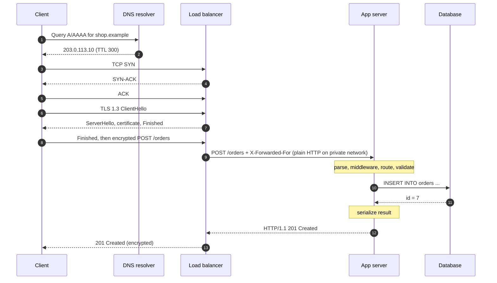
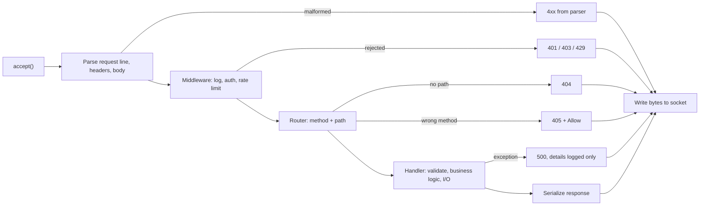

# 001 · What a backend is: the request → response lifecycle end to end

> **One-line summary:** a backend is a program that waits on a socket, turns incoming bytes into a request, decides what that request means, does the work, and turns the result back into bytes. Everything else is detail inside one of those steps.
> **Track:** BE · **Prerequisites:** none

## 1. The problem

A user clicks "Place order" and a second later sees "Order #7 confirmed". In between, a DNS resolver, the TCP stacks on both machines, a TLS implementation, usually a load balancer, the application process and its database all cooperated.

When that click fails, the error rarely names the failing step. "It's slow" might be DNS, the TLS handshake, a full accept queue or a slow query. "It returned 400" might be the proxy rejecting a header before the application ran. "It hung" might be a server with no read timeout.

You can't debug, scale or secure a backend without a precise model of where a request is at every moment. This entry builds that model, then implements the server side in one small Java file so no step is hidden inside a framework.

## 2. From first principles

### 2.1 What "backend" means

A **backend** is a long-running process that owns a **listening socket**, accepts **connections**, reads **requests** in an agreed protocol (almost always HTTP), maps each one to **application logic** that usually reads or writes shared state such as a database, and writes a **response** back on the same connection.

Two properties follow:

- **It serves many clients at once**, so concurrency, shared state and resource limits are central concerns.
- **It is the trust boundary.** Anything the client sends can be forged, so validation, authentication and authorization happen on the server.

### 2.2 Before the first byte of HTTP: name, connection, encryption

Take `https://shop.example/orders`.

**DNS.** A recursive resolver walks the hierarchy (root → TLD → the zone's authoritative servers) and returns `A` or `AAAA` records (RFC 1034, RFC 1035). Answers carry a TTL and are cached at several layers, which is why DNS changes "take time to propagate".

**TCP.** The client connects to `IP:443` with a three-way handshake, SYN → SYN-ACK → ACK (RFC 9293 §3.5): one round trip. The result is a reliable, ordered **byte stream**, not a sequence of messages: 500 bytes written may arrive in one `read()` or in five. Boundaries must come from the protocol on top. The kernel does the handshake: after `bind()` and `listen()` it queues finished connections in a **backlog**, and `accept()` takes the next one. If the application accepts too slowly, the queue fills and connections fail before your code runs.

**TLS.** A TLS 1.3 handshake (one round trip, RFC 8446 §2) checks the server's certificate against the hostname and agrees on keys. TLS is often **terminated** at a load balancer that forwards plain HTTP, so the application sees the proxy as its peer. That's why proxies add `Forwarded` (RFC 7239) or `X-Forwarded-For`, which may be trusted only from your own proxy.

A new HTTPS connection therefore costs a DNS lookup (if not cached) plus about two round trips before the request is sent. HTTP/1.1 connections are persistent by default to avoid paying that again (RFC 9112 §9.3).

### 2.3 The request on the wire

HTTP/1.1 turns the byte stream back into messages (RFC 9112 §2.1):

```
POST /orders HTTP/1.1\r\n                   ← request line: method, target, version
Host: shop.example\r\n                       ← header fields, one per line
Content-Type: application/json\r\n
Content-Length: 27\r\n
\r\n                                          ← empty line: end of the head
{"sku":"A-100","quantity":2}                 ← body: exactly Content-Length bytes
```

Three framing rules do all the work: **lines end in CRLF**; **an empty line ends the head**; and **the body length is declared up front**, by `Content-Length` or by `Transfer-Encoding: chunked` (RFC 9112 §6). With neither, a request has no body.

`Host` is mandatory in HTTP/1.1; without it the answer is 400 (RFC 9112 §3.2). The connection says *which machine*; `Host` says *which site*.

The response has the same shape, with a status line first:

```
HTTP/1.1 201 Created\r\n
Content-Type: application/json\r\n
Content-Length: 25\r\n
\r\n
{"id":7,"status":"placed"}
```

What methods, status codes and headers *mean* is defined separately, in RFC 9110. HTTP/2 (RFC 9113) and HTTP/3 (RFC 9114) use binary framing instead, but the lifecycle here applies to all three. Entry 002 covers the differences.

### 2.4 Inside the server: from bytes to a handler and back

Once the connection is accepted and decrypted, every backend runs the same sequence, whether hand-written, Spring Boot on Tomcat, Node.js or a Next.js route handler:

1. **Read and parse** the head, then exactly as many body bytes as the framing says. Reject malformed input with a 4xx before application code sees it.
2. **Middleware:** logging, request IDs, authentication, rate limiting. (Entry 013.)
3. **Route** by method and path. No path match is 404; the wrong method is 405 with an `Allow` header (RFC 9110 §15.5.6).
4. **Deserialize and validate.** Bad input is a 400 or 422, not a 500. (Entries 007–008.)
5. **Business logic and I/O:** database queries, calls to other services. Usually most of the time.
6. **Serialize and write** a status, headers and body.
7. **Finish the connection:** keep it for the next request, or close it.

Two properties matter for everything later:

- **Each request is handled independently.** Request *N+1* sees nothing from request *N* unless it's stored where both can reach it: a database, a cache, or a token the client sends back. This is HTTP's statelessness (RFC 9110 §3.3), and it's what lets you add instances behind a load balancer. (Entry 002.)
- **Concurrency comes from handling connections in parallel**, with a thread per connection (classic Tomcat, and this entry's code using Java 21 virtual threads) or an event loop (Node.js, Netty). Either way, waiting on I/O must not block other users. (Entry 026.)

### Self-check

- A user reports that the first request to your API takes 300 ms but later ones take 40 ms. Name two lifecycle steps that only the first request pays for.
- Your application logs show no record of a failing request at all. List the steps where it could have died before reaching your code.
- Why can't the server use "one `read()` call = one request" to find request boundaries?

<details>
<summary>Answers</summary>

- An uncached DNS lookup, and connection setup (TCP plus TLS handshakes). Later requests on the reused connection skip both. Application warm-up (JIT, lazy initialization, a cold connection pool) can also hit only the first request.
- DNS (stale address), TCP connect (port closed, backlog full, firewall), TLS (certificate mismatch or expiry), the load balancer or proxy (no healthy upstream, size or header limits), or the server's HTTP parser rejecting malformed bytes.
- TCP has no message boundaries. A request may arrive across several reads, and on a persistent connection one read may hold the end of one request and the start of the next. Only HTTP's framing (the empty line, then `Content-Length` or chunking) says where a message ends.

</details>

## 3. Diagram

The full round trip for a first request on a new connection, with TLS terminated at a load balancer:



What happens inside the app server between steps 9 and 12, as a pipeline. Every arrow out to the right is an early exit that never reaches the handler:



## 4. Code

[`MiniHttpServer.java`](../../code/src/main/java/foundations/e001_request_lifecycle/MiniHttpServer.java) is an HTTP/1.1 server on raw sockets covering steps 1, 3, 6 and 7 of §2.4, without TLS, keep-alive or chunked bodies. [`MiniHttpServerTest.java`](../../code/src/test/java/foundations/e001_request_lifecycle/MiniHttpServerTest.java) exchanges raw bytes with it over real TCP, so the wire format is visible in every assertion.

The connection handler is the whole lifecycle in one method:

```java
private void handle(Socket client) {
    try (client) {
        client.setSoTimeout(READ_TIMEOUT_MILLIS); // otherwise a client that sends nothing holds this socket forever
        Response res;
        try { // ISO-8859-1 maps each byte to one char, so char counts below equal byte counts
            res = route(parse(new BufferedReader(new InputStreamReader(client.getInputStream(), ISO_8859_1))));
        } catch (HttpError e) { // malformed input never reaches a handler
            res = new Response(e.status, e.getMessage() + "\n", null);
        } catch (RuntimeException bug) { // a handler bug: log the details, never send them to the client
            System.err.println("handler failed: " + bug);
            res = new Response(500, "internal error\n", null);
        }
        // Content-Length tells the client where the body ends; "close": one request per connection.
        String head = "HTTP/1.1 " + res.status() + " \r\n" + (res.allow() == null ? "" : "Allow: " + res.allow() + "\r\n")
                + "Content-Length: " + res.body().length() + "\r\nConnection: close\r\n\r\n";
        client.getOutputStream().write((head + res.body()).getBytes(ISO_8859_1));
    } catch (IOException timeoutOrDisconnect) {} // nothing useful can be sent back
}
```

The parser restores message boundaries on top of TCP's byte stream:

```java
if (Integer.parseInt(declared) > MAX_BODY_BYTES) throw new HttpError(413, "body too large"); // before allocating
char[] body = new char[Integer.parseInt(declared)];
// TCP has no message boundaries: one read() may return part of the body, so loop until it is complete.
for (int n = 0, r; n < body.length; n += r)
    if ((r = in.read(body, n, body.length - n)) < 0) throw new HttpError(400, "body cut short");
```

It also refuses any `Transfer-Encoding` (501) rather than guess at framing. When a proxy and a server disagree about where a request ends, an attacker can hide a second request in the first one's body: **request smuggling** (RFC 9112 §11.2). Production parsers also reject duplicate `Content-Length` values and whitespace before a header's colon (RFC 9112 §5.1). Run the tests with `cd code && ./gradlew test --tests 'foundations.e001_request_lifecycle.*'`.

### Self-check

- What happens if you remove `client.setSoTimeout(...)` and a client opens 10,000 connections without sending anything?
- `handle` always writes `Content-Length`. What would the client have to do to find the end of the body if it didn't, and what would that cost?
- Why is `routes` keyed by path first and method second, instead of by a single `"GET /hello"` string?

<details>
<summary>Answers</summary>

- Each virtual thread blocks in `read()` forever, and each socket holds a file descriptor and buffers. Virtual threads are cheap, descriptors are not unlimited: eventually `accept()` fails and real users can't connect. The timeout bounds how long an idle client holds resources; `silentClientIsDisconnectedAfterTheReadTimeout` checks it.
- Read until the server closes the connection, the only remaining end-of-body signal (RFC 9112 §6.3). The connection can't be reused, and a complete body looks the same as one cut off by a network failure.
- "This path exists, but not for this method" (405 with `Allow`) is a different answer from "no such path" (404). A combined key could only ever say 404.

</details>

## 5. Trade-offs and failure modes

**Setup cost.** A new HTTPS connection pays DNS plus a round trip each for TCP and TLS before the request leaves. The fixes all attack setup: connection reuse and pools, HTTP/2 multiplexing, TLS session resumption, terminating TLS near users at a CDN.

**Failures without a log line.** A stale DNS record, a full backlog, an expired certificate, a proxy limit or a parser rejection never reaches application logs. When app logs are clean but "the API is down", check proxy and load-balancer logs and connection metrics.

**Limits are part of correctness.** Every unbounded read is a denial-of-service vector: idle time, body size, line length, header count. The example caps the first two; production servers cap all four.

**Thread per connection vs event loop.** Blocking code is easy to read, but platform threads are expensive, which is why event loops won at high connection counts. Virtual threads (JEP 444) make blocking cheap again for I/O-bound work, not for CPU-bound work, and they don't lift limits such as database pool size.

**Classify errors at the boundary.** Malformed input is 4xx; a bug or failed dependency is 5xx. Clients may retry a 503 but not blindly a 400. Exception details go to logs, never into responses.

## 6. In the real world

**Callwise** runs on Next.js on Vercel. The platform handles DNS, TLS and the HTTP server, so application code starts at §2.4 with an already-parsed `Request`:

- [`src/proxy.ts`](https://github.com/sanjaysathyarapu/callwise/blob/main/src/proxy.ts) is middleware (Next.js 16 calls it "proxy"): it redirects signed-out users to `/login` before any page handler runs.
- [`src/app/api/chat/route.ts`](https://github.com/sanjaysathyarapu/callwise/blob/main/src/app/api/chat/route.ts) handles `POST /api/chat` in lifecycle order: rate-limit by client IP (429), validate the JSON body with zod (400), check message sizes, then do the I/O (database, retrieval, model call) and stream the response.

**Spring Boot.** Embedded Tomcat accepts and parses; servlet filters are the middleware (Spring Security is a filter chain); `DispatcherServlet` routes to a `@RestController`; `HttpMessageConverter`s (Jackson) convert bodies; `@ControllerAdvice` maps exceptions to status codes.

**Load balancers and CDNs** terminate TLS, enforce size limits and add forwarding headers. Their limits and timeouts are part of your API's behavior whether or not you configured them.

## 7. Interview Q&A

**Q:** What happens when you type a URL into a browser and press Enter? Focus on the backend side.
**A:** The browser resolves the hostname through DNS, often from cache. It opens a TCP connection and, for HTTPS, runs a TLS handshake that authenticates the server and agrees on keys. It sends a request: method, target, headers including `Host`, optional body. A load balancer often terminates TLS and forwards to an app server, which parses the request, runs middleware such as auth and logging, routes to a handler that validates input and queries a database, and serializes a response. The connection is usually kept for reuse.

**Q:** How does an HTTP/1.1 server know where one request ends and the next begins on the same connection?
**A:** TCP is only a byte stream, so HTTP/1.1 frames messages itself. The head ends at the first empty line. The body length comes from `Content-Length`, or from `Transfer-Encoding: chunked`, where each chunk is length-prefixed and a zero-length chunk ends the body. With neither, there is no body. If two hops disagree on these rules you get request smuggling, so strict servers reject ambiguous framing.

**Q:** Where can a request fail before it reaches your application code, and how would you tell?
**A:** At DNS, TCP connect (port closed, firewall, full backlog), TLS (bad certificate), the load balancer or proxy (no healthy backend, limits, timeouts), or the HTTP parser. None produce application logs. The client's error type tells them apart (DNS error, connection refused, TLS error, a proxy's 502/504), and proxy logs and metrics confirm it.

**Q:** Why should a handler bug return 500 with a generic body instead of the exception message?
**A:** A 5xx tells the client the server failed, which drives correct retries and alerting. Exception messages and stack traces can expose SQL, paths, versions or data. Log the details with a request ID and return a generic message carrying that ID.

**Q:** Why are backends designed so that each request can be handled independently?
**A:** HTTP is stateless: each request carries everything needed to interpret it. Shared state lives in a database, cache or client-held token, so a load balancer can send any request to any instance. That is what makes horizontal scaling, rolling deploys and surviving instance failure possible.

## 8. References

- RFC 9110, *HTTP Semantics*: methods, status codes, header fields, statelessness. https://www.rfc-editor.org/rfc/rfc9110
- RFC 9112, *HTTP/1.1*: message format, framing, persistent connections, request smuggling (§11.2). https://www.rfc-editor.org/rfc/rfc9112
- RFC 9113, *HTTP/2*. https://www.rfc-editor.org/rfc/rfc9113 · RFC 9114, *HTTP/3*. https://www.rfc-editor.org/rfc/rfc9114
- RFC 9293, *Transmission Control Protocol (TCP)*. https://www.rfc-editor.org/rfc/rfc9293
- RFC 8446, *The Transport Layer Security (TLS) Protocol Version 1.3*. https://www.rfc-editor.org/rfc/rfc8446
- RFC 1034 and RFC 1035, *Domain Names*: concepts and implementation. https://www.rfc-editor.org/rfc/rfc1034 · https://www.rfc-editor.org/rfc/rfc1035
- RFC 7239, *Forwarded HTTP Extension*. https://www.rfc-editor.org/rfc/rfc7239
- JEP 444, *Virtual Threads*. https://openjdk.org/jeps/444
- Java SE 21 API: [`java.net.ServerSocket`](https://docs.oracle.com/en/java/javase/21/docs/api/java.base/java/net/ServerSocket.html)
- Spring Framework reference, *DispatcherServlet*. https://docs.spring.io/spring-framework/reference/web/webmvc/mvc-servlet.html
- Next.js docs, *Route Handlers* and *Proxy*. https://nextjs.org/docs/app/api-reference/file-conventions/route · https://nextjs.org/docs/app/api-reference/file-conventions/proxy
