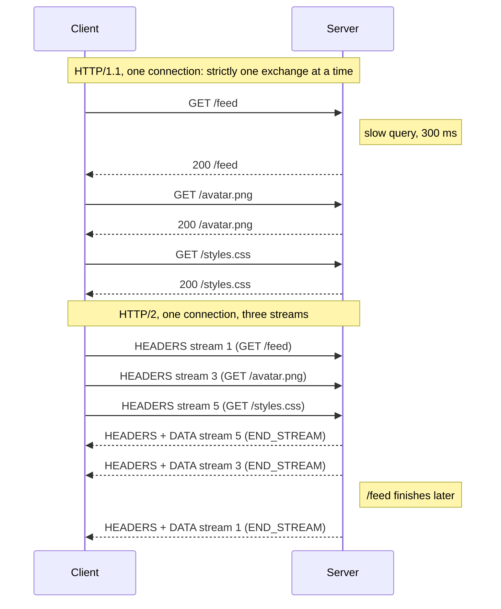
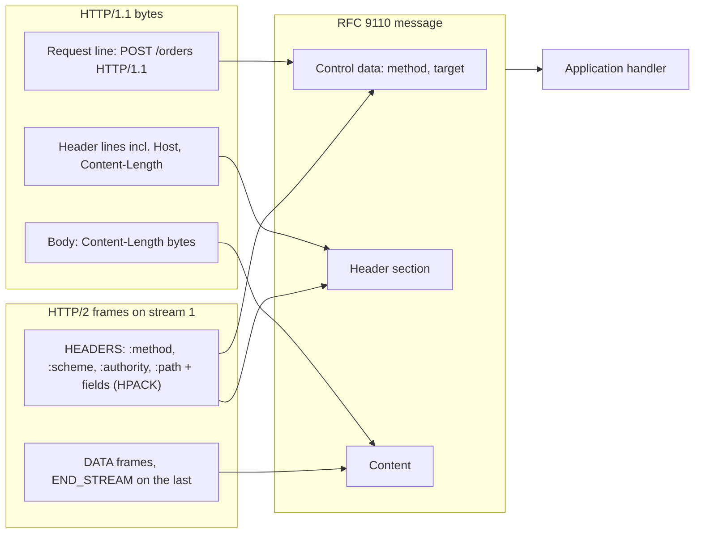

# 002 · HTTP fundamentals: messages, statelessness, HTTP/1.1 vs HTTP/2

> **One-line summary:** HTTP defines one abstract message (control data, headers, content, trailers) with fixed meanings, and each protocol version is just a different way to put that message on the wire. HTTP/1.1 uses text on one request at a time per connection; HTTP/2 uses binary frames so many requests share one connection. Neither version keeps state between requests.
> **Track:** BE · **Prerequisites:** [001 · The request → response lifecycle](../001-request-response-lifecycle/)

## 1. The problem

Three common confusions come from mixing up *what an HTTP message means* with *how it is carried*:

- A team enables HTTP/2 and expects the API to get faster. Pages that load many small resources do; one large JSON response doesn't.
- A service keeps the logged-in user in server memory. Behind a load balancer with two instances, users get logged out at random, because their next request lands on the other instance.
- A developer inspecting HTTP/2 traffic finds no `Host` header and no `Connection: keep-alive`. Nothing is broken: HTTP/2 carries the first differently and forbids the second.

This entry separates the version-independent message and its stateless semantics (RFC 9110) from the two wire formats that dominate server-side traffic, HTTP/1.1 (RFC 9112) and HTTP/2 (RFC 9113).

## 2. From first principles

### 2.1 The message, independent of any version

RFC 9110 §6 defines an HTTP message abstractly. Every request and response, in every version, has four parts:

| Part | Request | Response |
|---|---|---|
| **Control data** | method, target URI, protocol version | status code, protocol version |
| **Header section** | name/value fields: `Content-Type`, `Authorization`, … | name/value fields: `Content-Type`, `Cache-Control`, … |
| **Content** | optional, possibly unbounded stream of bytes | same |
| **Trailer section** | optional fields sent *after* the content | same |

The meaning of every part is version-independent. `GET` is safe in HTTP/1.1, HTTP/2 and HTTP/3. A `404` means the same thing everywhere. A field name is case-insensitive (RFC 9110 §5.1), so `Content-Type` and `content-type` are the same field.

**Trailers** exist because some metadata is only known after the content has been produced: a checksum of a streamed body, or the final status of a long stream. gRPC, for example, sends its result status as a trailer at the end of an HTTP/2 response.

Keeping semantics separate from framing is what allowed HTTP/2 and HTTP/3 to be deployed without changing applications. A Spring controller or a Next.js route handler receives "a request with a method, a path, headers and a body". Whether those bytes arrived as text or binary frames is the server's concern, not the handler's.

### 2.2 HTTP/1.1: text, one exchange at a time

Entry 001 covered the HTTP/1.1 framing rules: a request line, header lines ending in CRLF, an empty line, then exactly `Content-Length` bytes (or a chunked body). What matters here is the consequence for **concurrency on one connection**.

An HTTP/1.1 connection carries one exchange at a time. The client sends a request, waits for the full response, and only then can it use that connection for the next request. The protocol does define **pipelining**, sending several requests without waiting, but the server must send the responses in the same order the requests arrived (RFC 9112 §9.3.2). One slow response then blocks every response queued behind it, even ones that are ready. This is **head-of-line blocking** at the HTTP layer. Because of this, and because some intermediaries handled pipelined requests incorrectly, mainstream browsers left pipelining disabled or removed it.

So an HTTP/1.1 client runs requests in parallel only by opening **more TCP connections**, commonly six per origin in browsers. Each one repeats the TCP and TLS handshakes from entry 001 and costs the server a socket and buffers.

The text format has a second cost: **repetition**. Every request resends its full header section, and fields such as `Cookie`, `Authorization` and `User-Agent` are nearly identical each time. The protocol has no way to say "same as last time", for a reason §2.3 explains.

HTTP/1.1 also uses headers to manage the connection itself: `Connection: close`, or `Transfer-Encoding: chunked` describing how *this hop* frames the body. These are **hop-by-hop** concerns, not part of the message's meaning.

### 2.3 Statelessness: what it means and what it doesn't

RFC 9110 §3.3 defines HTTP as stateless: *"each request message's semantics can be understood in isolation"*, and the relationship between connections and the messages on them has no effect on how those messages are interpreted.

Precisely, that means:

- The server must be able to interpret request *N* without having seen request *N−1*. Everything needed to understand it (who is asking, what they want, in what format) is in the request itself.
- Two requests on the same TCP connection are not "a session". A proxy may send requests from different users over one connection to the origin, and requests from one user may arrive on different connections, even at different servers.

It does **not** mean the application has no state. Applications are full of state: carts, logins, orders. Statelessness says where that state may *not* live: in an implicit link between requests that the protocol doesn't carry. Applications put it in one of two places:

1. **On the client, sent with each request.** Cookies are the standard mechanism (RFC 6265): the server sets `Set-Cookie: sid=…`, and the client sends `Cookie: sid=…` on later requests to that site. A bearer token in `Authorization` works the same way. The state can be the data itself (a signed token holding the user ID, like a JWT) or just a key.
2. **In a shared store, found by a key from the request.** The cookie holds a random session ID, and every server instance looks it up in the same database or cache.

What breaks the rule is the third option: keeping the state in one server process's memory. That ties a user to one instance. **Sticky sessions** (a load balancer routing a user to the same instance every time) can hide the problem, but a deploy, a crash or a scale-in then loses those users' state, and load can't be spread evenly.

Statelessness is what lets any instance serve any request, so you can add instances, replace them during deploys, cache responses at intermediaries, and retry a failed request elsewhere. Its cost is the repetition from §2.2, which HTTP/2 reduces without changing the rule.

### Self-check

- A server keeps a per-user `HashMap` of shopping carts in memory and runs on three instances behind a round-robin load balancer. Describe exactly what a user sees.
- Does sending two requests on one keep-alive connection let the server treat the second as "the same session" as the first? Why or why not?
- Name the four parts of an HTTP message, and one concrete use of the part most people forget.

<details>
<summary>Answers</summary>

- The cart appears and disappears. Each request goes to whichever instance is next, and only one instance has the item the user added. Roughly two out of three requests see an empty or different cart. A deploy that restarts instances empties every cart. The fix is to put the cart in a shared store, or in the client, keyed by something the request carries.
- No. RFC 9110 §3.3 says the relationship between connections and the messages on them has no effect on interpretation. An intermediary may reuse one connection to the origin for requests from different users, so identity must come from the request itself (a cookie or token), never from the connection.
- Control data, header section, content, trailer section. Trailers carry metadata only known after streaming the content, such as a checksum, or the final status of a gRPC call.

</details>

### 2.4 HTTP/2: the same message, in binary frames on parallel streams

HTTP/2 (RFC 9113, first standardized in 2015 as RFC 7540) keeps RFC 9110's semantics and replaces only the wire format. Its core ideas:

**Frames.** Everything on the connection is a **frame** with a fixed 9-octet header (RFC 9113 §4.1):

```
+-----------------------------------------------+
|                 Length (24)                   |
+---------------+---------------+---------------+
|   Type (8)    |   Flags (8)   |
+-+-------------+---------------+-------------------------------+
|R|                 Stream Identifier (31)                      |
+=+=============================================================+
|                   Frame Payload (Length octets)             ...
+---------------------------------------------------------------+
```

The receiver reads 9 bytes, learns exactly how long the payload is, and reads that many. There is no scanning for CRLF and no ambiguity about where a message ends, which removes the class of framing disagreements that causes request smuggling in HTTP/1.1. By default a frame payload is at most 16,384 octets; the receiver can raise that limit with a setting (§4.2).

**Streams.** The stream identifier says which request/response exchange a frame belongs to. A request is a **stream**: a HEADERS frame (the header section), optionally DATA frames (the content), and the END_STREAM flag on the last frame. Client-initiated streams use odd numbers, server-initiated streams use even numbers, and stream 0 is reserved for frames about the connection as a whole (§5.1.1).

**Multiplexing.** Because every frame is labeled with its stream, frames from different streams can be **interleaved**. The client can send requests on streams 1, 3 and 5 at once, and the server can answer 5 first if it's ready first. One TCP connection replaces the six that HTTP/1.1 browsers opened, and HTTP-level head-of-line blocking is gone.

**Control data as pseudo-header fields.** HTTP/2 has no request line. The control data travels in the HEADERS frame as **pseudo-header fields** whose names start with a colon (§8.3): `:method`, `:scheme`, `:authority` (which replaces `Host`) and `:path` in requests, and `:status` in responses. Field names must be lowercase on the wire (§8.2.1).

**No connection-specific headers.** `Connection`, `Keep-Alive`, `Proxy-Connection`, `Transfer-Encoding` and `Upgrade` are forbidden in HTTP/2 (§8.2.2), because the framing layer already handles what they did. A message containing them is malformed. That is why the debugging developer in §1 found no `Connection: keep-alive`.

**Header compression (HPACK).** Header sections are compressed with HPACK (RFC 7541). Each side keeps a table of recently sent fields, so a repeated `cookie` can be sent as a small index. The *protocol* stays stateless (every request still logically carries its full header section); only the *connection* keeps a compression context. HPACK was designed to resist the CRIME attack that made general-purpose header compression unsafe over TLS.

**Flow control.** With many streams on one connection, one large download could fill the receiver's buffers and starve the others. HTTP/2 gives each stream and the connection a flow-control window (initially 65,535 octets) that the receiver widens with WINDOW_UPDATE frames (§5.2, §6.9).

**Starting HTTP/2.** For `https` URLs, client and server agree on HTTP/2 during the TLS handshake using ALPN with the identifier `h2` (RFC 7301; RFC 9113 §3.2), so no extra round trip is spent. HTTP/2 over TLS requires TLS 1.2 or later (§9.2). Over cleartext, a client can only use HTTP/2 if it already knows the server supports it ("prior knowledge", §3.3); the old HTTP/1.1 `Upgrade: h2c` mechanism is deprecated in RFC 9113. Either way, the client then sends a fixed 24-octet **connection preface**, `PRI * HTTP/2.0\r\n\r\nSM\r\n\r\n`, followed by a SETTINGS frame (§3.4). An HTTP/1.1 server that receives the preface sees an unknown method `PRI` and fails cleanly instead of misreading binary data.

**Server push** (unrequested responses sent by the server) is still in RFC 9113, but Chrome removed support in 2022. Don't design around it.

### 2.5 What HTTP/2 does not fix

HTTP/2 removes head-of-line blocking at the HTTP layer but not at the transport layer. All streams share one TCP byte stream, and TCP delivers bytes in order. If one TCP segment is lost, every byte after it waits for the retransmission, including frames of streams that had nothing to do with the lost segment. On a lossy network, six HTTP/1.1 connections can sometimes do better than one HTTP/2 connection, because a loss stalls only one of them.

HTTP/3 (RFC 9114) addresses this by running over QUIC (RFC 9000), which provides independent streams on top of UDP, so a lost packet only delays the stream it belongs to. The semantics are, again, RFC 9110's.

## 3. Diagram

Three requests for the same page, on HTTP/1.1 with one connection versus HTTP/2. In HTTP/1.1 the slow `/feed` response blocks the two ready ones queued behind it. In HTTP/2 the server answers each stream as soon as it's ready:



One abstract message, two encodings. The handler only ever sees the middle box:



## 4. Code

The example implements the one piece of HTTP/2 that makes everything else possible: the 9-octet frame header. It's a single record with `parse` and `encode`:

- [`FrameHeader.java`](../../code/src/main/java/foundations/e002_http_fundamentals/FrameHeader.java)
- Test: [`FrameHeaderTest.java`](../../code/src/test/java/foundations/e002_http_fundamentals/FrameHeaderTest.java) checks hand-written wire bytes for an empty SETTINGS frame, a HEADERS frame with flags, the reserved bit, and the round trip.

The parse method is the whole idea of binary framing:

```java
public static FrameHeader parse(ByteBuffer in) {
    if (in.remaining() < SIZE) throw new IllegalArgumentException("need 9 octets");
    // Three unsigned bytes, big-endian ("network byte order", RFC 9113 §1).
    int length = (in.get() & 0xFF) << 16 | (in.get() & 0xFF) << 8 | (in.get() & 0xFF);
    int type = in.get() & 0xFF;
    int flags = in.get() & 0xFF;
    // The top bit is reserved and MUST be ignored on receipt (§4.1), so mask it off.
    int streamId = in.getInt() & 0x7FFF_FFFF;
    return new FrameHeader(length, type, flags, streamId);
}
```

Compare it with entry 001's HTTP/1.1 parser, which had to read byte by byte looking for CRLF, cap line lengths, and reject ambiguous `Content-Length` headers. Here a receiver reads a fixed 9 bytes and knows exactly how many to read next. The `& 0xFF` is needed because Java's `byte` is signed: without it, a byte such as `0x80` would sign-extend to a negative `int` and corrupt the length.

A real implementation adds payload formats, HPACK, stream state machines and flow control, and you rarely write one. The JDK's `java.net.http.HttpClient` already defaults to `HttpClient.Version.HTTP_2` and falls back to HTTP/1.1 when the server doesn't negotiate `h2`; `response.version()` tells you which one was used.

Run the tests:

```bash
cd code
./gradlew test --tests 'foundations.e002_http_fundamentals.*'
```

### Self-check

- What goes wrong if you remove `& 0x7FFF_FFFF` from the stream ID and a peer sets the reserved bit?
- An attacker sends a frame header with length `0xFFFFFF`. What should a server do *before* reading the payload, and which setting governs it?
- Why can the frame header put the stream ID in every frame, while HTTP/1.1 has no equivalent field at all?

<details>
<summary>Answers</summary>

- The stream ID becomes negative (or a huge unsigned value), so the frame is attributed to a stream that doesn't exist. RFC 9113 says the bit MUST be ignored on receipt, so a correct peer would treat the frame as belonging to the low 31-bit stream. Without the mask, the parser would treat a legal frame as an error, or mix it up with another stream.
- Compare the length against its advertised `SETTINGS_MAX_FRAME_SIZE` (16,384 by default) and reject an oversized frame with a FRAME_SIZE_ERROR before allocating or reading anything (RFC 9113 §4.2). Trusting the declared length would let one header make the server buffer 16 MB.
- HTTP/1.1 has only one exchange in flight per connection, so "which request is this byte for" is always "the current one". HTTP/2 interleaves many exchanges on one connection, so every frame must say which one it belongs to.

</details>

## 5. Trade-offs and failure modes

**HTTP/2 helps many small requests, not one big one.** Multiplexing saves connection setup and removes queueing behind slow responses. A single large response is limited by bandwidth and server time, which HTTP/2 doesn't change. Measure the actual request pattern before expecting a gain.

**One connection is one failure domain.** With HTTP/2, a lost TCP segment stalls every stream on the connection, and a connection reset fails every in-flight request at once. HTTP/1.1's several connections fail independently. On lossy mobile networks this can make HTTP/2 slower, which is part of HTTP/3's motivation.

**Load balancing changes shape.** With HTTP/1.1, a client's requests are spread over several connections and therefore possibly several backends. With HTTP/2, a client may send everything over one long-lived connection to one backend. A layer-4 (TCP) load balancer then balances *connections*, not requests, and one busy client can pin one backend. Balancing per request requires a layer-7 proxy that understands HTTP/2 streams. This matters most for service-to-service traffic such as gRPC.

**Proxies often translate.** Many deployments terminate HTTP/2 at the load balancer or CDN and speak HTTP/1.1 to the application, so HTTP/2's benefits stop at the proxy. A translating proxy must validate fields: forwarding a forbidden `Transfer-Encoding` or a value containing CRLF into HTTP/1.1 reopens request smuggling.

**New resource-exhaustion attacks.** Multiplexing gives an attacker cheap ways to make a server work: open many streams, then cancel them, or send tiny WINDOW_UPDATE frames. The "Rapid Reset" attack (CVE-2023-44487) opened and immediately reset streams in a loop. Servers defend with limits: `SETTINGS_MAX_CONCURRENT_STREAMS`, caps on resets and control frames per connection, and header-list size limits. As in entry 001, limits are part of correctness.

**Statelessness has costs too.** A self-contained token (a JWT) can't be revoked by the server forgetting it, because the server never stored it. Systems that need revocation add a server-side check, which brings back a lookup per request.

## 6. In the real world

**Callwise.** Callwise authenticates with Auth.js using the `jwt` session strategy ([`src/lib/auth/edge-config.ts`](https://github.com/sanjaysathyarapu/callwise/blob/main/src/lib/auth/edge-config.ts)): the user's identity is a signed token in a cookie, sent with every request, so any server instance can authenticate any request without shared session memory. That's statelessness from §2.3, option 1. The revocation problem from §5 shows up too: the token carries a session version (`sv`), and [`src/lib/data/index.ts`](https://github.com/sanjaysathyarapu/callwise/blob/main/src/lib/data/index.ts) compares it with the user's `sessionVersion` in the database, which is incremented when the password changes. That turns a self-contained token into one the server can invalidate, at the cost of a database read.

**A typical Spring Boot service.** Embedded Tomcat speaks HTTP/1.1 by default. Setting `server.http2.enabled=true` enables HTTP/2 (`h2` over TLS). Controllers don't change, because they work with the RFC 9110 message, not the frames. Session state is either kept out of the server (tokens) or moved to a shared store with Spring Session (for example, Redis or JDBC), so instances stay interchangeable.

**gRPC.** Each RPC is an HTTP/2 stream, messages travel in DATA frames, and the call's status arrives in trailers.

## 7. Interview Q&A

**Q:** What does it mean that HTTP is stateless, and how do applications have logins and carts anyway?
**A:** Each request must be understandable on its own; the server doesn't rely on memory of earlier requests or on which connection a request arrived on (RFC 9110 §3.3). Application state still exists, but it travels with the request or is found from something in it. Typically a cookie or `Authorization` header carries either a signed token with the state itself, or a session ID that every instance looks up in a shared store. Keeping state in one process's memory breaks this and forces sticky sessions, which fail on deploys and scale-in.

**Q:** What are the main differences between HTTP/1.1 and HTTP/2?
**A:** Semantics are identical; only the wire format differs. HTTP/1.1 is text and carries one exchange at a time per connection, so clients open several connections and responses can be blocked behind a slow one. HTTP/2 is binary: every message is split into frames labeled with a stream ID, so many requests are multiplexed on one connection and answered in any order. It also compresses headers with HPACK, adds per-stream flow control, replaces the request line with pseudo-headers like `:method` and `:path`, and forbids connection-specific headers.

**Q:** Does HTTP/2 eliminate head-of-line blocking?
**A:** Only at the HTTP layer. Responses no longer wait for each other in a queue. But all streams share one TCP connection, and TCP delivers bytes in order, so one lost segment stalls every stream until it is retransmitted. HTTP/3 solves that by running over QUIC, whose streams are independent at the transport layer.

**Q:** How does a client know a server supports HTTP/2?
**A:** For HTTPS, they negotiate it inside the TLS handshake with ALPN: the client offers `h2` and `http/1.1`, and the server picks one, at no extra round trip. For cleartext, the client must already know (prior knowledge); the old `Upgrade: h2c` path is deprecated. After choosing HTTP/2, the client sends the fixed connection preface and a SETTINGS frame.

**Q:** You moved service-to-service traffic to gRPC and one backend is overloaded while others idle. Why?
**A:** gRPC uses HTTP/2, which multiplexes all of a client's calls onto one long-lived connection. A layer-4 load balancer distributes connections, not requests, so each client's whole load lands on one backend. The fix is request-level balancing: a layer-7 proxy that understands HTTP/2 streams, or client-side balancing.

## 8. References

- RFC 9110, *HTTP Semantics*: message abstraction (§6), field names (§5.1), statelessness (§3.3). https://www.rfc-editor.org/rfc/rfc9110
- RFC 9112, *HTTP/1.1*: message format, persistence and pipelining (§9.3). https://www.rfc-editor.org/rfc/rfc9112
- RFC 9113, *HTTP/2*: starting HTTP/2 (§3), frame format (§4.1), streams (§5.1), flow control (§5.2), field rules and pseudo-headers (§8.2–8.3), TLS requirements (§9.2). https://www.rfc-editor.org/rfc/rfc9113
- RFC 7541, *HPACK: Header Compression for HTTP/2*. https://www.rfc-editor.org/rfc/rfc7541
- RFC 7301, *TLS Application-Layer Protocol Negotiation Extension*. https://www.rfc-editor.org/rfc/rfc7301
- RFC 6265, *HTTP State Management Mechanism* (cookies). https://www.rfc-editor.org/rfc/rfc6265
- RFC 9114, *HTTP/3*. https://www.rfc-editor.org/rfc/rfc9114 · RFC 9000, *QUIC*. https://www.rfc-editor.org/rfc/rfc9000
- CVE-2023-44487, *HTTP/2 Rapid Reset*. https://nvd.nist.gov/vuln/detail/CVE-2023-44487
- Java SE 21 API: [`java.net.http.HttpClient`](https://docs.oracle.com/en/java/javase/21/docs/api/java.net.http/java/net/http/HttpClient.html)
- Spring Boot reference, *HTTP/2 support*. https://docs.spring.io/spring-boot/how-to/webserver.html
- Auth.js, *Session strategies*. https://authjs.dev/concepts/session-strategies
