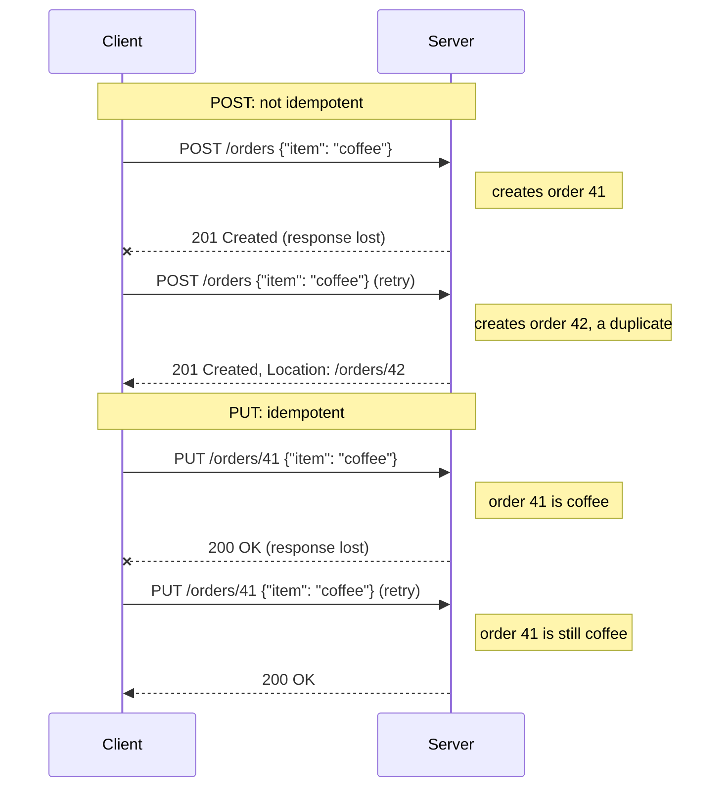
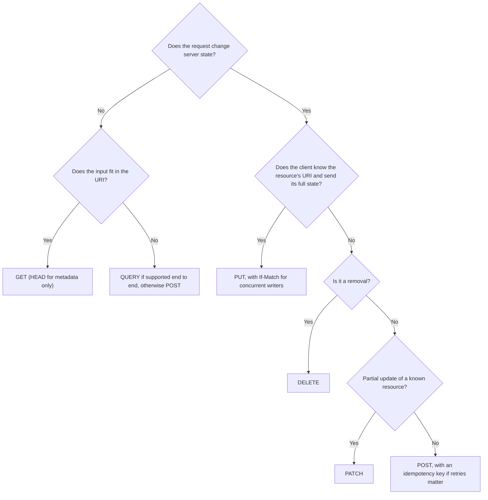

# 003 · HTTP methods and semantics: safe, idempotent, cacheable

> **One-line summary:** An HTTP method is a promise about what a request is allowed to do. *Safe* means the client asked for no state change, *idempotent* means sending it twice has the same intended effect as sending it once, and *cacheable* means a stored response may answer a later request. Clients, proxies, caches and crawlers act on those promises without ever seeing your code.
> **Track:** BE · **Prerequisites:** [001 · The request → response lifecycle](../001-request-response-lifecycle/), [002 · HTTP fundamentals](../002-http-fundamentals/)

## 1. The problem

Three failures, each caused by a method that didn't mean what its name promised:

- An admin page lists records with links like `GET /records/42/delete`. A browser extension that prefetches links, or a search crawler that follows them, deletes the records. Nobody clicked anything.
- A mobile client sends `POST /payments`. The server charges the card, but the connection drops before the response arrives. The client's HTTP library, or the user tapping "Pay" again, resends it, and the customer is charged twice.
- A team uses `POST /search` for complex queries because the filters don't fit in a URL. Every search now bypasses the CDN cache, and the client library refuses to retry searches after a timeout, even though a search changes nothing.

In each case the server's code was "correct" in isolation. What broke was the contract between the method and every other component on the path. RFC 9110 §9 defines that contract.

## 2. From first principles

### 2.1 What a method is

The method is the first token of the request's control data (entry 002, §2.1). It tells the server what the client wants done to the **target resource**, the thing the URI identifies. RFC 9110 §9.1 sets three ground rules:

- **Method names are case-sensitive.** `GET` is a method; `get` is a different, unknown one. The standard methods are all uppercase by convention.
- **Unknown versus not allowed.** A server that doesn't recognize or implement a method should answer `501 Not Implemented`. A server that knows the method but doesn't allow it on *this* resource should answer `405 Method Not Allowed`, and a 405 response MUST include an `Allow` header listing the methods the resource does support (§15.5.6).
- **Only GET and HEAD are mandatory.** Every general-purpose server must support them; all other methods are optional.

The method's meaning is fixed by the specification, not by the application. That is the whole point: a component in the middle (a cache, a proxy, a retrying client library) knows nothing about your `/payments` endpoint, but it knows what `POST` permits. The properties in §2.2–2.4 are the parts of that meaning that such components rely on.

### 2.2 Safe: the client asked for nothing to change

RFC 9110 §9.2.1: a method is **safe** if *"the client does not request, and does not expect, any state change on the origin server"*. GET, HEAD, OPTIONS and TRACE are safe.

The definition is about **what was requested**, not about what the server's code physically does. A GET handler may write an access log, increment a rate-limit counter or warm a cache. Those are side effects the client didn't ask for and isn't accountable for, and they don't make the method unsafe. What the server must not do is perform the *operation the user cares about* (deleting, buying, sending) in response to a safe method.

Safety is what makes automated traffic possible. Crawlers follow every link, browsers prefetch, link-preview bots fetch URLs pasted into chat apps, and monitoring tools poll endpoints. All of them send GET because GET is promised to be harmless. RFC 9110 puts the responsibility on the resource owner: if a URI such as `/records/42/delete` triggers an action when fetched, the bug is the server's, not the crawler's.

### 2.3 Idempotent: twice has the same effect as once

RFC 9110 §9.2.2: a method is **idempotent** if *"the intended effect on the server of multiple identical requests with that method is the same as the effect for a single such request"*. PUT, DELETE and all safe methods are idempotent. POST and PATCH are not.

Three precise points:

1. **Every safe method is idempotent.** Asking for no change twice is the same as asking for no change once. The reverse doesn't hold: PUT and DELETE change state, but repeating them doesn't change it further.
2. **It's about server state, not the response.** The first `DELETE /orders/7` returns `204`; the second returns `404`. The responses differ, but after either one, order 7 doesn't exist. That is idempotent.
3. **Like safety, it covers only the intended effect.** The server may log each request or keep a revision history.

Why PUT is idempotent and POST isn't comes from who names the resource. In `PUT /orders/7` the client names the resource and sends its **complete new state**; replacing a state with the same state twice leaves one result. In `POST /orders` the target is a *collection* that processes the content by its own rules, typically creating a new member with a server-chosen URI. Two POSTs make two orders. RFC 9110 §9.3.4 states the difference this way: a POST's target handles the enclosed representation according to its own semantics, while a PUT's enclosed representation *replaces* the target's state.

**Why it matters: retries.** A client that loses the connection after sending a request can't know whether the server applied it. The request may never have arrived, or it may have been applied and only the response was lost. For an idempotent method, the client resolves this by sending it again: either way, the final state is right. RFC 9110 §9.2.2 says idempotent requests *"can be repeated automatically if a communication failure occurs before the client is able to read the server's response"*, and that a client SHOULD NOT automatically retry a non-idempotent request unless it has some way to know the request is idempotent anyway, or that the original was never applied. Proxies MUST NOT automatically retry non-idempotent requests, and a client SHOULD NOT automatically retry a retry that itself failed.

"Some way to know" is what **idempotency keys** provide: the client attaches a unique key to a POST, and the server stores the result per key, so a retry returns the stored result instead of acting again. Stripe's `Idempotency-Key` header is a widely used example. Entry 018 covers the pattern in depth.

### 2.4 Cacheable: a stored response may be reused

RFC 9110 §9.2.3 defines GET, HEAD and POST as cacheable methods, meaning their responses may be stored and reused for later requests. In practice, the RFC itself notes, *"the overwhelming majority of cache implementations only support GET and HEAD"*. A POST response is reusable only if it has explicit freshness information and a `Content-Location` equal to the POST's target URI (§9.3.3), and it can only answer a later GET or HEAD, never a later POST, because POST is potentially unsafe. So for real systems: **if you want it cached, make it a GET.** Whether a particular GET response is actually stored depends on its status code and headers such as `Cache-Control` (entry 023).

### Self-check

- A GET handler increments a view counter in the database. Is GET still safe?
- The second `DELETE /orders/7` returns `404` instead of `204`. Is DELETE still idempotent?
- `PUT /orders/7` with `{"qty": 2}` times out and is sent again. Separately, `POST /orders/7/increment` times out and is sent again. If both originals were applied, what is the result of each?

<details>
<summary>Answers</summary>

- Yes. The client didn't request the increment and isn't accountable for it; safety is about requested semantics (§9.2.1). But the counter will now be inflated by crawlers and prefetchers, so a count of "views by people" needs filtering. That is a property of the data, not a protocol violation.
- Yes. Idempotency is about the effect on server state, and after one or two DELETEs the order is gone either way. Clients should treat `404` on a retried DELETE as success.
- After the PUTs, `qty` is 2, however many copies arrived. After the POSTs, the quantity has gone up by 2 instead of the intended 1, because each POST is a separate request to act. That is why a client library must not resend that POST blindly after a timeout.

</details>

### 2.5 The methods one by one

| Method | Safe | Idempotent | Cacheable | Meaning (RFC 9110 §9.3 unless noted) |
|---|---|---|---|---|
| GET | yes | yes | yes | Transfer a current representation of the target. |
| HEAD | yes | yes | yes | Same as GET, but the server MUST NOT send content. |
| OPTIONS | yes | yes | no | Describe the communication options for the target. |
| TRACE | yes | yes | no | Echo the received request back, for diagnostics. |
| PUT | no | yes | no | Replace the target's state with the enclosed representation, creating it if needed. |
| DELETE | no | yes | no | Remove the association between the target resource and its current functionality. |
| POST | no | no | conditional | Have the target process the enclosed representation by its own rules. |
| PATCH | no | no | conditional | Apply a set of changes to the target (RFC 5789). |
| CONNECT | no | no | no | Open a tunnel to the destination, used by proxies for HTTPS. |
| QUERY | yes | yes | yes | A safe, idempotent query whose input travels in the request content (RFC 10008). |

Notes on the ones with traps:

**GET with a body.** RFC 9110 §9.3.1 says content in a GET request has no defined semantics, can't change the meaning of the request, and may cause some implementations to reject the request and close the connection, because of its potential for request smuggling. A client SHOULD NOT send it unless the request goes directly to an origin server that has said it supports it. Proxies and caches may drop or reject it, so don't depend on it.

**HEAD** lets a client check whether a resource exists, its size or its validators without downloading it. The server should send the same header fields as for GET, though it may omit ones it can only know by generating the content. A framework that implements HEAD by running the GET handler and discarding the body is correct, just not efficient.

**PUT versus PATCH.** PUT sends the *whole* new state; fields you leave out are not kept. PATCH sends *instructions*: a JSON Merge Patch (RFC 7396) document or a JSON Patch (RFC 6902) operation list. A merge patch like `{"status": "shipped"}` happens to be idempotent, but a JSON Patch `add` to an array is not, which is why the method as a whole can't promise it. RFC 5789 notes that a PATCH can be made idempotent by sending it conditionally, as described next.

**Conditional requests make updates safe against concurrency.** Two clients GET the same order, each edits it, and each PUTs it back. The second PUT silently overwrites the first: the **lost update** problem. Idempotency doesn't help, because the two PUTs are different requests. The fix is `If-Match` (RFC 9110 §13.1.1): the client sends the ETag it read, and the server applies the write only if the resource still has that ETag; otherwise it answers `412 Precondition Failed` and the client re-reads. A conditional PATCH is also safe to retry: the second copy fails with 412 instead of applying twice.

PATCH responses follow the same caching rule as POST: reusable only with explicit freshness and a matching `Content-Location`.

**POST for creation** returns `201 Created` with a `Location` header pointing at the new resource. POST is also the general fallback for any operation that isn't a retrieval or a replacement: "send this email", "run this report".

**QUERY** (RFC 10008, June 2026) solves the `POST /search` problem from §1. It carries its input in the request content like POST, but it is safe and idempotent, so it can be retried, and its responses are cacheable with the request content as part of the cache key. As a new method, it needs support in your server framework, proxies and CDN before you rely on it.

**TRACE and CONNECT in browsers.** The Fetch standard forbids browser scripts from sending CONNECT, TRACE and TRACK. Many servers disable TRACE entirely, because echoing a request back can reveal headers such as cookies to whoever can read the response. CONNECT is what a browser sends to an HTTP proxy to open a tunnel for an `https` URL.

**HTML forms** can only submit GET and POST. That's one reason many APIs and frameworks route deletes and updates through POST, and some APIs accept a header such as `X-HTTP-Method-Override` (a convention, not a standard) to emulate other methods.

## 3. Diagram

A lost response, sent with POST and with PUT. The client times out in both cases and resends the same request:



Choosing a method for a new endpoint:



## 4. Code

Two small files model the contract and its consequence:

- [`Method.java`](../../code/src/main/java/foundations/e003_http_methods/Method.java): the methods as an enum carrying the `safe` and `idempotent` flags from the table in §2.5, a case-sensitive `parse`, and `mayRetryAutomatically()`.
- [`OrderStore.java`](../../code/src/main/java/foundations/e003_http_methods/OrderStore.java): a toy `/orders` server with `post`, `put` and `delete`, each returning the status code it would send.
- Test: [`HttpMethodsTest.java`](../../code/src/test/java/foundations/e003_http_methods/HttpMethodsTest.java) replays the lost-response scenario from §3 against each method.

The retry rule is one line, and it's the reason the flags exist:

```java
/**
 * §9.2.2: after a connection failure the client can't tell whether the server applied the
 * request. Resending is harmless only if two copies have the same intended effect as one.
 */
public boolean mayRetryAutomatically() {
    return idempotent;
}
```

The store shows where idempotency comes from. Only `post` chooses an id, so only `post` can create something new on a repeat:

```java
public int post(String order) {
    while (orders.containsKey(nextId)) nextId++; // skip ids already taken by a PUT
    orders.put(nextId, order);
    return nextId++;
}

public int put(int id, String order) {
    return orders.put(id, order) == null ? 201 : 200; // 201 Created, or 200 OK if replaced
}

public int delete(int id) {
    return orders.remove(id) != null ? 204 : 404;
}
```

The tests compare `snapshot()` after one request and after two. For PUT and DELETE the snapshots are equal even though the status codes differ (`201` then `200`, `204` then `404`). For POST the second snapshot has two orders.

Run the tests:

```bash
cd code
./gradlew test --tests 'foundations.e003_http_methods.*'
```

### Self-check

- `put` returns `201` the first time and `200` the second. Does that break idempotency?
- Change `put` so it appends to a per-order history list and returns the history size. Is the method still idempotent from the client's point of view?
- `Method.parse("get")` returns empty. What status code should a server send for it, and why not 405?

<details>
<summary>Answers</summary>

- No. Idempotency is about the state on the server, which is the same after one or two identical PUTs. Clients must not assume identical responses.
- The *intended effect*, "order 7 has this state", is unchanged, so yes. RFC 9110 explicitly allows keeping a revision history per request. The history is a side effect the client didn't ask for, like a log line.
- `501 Not Implemented`. Method names are case-sensitive, so `get` is an unrecognized method, not GET. `405` is for a method the server knows but doesn't allow on this resource, and it must come with an `Allow` header.

</details>

## 5. Trade-offs and failure modes

**Actions behind GET.** Any state change reachable by GET will eventually be triggered by a crawler, a prefetcher, a link-preview bot or a security scanner. It also makes the action vulnerable to cross-site request forgery through something as simple as an `` tag. Entry 028 covers CSRF.

**POST everywhere.** Some APIs (and RPC-style designs) send every call as POST. It works, but it throws away what the method tells the infrastructure: caches can't store reads, client libraries won't retry reads after a timeout, and logs and dashboards can't tell reads from writes. If an endpoint only reads, make it GET (or QUERY).

**Retries without idempotency.** Timeouts are ambiguous: the request may or may not have been applied. Load balancers, service meshes and HTTP clients often have retry settings, and a retry configured for "all failed requests" will duplicate non-idempotent work. Restrict automatic retries to idempotent methods, and give POST endpoints that must survive retries an idempotency key.

**PUT that isn't really PUT.** A handler named PUT that increments a counter or appends to a list breaks the promise, and every client that retries it causes duplicates. If an operation isn't a full replacement, use PATCH or POST.

**Idempotent is not concurrency-safe.** Two *different* PUTs from two users still race, and the last one wins. Use `If-Match` with ETags when concurrent writers are possible.

**Long URLs for GET.** Moving complex filters into a GET query string can hit URI length limits in servers and proxies. RFC 9110 §4.1 recommends that senders and recipients support URIs of at least 8,000 octets, but individual components may allow less, and a server answers `414 URI Too Long` when it won't accept one. That is the gap QUERY fills.

## 6. In the real world

**Callwise.** The route handlers map cleanly onto the methods:

- [`DELETE /api/assistants/[id]/documents/[docId]`](https://github.com/sanjaysathyarapu/callwise/blob/main/src/app/api/assistants/%5Bid%5D/documents/%5BdocId%5D/route.ts) deletes a document and answers `404` when it no longer exists. A retried delete leaves the same state and gets a `404`, which is exactly the idempotent behavior from §2.3.
- [`GET /api/account/export`](https://github.com/sanjaysathyarapu/callwise/blob/main/src/app/api/account/export/route.ts) only reads, so it's safe, yet it writes to the database: it increments a rate-limit counter on every call. That is the kind of unrequested side effect §2.2 allows.
- [`POST /api/chat`](https://github.com/sanjaysathyarapu/callwise/blob/main/src/app/api/chat/route.ts) is correctly a POST: each call stores the user's message, calls the model and stores the reply. Resending it would store a second copy of the question and pay for a second model call.
- Next.js server actions, which Callwise uses for forms in [`src/lib/actions/`](https://github.com/sanjaysathyarapu/callwise/tree/main/src/lib/actions), run as POST requests to the page that uses them. A crawler following links sends GET, so it renders pages but can't invoke an action.

**A typical Spring Boot service.** `@GetMapping`, `@PostMapping`, `@PutMapping`, `@PatchMapping` and `@DeleteMapping` bind handlers to methods. Spring MVC also answers HEAD for any `@GetMapping` and answers OPTIONS by default with an `Allow` header built from the mapped methods. A request with a method the path doesn't map is rejected with `405`.

**Cloud APIs.** Some APIs take an idempotency token as a request parameter instead of a header. Amazon EC2's `RunInstances`, for example, accepts a `ClientToken`, so retrying a launch doesn't start a second set of instances.

## 7. Interview Q&A

**Q:** What is the difference between a safe and an idempotent method?
**A:** A safe method is one where the client requests no change to server state: GET, HEAD, OPTIONS, TRACE. An idempotent method is one where sending the same request several times has the same intended effect as sending it once. Every safe method is idempotent, but PUT and DELETE are idempotent without being safe: they change state, but repeating them doesn't change it further. Both properties are about the requested effect, so logging or metrics don't violate them.

**Q:** Why is PUT idempotent and POST not?
**A:** With PUT the client names the resource and sends its complete new state, so applying the same PUT twice leaves the same state. With POST the client sends content to a resource that processes it by its own rules, usually a collection that creates a new member with a server-chosen ID, so each POST can create something new. The practical consequence is retries: a client can safely resend a PUT after a timeout, but resending a POST may create a duplicate.

**Q:** A DELETE returns 204 the first time and 404 the second. Is that idempotent?
**A:** Yes. Idempotency is defined on the effect on server state, not on the response. After one or two DELETEs the resource is gone either way. A client retrying a DELETE should treat 404 as success.

**Q:** How would you make a payment endpoint safe to retry?
**A:** Keep it a POST, because each payment is a new action, and require an idempotency key: a unique value the client generates per logical payment and sends with every attempt. The server records the key and the outcome atomically with the payment record, before or together with acting on it. A retry with the same key returns the stored result instead of charging again, and a retry with the same key but different content is rejected.

**Q:** Can a GET request have a body?
**A:** The syntax allows it, but RFC 9110 gives GET content no defined meaning and warns that some implementations reject such requests, partly because of request-smuggling risk. Caches and proxies may also ignore or drop it. For queries whose input doesn't fit in a URI, use POST, or the QUERY method (RFC 10008) where the whole path supports it.

## 8. References

- RFC 9110, *HTTP Semantics*: methods overview (§9.1), safe (§9.2.1), idempotent (§9.2.2) and cacheable (§9.2.3) methods, method definitions (§9.3), If-Match (§13.1.1), 405 and the Allow header (§15.5.6), URI length (§4.1). https://www.rfc-editor.org/rfc/rfc9110
- RFC 9111, *HTTP Caching*. https://www.rfc-editor.org/rfc/rfc9111
- RFC 5789, *PATCH Method for HTTP*. https://www.rfc-editor.org/rfc/rfc5789
- RFC 7396, *JSON Merge Patch*. https://www.rfc-editor.org/rfc/rfc7396 · RFC 6902, *JSON Patch*. https://www.rfc-editor.org/rfc/rfc6902
- RFC 10008, *The HTTP QUERY Method*. https://datatracker.ietf.org/doc/rfc10008/
- WHATWG Fetch Standard, *forbidden method*. https://fetch.spec.whatwg.org/#forbidden-method
- Spring Framework reference, *Request Mapping* (HTTP HEAD, OPTIONS). https://docs.spring.io/spring-framework/reference/web/webmvc/mvc-controller/ann-requestmapping.html
- Next.js documentation, *Server Actions* guide. https://nextjs.org/docs/app/guides/server-actions
- Stripe API reference, *Idempotent requests*. https://docs.stripe.com/api/idempotent_requests
- Amazon EC2, *Ensuring idempotency*. https://docs.aws.amazon.com/ec2/latest/devguide/ec2-api-idempotency.html
