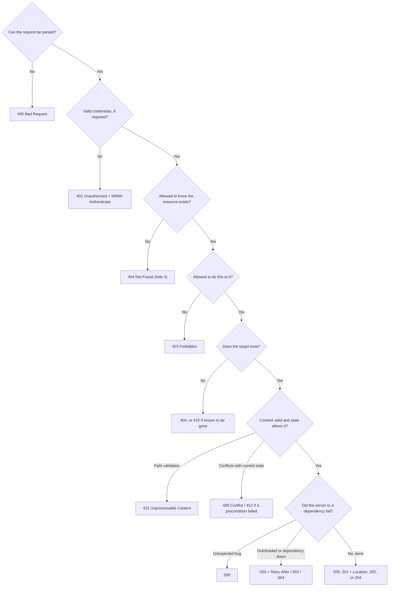
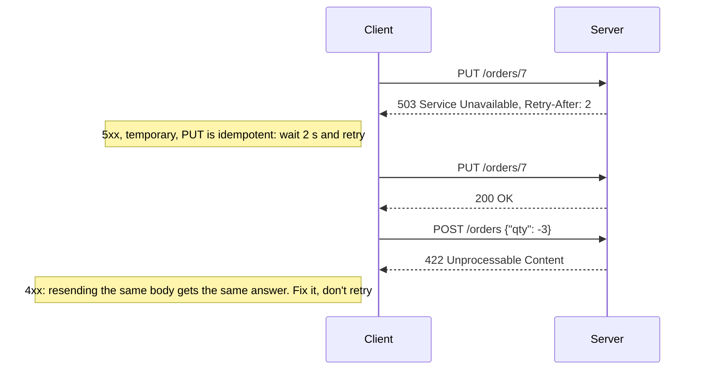

# 004 · HTTP status codes: choosing the right one

> **One-line summary:** A status code is the machine-readable verdict on a request. Its first digit tells every client, proxy and cache what *kind* of outcome happened, and the full code tells them what to do next: use the response, follow a redirect, fix the request, wait and retry, or give up.
> **Track:** BE · **Prerequisites:** [002 · HTTP fundamentals](../002-http-fundamentals/), [003 · HTTP methods and semantics](../003-http-methods/)

## 1. The problem

Three failures, each caused by a status code that said the wrong thing:

- An API answers every request with `200 OK` and puts `{"error": "not found"}` in the body. A CDN caches the "not found" page for an hour because, as far as it can tell, the request succeeded. Monitoring dashboards show a 0% error rate during an outage.
- A service returns `500 Internal Server Error` when a client sends a malformed date. The client's HTTP library treats 5xx as "server trouble, try again" and resends the same broken request with backoff for a minute before giving up. On-call gets paged for an error rate that is really a client bug.
- A login endpoint returns `404` for an unknown username and `401` for a wrong password. An attacker now has a free oracle for which accounts exist.

The body is for humans and application code that knows your API. The status code is for everything else on the path, which knows nothing about your API but knows exactly what each code means. RFC 9110 §15 defines those meanings.

## 2. From first principles

### 2.1 Where the code lives and what it is

The status code is the first piece of response control data (entry 002, §2.1). In HTTP/1.1 it sits in the status line, `HTTP/1.1 404 Not Found`. In HTTP/2 and HTTP/3 it is the `:status` pseudo-header, and there is no reason phrase at all.

That tells you something: the **reason phrase** ("Not Found") carries no meaning. RFC 9112 says a client should ignore it. Code that branches on `"Not Found"` instead of `404` is broken over HTTP/2.

A status code is a **three-digit integer from 100 to 599**. The first digit is the **class**:

| Class | Meaning | Final? |
|---|---|---|
| 1xx Informational | The request was received; keep waiting, a final response follows. | no |
| 2xx Successful | The request was received, understood and accepted. | yes |
| 3xx Redirection | Further action, usually another request, is needed to complete it. | yes |
| 4xx Client Error | The request is at fault: bad syntax, missing credentials, wrong state. | yes |
| 5xx Server Error | The request looked valid, but the server failed to fulfil it. | yes |

### 2.2 The class rule: why the first digit matters most

New codes are added over time (the IANA *HTTP Status Code Registry* holds them all), and no client knows every one. RFC 9110 §15 handles this with one rule: a client **must understand the class** of any status code, and must treat a code it doesn't recognize as the **x00 code of that class**. A client that has never heard of `422` treats it as `400`; an unknown `599` is a `500`.

This is what makes the codes extensible without breaking anyone. It also sets a design rule for you: **the class must be right even if the specific code is unfamiliar.** Pick a 4xx for a client mistake and a 5xx for a server failure first; refine the exact code second.

The split between 4xx and 5xx is the most important decision a handler makes, because it decides who acts:

- **4xx** says "*you* need to change something". Resending the identical request should produce the identical answer, so clients don't retry it blindly. Error-rate alerts usually exclude it, because one buggy client shouldn't page your on-call.
- **5xx** says "*we* failed". The client did nothing wrong, the request may succeed later, and it counts against your availability.

### 2.3 Success: 200, 201, 202, 204

- **200 OK** is the general success. Its content depends on the method: a representation for GET, the result of the action for POST.
- **201 Created** says a new resource exists. The `Location` header identifies it; if there's none, the created resource is the target URI itself (the case for `PUT /orders/7`).
- **202 Accepted** says "received, not done yet". RFC 9110 calls it intentionally noncommittal: HTTP has no way to send a later status code for the same request. So a 202 should tell the client where to check progress, typically with a status resource such as `Location: /jobs/123`.
- **204 No Content** is success with nothing to send back, common for DELETE and for PUT when the client already has the state. A 204 cannot have content; the response ends after the headers.

Use the most specific one that's true. A client that gets 201 knows to read `Location`; a client that gets 200 for a creation has to guess.

### 2.4 Redirection: which redirect keeps the method

Redirects tell the client to make another request, to the URI in `Location`. The codes differ on two axes: **permanent or temporary** (should clients and search engines update their stored link?) and **whether the method may change**.

| Code | Permanent? | Method on the follow-up request |
|---|---|---|
| 301 Moved Permanently | yes | May change POST to GET (historical behavior) |
| 302 Found | no | May change POST to GET (historical behavior) |
| 303 See Other | no | Always GET (or HEAD) |
| 307 Temporary Redirect | no | MUST NOT change |
| 308 Permanent Redirect | yes | MUST NOT change |

301 and 302 are old. Early browsers turned a redirected POST into a GET, and RFC 9110 still permits that "for historical reasons". 307 and 308 were added to say unambiguously "repeat the same method with the same content". So:

- Moving an API endpoint permanently: **308**, so a redirected `POST /v1/orders` stays a POST.
- After a form POST succeeds, sending the browser to a result page: **303**. This is the Post/Redirect/Get pattern: the browser's history now ends in a GET, so pressing reload doesn't resubmit the form.

**304 Not Modified** is the odd one out: it isn't a redirect to anywhere. It answers a conditional GET (`If-None-Match: "v7"`) with "your cached copy is still valid". It has no content, which is the whole point. Entry 023 covers it.

### 2.5 Client errors: the codes that get confused

**400 Bad Request.** The server can't or won't process the request because of something it sees as a client error: malformed syntax, invalid framing, a JSON body that doesn't parse. It's the right fallback for any client error with no better code.

**401 Unauthorized versus 403 Forbidden.** The names are misleading. **401 means unauthenticated**: there are no valid credentials, so the server doesn't know who you are. RFC 9110 requires a 401 to carry a `WWW-Authenticate` header naming at least one way to authenticate, for example `WWW-Authenticate: Bearer`. **403 means the server knows the request and refuses it**: if credentials were sent, they're insufficient, and the client shouldn't simply repeat the request with the same ones. Logging in fixes a 401; it doesn't fix a 403.

**404 Not Found and hiding existence.** A 404 says the server found no current representation for the target, *or isn't willing to disclose that one exists*. RFC 9110 explicitly allows a server to answer 404 instead of 403 to hide a resource from someone who isn't allowed to know about it. That's the standard defence against ID enumeration in multi-tenant systems: tenant A asking for tenant B's `/invoices/981` should get the same 404 as for an invoice that never existed. Otherwise the difference between 403 and 404 leaks which IDs are real.

**405 Method Not Allowed** (with a required `Allow` header) and **501 Not Implemented** were covered in entry 003, §2.1.

**409 Conflict.** The request conflicts with the *current state* of the resource: creating a username that's taken, deleting a folder that isn't empty, a version-control style edit conflict. The body should explain the conflict so the client can resolve it.

**410 Gone.** Like 404, but the server knows the resource existed and is gone, likely permanently. Clients and search engines can drop their links.

**412 Precondition Failed** answers a conditional request whose condition was false, for example `If-Match` with a stale ETag (entry 003's lost-update fix). **428 Precondition Required** (RFC 6585) lets a server *demand* conditional writes: "send `If-Match` or I won't apply this".

**413 Content Too Large** and **415 Unsupported Media Type** are specific forms of "I won't take this body": too big, or a `Content-Type` the endpoint doesn't accept. RFC 9110 renamed 413 from "Payload Too Large".

**422 Unprocessable Content.** The server understands the content type, the syntax is correct, but it can't process the instructions: a well-formed JSON order whose `quantity` is `-3`. 422 began in WebDAV and RFC 9110 now defines it for general use. The common convention: **400 for content that can't be parsed, 422 for content that parses but fails validation.** Either is defensible; what matters is being consistent across an API.

**429 Too Many Requests** (RFC 6585) says the client exceeded a rate limit. It should come with `Retry-After`, either a number of seconds or an HTTP date, telling the client how long to wait.

### 2.6 Server errors: 500, 502, 503, 504

- **500 Internal Server Error** is the generic "something broke" for an unexpected condition: an unhandled exception, a null where none should be. It usually means a bug, so retrying the same request often fails the same way.
- **502 Bad Gateway**: a gateway or proxy got an *invalid* response from the upstream server it called. A load balancer whose backend crashed mid-response returns this.
- **503 Service Unavailable**: the server can't handle the request *right now*, because of overload or maintenance, and expects to recover. It may send `Retry-After`. Health checks return 503 to say "take me out of rotation".
- **504 Gateway Timeout**: a gateway or proxy gave up waiting for the upstream. Crucially, it says nothing about whether the upstream eventually did the work.

Two rules for the body of any 5xx: it must not leak internals (stack traces, SQL, hostnames, exception messages; entry 001's `MiniHttpServer` tests for this), and it should carry a correlation ID so a user report can be matched to a log line (entry 014).

### 2.7 Informational: 100, 101, 103

1xx responses are **interim**: the final response still follows on the same request, and a client must be able to handle 1xx responses even if it didn't expect them.

- **100 Continue** answers `Expect: 100-continue`. A client about to upload 2 GB asks first; the server can reply 100 ("send it") or reject straight away with, say, 413 or 401, saving the upload.
- **101 Switching Protocols** confirms an `Upgrade`, for example to WebSocket over HTTP/1.1.
- **103 Early Hints** (RFC 8297) lets a server send `Link` headers for stylesheets and scripts while it's still computing the page, so the browser can start fetching them.

### 2.8 Errors need a body too: problem details

The status code says what *kind* of failure happened; the client usually needs more: which field, what limit. Every API invents an error body unless it adopts a standard. **RFC 9457, *Problem Details for HTTP APIs*** (which replaced RFC 7807) defines one, with the media type `application/problem+json`:

```http
HTTP/1.1 422 Unprocessable Content
Content-Type: application/problem+json

{
  "type": "https://api.example.com/problems/invalid-quantity",
  "title": "Quantity must be positive",
  "status": 422,
  "detail": "Line 2 has quantity -3.",
  "instance": "/orders/requests/8f2c"
}
```

`type` is a URI identifying the problem category, stable enough for code to switch on; `title` is a short human summary of that type; `detail` explains this occurrence; `instance` identifies this occurrence. The `status` member repeats the HTTP code for convenience, but the real status line is the one that counts. Extension members (for example a list of invalid fields) are allowed.

### Self-check

- A client sends a valid request with an expired access token. 401 or 403?
- A user tries to open another tenant's document by guessing its ID. 403 or 404?
- A form POST creates an order, and the server wants the browser to show the order page. Which redirect, and why not 302?

<details>
<summary>Answers</summary>

- 401. The credentials aren't valid, so the server doesn't know who is asking, and fresh credentials would fix it. The response must include `WWW-Authenticate`. 403 is for a caller the server has identified who still isn't allowed.
- Usually 404. RFC 9110 lets a server answer 404 to hide that a forbidden resource exists, and a 403 would confirm that the guessed ID is real. Answer 403 when the caller is allowed to know the resource exists, for example a read-only member trying to edit a shared document.
- 303 See Other. It tells the browser to GET the `Location`, and makes reload safe (Post/Redirect/Get). 302 happens to work in browsers because they switch POST to GET, but that behavior is the historical accident 303 and 307 were created to make explicit.

</details>

## 3. Diagram

How a handler can choose a code. Work down the checks in the order a request is processed: is it understood, who is asking, may they, does the target exist, does it fit the current state, did we manage to do it:



What a client does with each class after a request whose response it did receive:



## 4. Code

One small file turns the rules above into a client-side decision:

- [`StatusCodes.java`](../../code/src/main/java/foundations/e004_http_status_codes/StatusCodes.java): `kindOf` (the class from the first digit), `understoodAs` (the unknown-code rule from §2.2), and `nextStep`, which combines the status class with entry 003's `Method` to decide what a client does next.
- Test: [`StatusCodesTest.java`](../../code/src/test/java/foundations/e004_http_status_codes/StatusCodesTest.java).

The unknown-code rule is integer arithmetic:

```java
public static int understoodAs(int code, Set<Integer> recognized) {
    kindOf(code); // validates the range
    return recognized.contains(code) ? code : code / 100 * 100;
}
```

The retry decision is where status codes and methods meet. A temporary failure is worth repeating, but only if a repeat can't duplicate the effect:

```java
// Codes that usually mean "the problem was temporary". Resending the same bytes may succeed.
private static final Set<Integer> TRANSIENT = Set.of(408, 429, 502, 503, 504);

case CLIENT_ERROR, SERVER_ERROR -> TRANSIENT.contains(code)
        ? (method.idempotent ? NextStep.RETRY_WITH_BACKOFF : NextStep.GIVE_UP)
        : (code < 500 ? NextStep.FIX_REQUEST : NextStep.GIVE_UP); // same request, same answer
```

This policy is a common client convention, not a rule from the RFC. Real libraries differ in the details: some also retry a plain 500, and some retry POST on 429 or 503 when the server's documentation says the request wasn't processed. The structure is what to take away: **class first, then the specific code, then the method's idempotency.**

Run the tests:

```bash
cd code
./gradlew test --tests 'foundations.e004_http_status_codes.*'
```

### Self-check

- Why does `nextStep(Method.POST, 504)` return `GIVE_UP` while `nextStep(Method.PUT, 504)` returns `RETRY_WITH_BACKOFF`?
- A server starts returning a new code, `461`, that this client has never seen. What does `understoodAs` turn it into, and what will `nextStep` do with it?
- `304` is in the 3xx class. Why does `nextStep` return `DONE` instead of `FOLLOW_REDIRECT`?

<details>
<summary>Answers</summary>

- A 504 means the gateway stopped waiting, not that the origin did nothing. The order may have been created. Resending a PUT leaves the same state either way; resending a POST may create a second order (entry 003, §2.3). Without an idempotency key, the client has to surface the uncertainty instead.
- `400`, because an unrecognized code is treated as the x00 of its class. `nextStep` returns `FIX_REQUEST`: the client won't hammer the server with retries, which is exactly the behavior the class rule is designed to guarantee.
- 304 has no `Location` to follow. It means "the copy you already have is current", so the client uses its cached response.

</details>

## 5. Trade-offs and failure modes

**200 for everything.** Errors hidden inside 200 bodies defeat caches (an error response stored as if it were the resource), client libraries (no retries, no exceptions), and monitoring (error rates computed from status codes read zero). Some protocols layered on HTTP make this choice deliberately: many GraphQL servers return 200 with an `errors` array for field-level errors, because one response can contain both data and errors. If you take that route, know that every generic tool on the path is blind to those failures.

**The wrong class.** A validation failure reported as 500 inflates your error budget and invites pointless retries. A dependency outage reported as 400 tells clients it's their fault and hides an incident from your alerts. Make sure exceptions that represent bad input are mapped to 4xx, and that the catch-all handler is the only place that produces 500.

**Too many codes.** Using an obscure code, or a private one like `499`, buys little: clients that don't know it fall back to the x00 anyway. Use codes clients act on, and put the detail in a problem-details body.

**Leaking through the difference between codes.** 401 versus 404 on login, or 403 versus 404 on resource IDs, reveals which accounts or records exist. Return the same code (and the same timing, ideally) for "doesn't exist" and "not yours".

**Caching error responses.** Some codes are cacheable by default without explicit freshness: RFC 9110 §15.1 lists 200, 203, 204, 206, 300, 301, 308, 404, 405, 410, 414 and 501 as heuristically cacheable. A 301 can be cached by browsers for a long time, so a mistaken permanent redirect is hard to undo. Test redirects with 302/307 first, and send `Cache-Control` explicitly on responses you don't want stored.

**Retry storms.** If every client retries 503 immediately, an overloaded server gets more load exactly when it can least take it. Clients should back off exponentially with jitter and honor `Retry-After`; servers should send it.

**504 means "unknown", not "failed".** Treating a gateway timeout on a non-idempotent request as a clean failure leads to duplicates when the user tries again. Idempotency keys (entry 018) close that gap.

## 6. In the real world

**Callwise.** The route handlers use a small, deliberate set of codes:

- [`src/lib/rate-limit.ts`](https://github.com/sanjaysathyarapu/callwise/blob/main/src/lib/rate-limit.ts) answers an exceeded limit with `429` and a `Retry-After` header in seconds, exactly as §2.5 describes.
- [`GET /api/health`](https://github.com/sanjaysathyarapu/callwise/blob/main/src/app/api/health/route.ts) returns `200` when the database and model provider respond and `503` when they don't, with `Cache-Control: no-store`, so uptime monitors can act on the status code alone without parsing the body.
- [`POST /api/assistants/[id]/documents`](https://github.com/sanjaysathyarapu/callwise/blob/main/src/app/api/assistants/%5Bid%5D/documents/route.ts) answers `404`, not `403`, when the assistant belongs to another account: the hide-existence rule from §2.5. When the embedding provider fails it returns `502`, a server-side failure caused by an upstream dependency, and when saving fails it returns `500`. Oversized files and unsupported file types get `400` with a clear message; `413` and `415` would be the more specific codes from §2.5, and are an option if a client ever needs to tell those cases apart without reading the message.
- [`POST /api/twilio/voice`](https://github.com/sanjaysathyarapu/callwise/blob/main/src/app/api/twilio/voice/route.ts) returns `503` when the phone line isn't configured (a temporary, server-side condition) and `403` when the request signature is invalid (the caller is identified as not allowed).
- Its JSON `401` responses for missing sessions don't include `WWW-Authenticate`. That is common for cookie-session APIs, but a strict reading of RFC 9110 requires the header on every 401.

**A typical Spring Boot service.** `@ResponseStatus` on an exception class or `ResponseEntity.status(...)` sets the code. Spring MVC answers `405` for an unmapped method, `415` for an unsupported `Content-Type` and `400` for an unreadable body on its own. Spring Framework 6 added `ProblemDetail` and `ErrorResponse`, which produce RFC 9457 `application/problem+json` bodies, and a `@ControllerAdvice` handler is the usual single place that maps domain exceptions to status codes.

**Cloud APIs.** Major APIs document which codes are retryable. Google Cloud's guidance, for example, treats 408, 429 and 5xx responses as candidates for retry with exponential backoff, which is the same shape as `nextStep` in §4.

## 7. Interview Q&A

**Q:** What's the difference between 401 and 403?
**A:** 401 means the request isn't authenticated: no credentials, or invalid ones, so the server doesn't know who is asking, and it must include a `WWW-Authenticate` header saying how to authenticate. 403 means the server understood the request and refuses it; if credentials were sent, they don't grant access, and sending them again won't help. Logging in fixes a 401 but not a 403. When even revealing that a resource exists is a leak, a server can answer 404 instead of 403.

**Q:** A client sends JSON that parses but has an invalid email address. Which status code?
**A:** A 4xx, because the client must change the request. The common convention is 400 for content that can't be parsed and 422 Unprocessable Content for content that parses but fails validation, so 422 here; plain 400 is also defensible. The important parts are consistency across the API and a body, ideally RFC 9457 problem details, that names the invalid field.

**Q:** Why shouldn't an API return 200 with an error in the body?
**A:** Everything between the client and your code reads the status code, not your body format. Caches may store the error as if it were the resource, HTTP clients won't raise errors or apply retry logic, and monitoring that computes error rates from status codes reports zero. The status class also tells the client whether to fix its request (4xx) or try later (5xx), which a 200 can't express.

**Q:** What's the difference between 301, 302, 307 and 308?
**A:** 301 and 308 are permanent, so clients and search engines should update the link; 302 and 307 are temporary. 301 and 302 historically allow a client to change POST into GET on the follow-up request, while 307 and 308 require the same method and content. For moving an API endpoint permanently, use 308; for sending a browser to a result page after a form POST, use 303 See Other.

**Q:** Which errors should a client retry?
**A:** Generally the temporary ones: 503, 429, 502, 504 and 408, with exponential backoff, jitter and respect for `Retry-After`. Other 4xx errors aren't retried, because the same request will get the same answer. And the method matters: a 504 doesn't mean the server didn't act, so a non-idempotent POST shouldn't be retried automatically unless it carries an idempotency key.

## 8. References

- RFC 9110, *HTTP Semantics*: status codes (§15), heuristically cacheable codes (§15.1), 1xx (§15.2), 2xx (§15.3), 3xx (§15.4), 4xx (§15.5), 5xx (§15.6), `Retry-After` (§10.2.3), `WWW-Authenticate` (§11.6.1). https://www.rfc-editor.org/rfc/rfc9110
- RFC 9112, *HTTP/1.1*: status line and reason phrase (§4). https://www.rfc-editor.org/rfc/rfc9112
- RFC 6585, *Additional HTTP Status Codes* (428, 429, 431, 511). https://www.rfc-editor.org/rfc/rfc6585
- RFC 8297, *An HTTP Status Code for Indicating Hints* (103). https://www.rfc-editor.org/rfc/rfc8297
- RFC 9457, *Problem Details for HTTP APIs*. https://www.rfc-editor.org/rfc/rfc9457
- IANA, *HTTP Status Code Registry*. https://www.iana.org/assignments/http-status-codes/
- Spring Framework reference, *Error Responses* (`ProblemDetail`). https://docs.spring.io/spring-framework/reference/web/webmvc/mvc-ann-rest-exceptions.html
- Google Cloud, *Retry strategy* (Cloud Storage). https://cloud.google.com/storage/docs/retry-strategy
