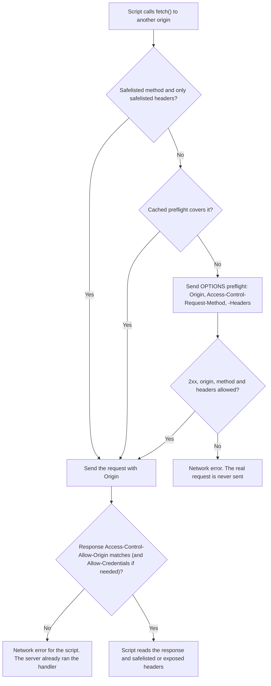
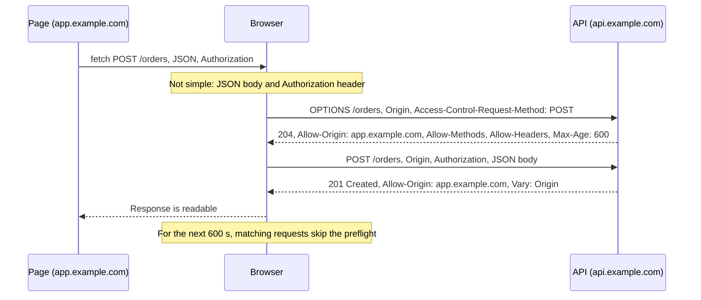

# 005 · HTTP headers and CORS: simple vs preflight requests

> **One-line summary:** Headers are the metadata channel of HTTP, a list of name/value fields that every hop can read. CORS is a set of headers through which a server tells the *browser* which other origins may read its responses, and, for requests a plain HTML form could never send, approve them in advance with a preflight.
> **Track:** BE · **Prerequisites:** [002 · HTTP fundamentals](../002-http-fundamentals/), [003 · HTTP methods and semantics](../003-http-methods/), [004 · HTTP status codes](../004-http-status-codes/)

## 1. The problem

A frontend at `https://app.example.com` calls an API at `https://api.example.com`:

```js
await fetch("https://api.example.com/orders", {
  method: "POST",
  headers: { "Content-Type": "application/json", "Authorization": "Bearer eyJ..." },
  body: JSON.stringify({ sku: "A-1", qty: 2 }),
});
```

It works in `curl` and in Postman. In the browser, the console says:

```
Access to fetch at 'https://api.example.com/orders' from origin 'https://app.example.com'
has been blocked by CORS policy: Response to preflight request doesn't pass access control check
```

The server log shows an `OPTIONS /orders` request answered with `405`, and no POST at all. Three questions follow, and this entry answers them:

1. Why does a browser enforce a rule that `curl` ignores?
2. Where did the `OPTIONS` request come from, and why didn't a similar `GET` trigger one?
3. Which headers must the server send, and which common "fixes" (`Access-Control-Allow-Origin: *` everywhere, reflecting the `Origin` header) open a security hole?

All of it runs on headers, so the entry starts there.

## 2. From first principles

### 2.1 What a header field is

Entry 002 split a message into control data, **header fields**, content, and trailer fields. A header field is a **name** and a **value** (RFC 9110 §5):

```http
Content-Type: application/json; charset=utf-8
Cache-Control: no-store
```

The rules that matter in practice:

- **Names are case-insensitive.** `content-type`, `Content-Type` and `CONTENT-TYPE` are the same field. HTTP/2 and HTTP/3 go further and require names to be sent in lowercase (RFC 9113 §8.2), so code that looks a header up by exact case can break when traffic moves to HTTP/2. Always use a case-insensitive map.
- **Values are text with structure defined per field.** Leading and trailing whitespace is not part of the value. Many fields carry parameters after a `;`, as in `charset=utf-8` above.
- **A field may appear more than once.** For a field defined as a comma-separated list, a recipient may combine `Accept: text/html` and `Accept: application/json` into `Accept: text/html, application/json` without changing the meaning (§5.3). The well-known exception is `Set-Cookie`: its values can contain commas, so it can't be folded and must stay as separate lines.
- **Unknown fields are ignored.** A recipient that doesn't recognize a field passes it on (proxies) or ignores it (endpoints). This is what makes HTTP extensible: new headers can be deployed without breaking old software, much as the status-code class rule does for codes (entry 004, §2.2).
- **Don't invent `X-` names.** RFC 6648 deprecated the `X-` prefix for new fields, because "experimental" headers like `X-Forwarded-For` became permanent and then couldn't be renamed. Pick a clear name; register it if it's meant to be public.

### 2.2 Headers grouped by job

There are hundreds of registered fields (the IANA *HTTP Field Name Registry*). A backend engineer meets the same few groups again and again:

| Job | Examples | Covered in |
|---|---|---|
| Describe the content | `Content-Type`, `Content-Length`, `Content-Encoding`, `Content-Language` | 002, 007 |
| Negotiate a representation | `Accept`, `Accept-Encoding`, `Accept-Language`, and `Vary` on the response | here |
| Routing and connection | `Host`, `Connection`, `Upgrade`, `Forwarded` | 002 |
| Authentication | `Authorization`, `WWW-Authenticate`, `Cookie`, `Set-Cookie` | 004, 009 |
| Caching and conditions | `Cache-Control`, `ETag`, `If-None-Match`, `If-Match`, `Last-Modified` | 003, 023 |
| Control and hints | `Location`, `Retry-After`, `Allow` | 004 |
| Security policy for browsers | `Strict-Transport-Security`, `Content-Security-Policy`, `X-Content-Type-Options`, CORS headers | here, 028 |

Two of these deserve a closer look before CORS, because CORS depends on them.

**Content negotiation and `Vary`.** A client lists what it can handle (`Accept: application/json`, `Accept-Encoding: gzip, br`); the server picks a representation and says which one in `Content-Type` and `Content-Encoding`. If the response depends on a request header, the server must say so with `Vary`:

```http
Vary: Accept-Encoding
```

A shared cache stores responses by URL. `Vary` tells it to add the listed request headers to the key, so a gzip-compressed body is never served to a client that didn't ask for gzip. Forgetting `Vary` is a classic cache-poisoning bug, and CORS reintroduces it with `Origin` (§2.7).

**`Origin`.** Browsers attach an `Origin` header to cross-origin requests (and to some same-origin ones, such as POSTs). Its value is the **origin** of the page that made the request: the triple **scheme, host, port** (RFC 6454). `https://app.example.com` and `https://app.example.com:443` are the same origin; `http://app.example.com`, `https://app.example.com:8443` and `https://api.example.com` are three different ones. Page scripts can't set or forge `Origin`; the browser controls it. A non-browser client can send any `Origin` it likes, which matters in §5.

### 2.3 The same-origin policy: what CORS relaxes

A browser runs code from many sites in one process, and it sends each site's cookies automatically. Without a rule, a script on `evil.example` could run `fetch("https://bank.example/accounts")`; the browser would attach the user's bank cookies, and the script would read the account list.

The **same-origin policy** is that rule: a script may *send* many kinds of request to another origin, but it may **not read the response** unless that origin allows it. Note the asymmetry. The policy protects *responses* from being read. It does not stop requests from being sent; HTML forms and `` tags have been able to send cross-origin GETs and POSTs since long before JavaScript could read anything. (Stopping forged requests is CSRF protection, entry 028.)

This also answers question 1 from §1. **CORS is enforced by the browser, on behalf of the user.** `curl` has no other site's cookies to protect and no untrusted scripts running inside it, so there's nothing to enforce. CORS is not a server-side access control: it doesn't stop anyone from calling your API, and it isn't a substitute for authentication.

**Cross-Origin Resource Sharing** (CORS) is the opt-in: a set of response headers, defined today in the WHATWG *Fetch Standard*, with which a server tells the browser "this origin may read my responses".

### 2.4 Simple requests: the response is checked after the fact

Some cross-origin requests are ones a page could already send with a `<form>` or an ``. Making the browser ask permission for them would protect nothing. The Fetch Standard sends these straight away, with no preflight. They're often called **simple requests**. A request qualifies when:

- the method is a **CORS-safelisted method**: `GET`, `HEAD` or `POST`; and
- every header the script set is a **CORS-safelisted request header**: `Accept`, `Accept-Language`, `Content-Language`, and `Content-Type` only if its value is `application/x-www-form-urlencoded`, `multipart/form-data` or `text/plain` (the three types a form can submit). The standard also safelists simple `Range` values and imposes length and character limits on these values; headers the browser sets itself, like `User-Agent` and `Origin`, don't count.

The browser sends the request with `Origin`, the server processes it, and the browser checks the response:

```http
GET /products HTTP/1.1
Host: api.example.com
Origin: https://app.example.com

HTTP/1.1 200 OK
Access-Control-Allow-Origin: https://app.example.com
Vary: Origin
Content-Type: application/json
```

If `Access-Control-Allow-Origin` matches the page's origin (or is `*`, §2.6), the script gets the response. If not, the script gets a network error. **The server has already run the handler either way.** For a simple POST, any side effect has already happened. This is why simple requests are limited to what forms could already do: CORS adds no new ability to cause side effects.

Even after a successful check, a script can read only a few response headers by default, the **CORS-safelisted response headers**: `Cache-Control`, `Content-Language`, `Content-Length`, `Content-Type`, `Expires`, `Last-Modified` and `Pragma`. Anything else, such as a pagination `Link` header or an `X-Request-Id`, must be listed in `Access-Control-Expose-Headers`, or `response.headers.get(...)` returns `null`.

### 2.5 Preflighted requests: permission before the request

Everything else is a request no form could send: `PUT`, `DELETE`, `PATCH`, a POST with `Content-Type: application/json`, any request with `Authorization` or a custom header. Old servers were written assuming browsers would never send such requests cross-origin, so the browser **asks first**. It sends a **preflight**: an `OPTIONS` request to the same URL that describes the request it wants to make, carries no content, and is sent without cookies.

```http
OPTIONS /orders HTTP/1.1
Host: api.example.com
Origin: https://app.example.com
Access-Control-Request-Method: POST
Access-Control-Request-Headers: authorization,content-type
```

The server answers whether it would accept such a request:

```http
HTTP/1.1 204 No Content
Access-Control-Allow-Origin: https://app.example.com
Access-Control-Allow-Methods: GET, POST, PUT
Access-Control-Allow-Headers: authorization, content-type
Access-Control-Max-Age: 600
Vary: Origin
```

The browser checks that the status is a success (2xx), that the origin matches, and that the requested method and every requested header are allowed. Only then does it send the real `POST`, which must itself carry `Access-Control-Allow-Origin` again, because the actual response goes through the same check as a simple request's. If the preflight fails, the real request is **never sent**.

This answers question 2. The JSON `Content-Type` and the `Authorization` header made the request non-simple, so the browser sent `OPTIONS`. The server had no handler for `OPTIONS /orders` and answered `405` (entry 004), so the preflight failed and the POST never left the browser. A plain `GET` with no custom headers is simple, so it was never preflighted.

`Access-Control-Max-Age` lets the browser cache a successful preflight for that origin, URL and set of permissions, so the next requests skip the extra round trip. When it's absent, the Fetch Standard uses a default of 5 seconds, and browsers impose their own upper limits, so a very large value is silently shortened.

### 2.6 Credentials, wildcards and the rule that bites

By default, `fetch` doesn't send cookies cross-origin. A script opts in with `credentials: "include"` (or `withCredentials = true` on `XMLHttpRequest`). For a credentialed request, the rules tighten:

- The response must include `Access-Control-Allow-Credentials: true`, or the script can't read it.
- `Access-Control-Allow-Origin` **must name the exact origin**. The wildcard `*` is rejected for credentialed requests.
- In `Access-Control-Allow-Methods`, `Access-Control-Allow-Headers` and `Access-Control-Expose-Headers`, `*` is a wildcard only for requests *without* credentials. With credentials it is just the literal name `*`.

The reasoning: `Access-Control-Allow-Origin: *` means "this is public data, anyone may read it", which is safe only if the response doesn't depend on who the user is. A response computed from the user's cookies is not public by definition.

`Access-Control-Allow-Origin` also holds **one** value: a single origin, `*`, or `null`. You can't list several origins. A server that serves several frontends has to check the request's `Origin` against an allowlist and echo back the one that matched.

### 2.7 Echoing the origin safely

Echoing leads to the two most common CORS mistakes.

**Reflecting any origin.** The shortcut "copy whatever `Origin` says into `Access-Control-Allow-Origin`, and add `Allow-Credentials: true`" turns CORS off. Any site the user visits can now read authenticated responses from your API, which is exactly what §2.3's policy exists to prevent. Prefix and suffix checks fail the same way: `endsWith("example.com")` also matches `evilexample.com`, and a check for `https://app.example.com` as a prefix matches `https://app.example.com.evil.net`. Compare full origins against an explicit set. Also never allowlist the literal origin `null`: sandboxed iframes and some redirects produce it, and an attacker can create such a page easily.

**Forgetting `Vary: Origin`.** If the value of `Access-Control-Allow-Origin` depends on the request's `Origin`, a shared cache must key on `Origin` too. Without `Vary: Origin`, a CDN can store the response made for `https://a.example` and serve it to `https://b.example`, whose browser rejects it, or, worse, cache a response with no CORS headers and break every origin until it expires. Send `Vary: Origin` on every response whose CORS headers depend on `Origin`, including the ones where the origin was rejected.

### Self-check

- A page at `https://shop.example` sends `fetch("https://api.shop.example/cart", { method: "DELETE" })`. Is it preflighted? Is `https://api.shop.example` the same origin?
- A script sends a cross-origin POST with `Content-Type: text/plain`. The server returns no CORS headers. Did the server's handler run?
- Why can't a credentialed request use `Access-Control-Allow-Origin: *`?

<details>
<summary>Answers</summary>

- Yes. `DELETE` isn't a safelisted method, so the browser sends an `OPTIONS` preflight first. And no, it's a different origin: the hosts differ (`shop.example` vs `api.shop.example`), even though they share a parent domain.
- Yes. It's a simple request (POST plus a form-compatible content type), so the browser sent it straight away and the server processed it. The missing headers only stop the script from *reading* the response. That's why simple requests must not cause side effects a form couldn't, and why state-changing endpoints need CSRF protection (entry 028).
- `*` declares the response public, readable by any origin. A credentialed response is computed from the user's cookies and so isn't public. Requiring the exact origin forces the server to decide deliberately that this particular origin may read user-specific data.

</details>

## 3. Diagram

The browser's decision, from `fetch()` to what the script sees:



The full exchange for §1's request once the server is fixed:



## 4. Code

[`Cors.java`](../../code/src/main/java/foundations/e005_http_headers_cors/Cors.java) implements both sides of §2.4–§2.7 in one small file:

- `needsPreflight(method, headers)`: the browser's rule for simple versus preflighted requests.
- `Policy`: a server's CORS configuration with an explicit origin allowlist. `preflight(...)` builds the `OPTIONS` response headers and `actual(...)` the headers for the real response.
- Test: [`CorsTest.java`](../../code/src/test/java/foundations/e005_http_headers_cors/CorsTest.java).

The browser-side rule is "could a form have sent this?":

```java
if (!SAFE_METHODS.contains(method)) return true; // method names are case-sensitive
for (var h : headers.entrySet()) {
    String name = h.getKey().toLowerCase(Locale.ROOT); // field names are not
    if (SAFE_HEADERS.contains(name)) continue;
    if (name.equals("content-type")) {
        String essence = h.getValue().split(";")[0].trim().toLowerCase(Locale.ROOT);
        if (FORM_TYPES.contains(essence)) continue; // ";charset=utf-8" doesn't matter
    }
    return true; // Authorization, X-Request-Id, Content-Type: application/json, ...
}
return false;
```

The server side echoes an origin only after an exact allowlist match, and always varies on `Origin`:

```java
out.put("Vary", "Origin"); // the answer depends on Origin, so shared caches must key on it
if (!origins.contains(origin)) return out;
out.put("Access-Control-Allow-Origin", origin); // one origin, echoed only from the allowlist
if (credentials) out.put("Access-Control-Allow-Credentials", "true");
```

It's simplified on purpose: it skips the length limits on safelisted header values and other request features that force a preflight, and a real server would answer a rejected preflight with a normal status and no CORS headers rather than a special error.

Run the tests:

```bash
cd code
./gradlew test --tests 'foundations.e005_http_headers_cors.*'
```

### Self-check

- `needsPreflight("POST", Map.of("Content-Type", "application/json; charset=utf-8"))` returns `true`, but with `text/plain; charset=utf-8` it returns `false`. Which line makes the difference?
- What would break if `actual` returned before adding `Vary` for a rejected origin?
- Suppose you replaced `origins.contains(origin)` with `origin.endsWith(".example.com")`. Which test would you add to show the problem?

<details>
<summary>Answers</summary>

- The `FORM_TYPES` check on the content type's essence (the part before `;`). `text/plain` is one of the three types a form can submit; `application/json` isn't, so it falls through to `return true`.
- A shared cache could store the rejected response, which has no `Access-Control-Allow-Origin`, under the bare URL, and serve it to the allowed origin, whose browser would then block the response. `Vary: Origin` has to be on every response whose CORS headers depend on `Origin`, not only the successful ones.
- One that calls `actual("https://forgotten.example.com")`, a subdomain nobody meant to trust, and asserts there is no `Access-Control-Allow-Origin`. A suffix check matches every subdomain, including one an attacker controls (for example, a forgotten subdomain taken over through a dangling DNS record) or user-generated content hosted under the domain. That's why the policy uses an exact set.

</details>

## 5. Trade-offs and failure modes

**CORS is not authorization.** It controls what *browsers* let scripts read. A server-to-server client, `curl`, or an attacker's script running on their own machine ignores it completely. Every endpoint still needs authentication and authorization (entries 009–011).

**`*` is fine for truly public, uncredentialed data.** A public read-only API, fonts, or open data can send `Access-Control-Allow-Origin: *`. It's the combination of a permissive origin with credentials, or with endpoints that use IP-based or network-based trust (internal admin panels reachable only from the office network), that is dangerous.

**Preflights cost a round trip.** A non-simple request to a new URL costs an extra `OPTIONS` exchange before the real one. Mitigations: set a reasonable `Access-Control-Max-Age`; answer `OPTIONS` early in the pipeline (before authentication, since preflights carry no credentials, and without hitting the database); or avoid cross-origin calls altogether by serving the API under the same origin, for example `app.example.com/api` routed by a reverse proxy. Don't try to dodge preflights by sending JSON as `text/plain`: it works, but it removes the protection preflights give and confuses every tool that relies on `Content-Type`.

**The `OPTIONS` handler forgot about auth middleware.** A frequent bug: an authentication filter rejects the preflight with `401` because it has no `Authorization` header, so every non-simple request fails. Preflights must pass through without credentials.

**Error responses lose their CORS headers.** If CORS headers are added only on the success path, a `401` or `500` from the API reaches the browser without `Access-Control-Allow-Origin`, and the script sees an opaque "CORS error" instead of the real status. Add CORS headers in a filter that runs for every response, including errors.

**`mode: "no-cors"` is not a fix.** It makes the browser send a simple request and hand the script an *opaque* response, with status 0 and no readable body or headers. The console error goes away, and so does the data.

**Over-broad allowlists age badly.** Allowlisting `http://localhost:3000` in production lets any page served from that port on a user's machine, by whatever software happens to run there, read production responses with that user's cookies. Keep development origins out of production configuration.

## 6. In the real world

**Callwise.** Callwise's embeddable chat avoids CORS entirely. The snippet a business pastes into its site, [`public/widget.js`](https://github.com/sanjaysathyarapu/callwise/blob/main/public/widget.js), doesn't call the API from the host page. It creates an `<iframe>` pointing at Callwise's own [`/embed/[slug]`](https://github.com/sanjaysathyarapu/callwise/blob/main/src/app/embed/%5Bslug%5D/page.tsx) page, and the chat component inside that frame calls the relative URL `/api/chat` ([`ChatWidget.tsx`](https://github.com/sanjaysathyarapu/callwise/blob/main/src/components/ChatWidget.tsx)). The request comes from Callwise's origin to Callwise's origin, so it's same-origin and needs no `Access-Control-*` headers or preflight handling, however many customer domains embed the widget. The trade-off is that the host page can't read the conversation or style its internals, which for a support widget is a feature. A widget that called the API directly from each customer's page would need a per-assistant origin allowlist, `Vary: Origin`, and an `OPTIONS` handler on the chat route.

**A typical Spring Boot service.** Spring MVC supports CORS with `@CrossOrigin` on a controller or, better, one global `CorsConfiguration` (allowed origins, methods, headers, `allowCredentials`, `maxAge`) registered through `WebMvcConfigurer#addCorsMappings` or a `CorsFilter`. Spring answers preflights itself. With Spring Security, CORS must be enabled in the security filter chain (`http.cors(...)`), so preflights are handled before authentication; this is the "auth middleware rejects the preflight" bug from §5 solved in configuration. Spring refuses to combine `allowCredentials(true)` with an allowed origin of `*` and offers `allowedOriginPatterns` for the cases that really need patterns.

**CDNs and object storage.** Public buckets on S3 or Cloud Storage have their own CORS configuration (allowed origins, methods, headers, max age) for browser uploads and downloads. If a CDN sits in front, it has to forward or vary on `Origin`, which is the cache problem from §2.7 at scale.

## 7. Interview Q&A

**Q:** What is CORS, and what problem does it solve?
**A:** Browsers enforce the same-origin policy: a script can send requests to another origin, but can't read the responses, because the browser attaches the user's cookies and the response may contain their private data. CORS is a header-based protocol, defined in the WHATWG Fetch Standard, that lets a server opt out of that restriction for specific origins, mainly through `Access-Control-Allow-Origin`. It's enforced by the browser on the user's behalf, so it doesn't protect an API from non-browser clients and isn't a replacement for authentication.

**Q:** What's the difference between a simple request and a preflighted request?
**A:** A simple request uses GET, HEAD or POST and only safelisted headers, with a `Content-Type` limited to the three form encodings. The browser sends it directly and only checks the CORS headers on the response, so the server's handler runs either way. Anything else, such as PUT or DELETE, JSON content, or an `Authorization` header, triggers a preflight: an `OPTIONS` request with `Access-Control-Request-Method` and `-Headers`. The browser sends the real request only if the preflight's response allows that origin, method and those headers.

**Q:** Why can't you use `Access-Control-Allow-Origin: *` with cookies?
**A:** The Fetch Standard rejects it: with credentials, the server must name the exact origin and also send `Access-Control-Allow-Credentials: true`. `*` means the response is public and safe for any site to read, which a response computed from the user's cookies isn't. Requiring the exact origin forces a deliberate decision per origin. If several frontends need access, the server checks the request's `Origin` against an exact allowlist, echoes the match and sends `Vary: Origin`.

**Q:** Your API works in Postman but the browser shows a CORS error on a POST. How do you debug it?
**A:** Open the browser's network tab and look for an `OPTIONS` request before the POST. If there is one, check its status and headers: it must return 2xx with an allowed origin, method and headers, and the common failures are a missing `OPTIONS` route (405) or authentication middleware rejecting it (401). If the preflight passes, check that the real response, including error responses, carries `Access-Control-Allow-Origin` matching the page's origin, plus `Allow-Credentials: true` if cookies are sent. Postman works because it isn't a browser and doesn't enforce CORS at all.

**Q:** Why are header names case-insensitive, and does it matter in code?
**A:** RFC 9110 defines field names as case-insensitive, so `Content-Type` and `content-type` are the same field. HTTP/2 and HTTP/3 additionally require lowercase names on the wire. Code that looks headers up with a case-sensitive map works over HTTP/1.1 with one client and breaks with another client or after a move to HTTP/2, so header maps should always be case-insensitive.

## 8. References

- WHATWG, *Fetch Standard*: the CORS protocol, CORS-safelisted methods and request headers, CORS-safelisted response header names, the CORS-preflight fetch and cache. https://fetch.spec.whatwg.org/
- RFC 9110, *HTTP Semantics*: fields (§5), field order and combining (§5.3), `Vary` (§12.5.5), `OPTIONS` (§9.3.7). https://www.rfc-editor.org/rfc/rfc9110
- RFC 9113, *HTTP/2*: field names must be lowercase (§8.2). https://www.rfc-editor.org/rfc/rfc9113
- RFC 6454, *The Web Origin Concept*: origins and the `Origin` header. https://www.rfc-editor.org/rfc/rfc6454
- RFC 6648, *Deprecating the "X-" Prefix*. https://www.rfc-editor.org/rfc/rfc6648
- IANA, *HTTP Field Name Registry*. https://www.iana.org/assignments/http-fields/
- MDN, *Cross-Origin Resource Sharing (CORS)*. https://developer.mozilla.org/en-US/docs/Web/HTTP/Guides/CORS
- Spring Framework reference, *CORS* (Web MVC). https://docs.spring.io/spring-framework/reference/web/webmvc-cors.html
