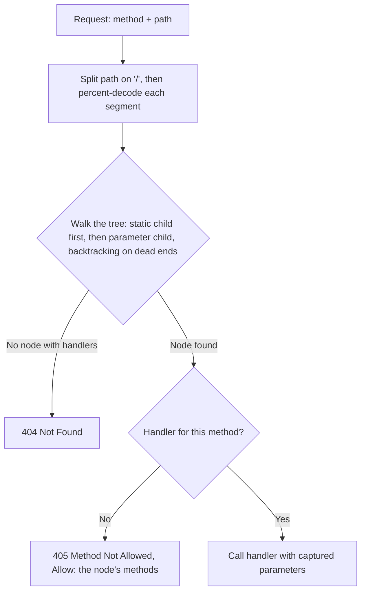
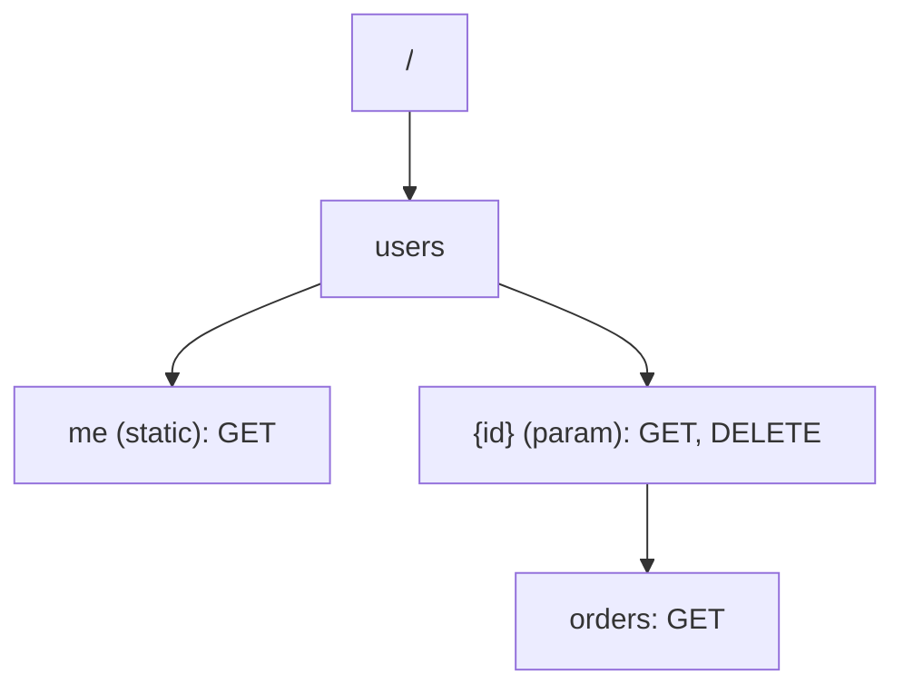

# 006 · Routing: matching paths, params, versioning

> **One-line summary:** Routing is the step that maps a request's method and path to exactly one handler, extracting the variable parts of the path as parameters, and choosing correctly between "no such resource" (404), "resource exists but not with this method" (405), and "this API version".
> **Track:** BE · **Prerequisites:** [001 · Request → response lifecycle](../001-request-response-lifecycle/), [003 · HTTP methods and semantics](../003-http-methods/), [004 · HTTP status codes](../004-http-status-codes/)

## 1. The problem

A service registers these routes, in this order, in a router that tries them one by one and picks the first match:

```text
GET    /users/{id}
GET    /users/me
DELETE /users/{id}
```

Three bugs follow, each from a real class of production incident:

1. `GET /users/me` never reaches the `me` handler. The first pattern already matches, with `id = "me"`. The user service then tries to parse `"me"` as a number and returns `400`, or looks it up and returns `404`.
2. `PUT /users/42` returns `404 Not Found`. The resource exists; only the method is wrong. The correct answer is `405 Method Not Allowed` with an `Allow: DELETE, GET` header (entry 004), and a client that gets `404` will conclude the user is gone.
3. A year later the team needs to change the shape of `GET /users/{id}`. Mobile apps released last year still call it and can't be updated on demand. With nothing in the request that says which contract the client expects, any change to the response breaks someone.

This entry builds routing up from the URL: what part of it a router looks at, how matching works and which match wins, how parameters are extracted and decoded safely, and how an API carries versions.

## 2. From first principles

### 2.1 What the router sees

A request target is a URI reference. RFC 3986 §3 splits a URI into five components:

```text
  https://api.example.com:8443/users/42/orders?status=open&page=2#latest
  \___/   \__________________/\_______________/\__________________/\_____/
 scheme        authority             path               query        fragment
```

- **Scheme and authority** (host and port) choose the server. By the time a request reaches the application, they've done their job: DNS, TLS and the load balancer used them. The host still arrives in the `Host` header (or `:authority` in HTTP/2), and some routers use it for host-based routing, such as serving `api.example.com` and `admin.example.com` from one process.
- **The path** (§3.3) is hierarchical: segments separated by `/`. This is what the router matches.
- **The query** (§3.4) is everything after `?`. RFC 3986 gives it no inner structure; the `key=value&key=value` convention comes from HTML form encoding (`application/x-www-form-urlencoded`, defined in the WHATWG URL Standard). Routers generally don't match on it. The handler reads it as optional inputs: filters, sorting, pagination.
- **The fragment** (§3.5) is processed by the client and is never sent to the server. A route can't depend on `#latest`.

So, at its core, a router is a function:

```text
(method, path)  →  handler + path parameters
               or  404 (no route has this path)
               or  405 (a route has this path, but not this method)
```

### 2.2 Path rules the router must respect

**The path is case-sensitive.** RFC 3986 §6.2.2.1 makes the scheme and host case-insensitive, but not the path. `/Users/42` and `/users/42` are different URIs unless the server decides otherwise. Most frameworks match case-sensitively; pick one rule and apply it everywhere.

**A trailing slash makes a different URI.** `/users` and `/users/` are distinct. Servers handle this in one of three ways: treat them as different (strict), match both silently, or redirect one to the canonical form. A silent match means two URLs for one resource, which splits caches and analytics. The redirect is the clean option, and for non-GET requests it should be `308 Permanent Redirect` (RFC 9110 §15.4.9), which, unlike `301`, guarantees the client repeats the same method and body.

**Percent-encoding hides delimiters.** A character that would otherwise be a delimiter is sent as `%` plus two hex digits (RFC 3986 §2.1). `%2F` is an encoded `/`, which is *data*, not a separator. A file named `a/b.txt` in the path `/files/a%2Fb.txt` is one segment. The order of operations therefore matters: **split the path into segments first, then decode each segment.** Decoding first turns that one segment into two.

**`+` is not a space in a path.** Form encoding uses `+` for a space, but that rule applies to form bodies and query strings, not to paths. Java's `URLDecoder` implements form decoding, so passing a path segment to it turns `c++.md` into `c  .md`. Use a decoder that leaves `+` alone, or protect it first.

**Dot segments must be resolved before authorization.** `.` and `..` have meaning in a path, and RFC 3986 §5.2.4 defines how to remove them. If a gateway checks "is the path under `/public/`?" on the raw string and the backend later resolves `/public/../admin/users`, the check approved a request for `/admin/users`. Encoded forms like `%2e%2e%2f` make the same attack harder to spot. Decode and normalize **once**, at one layer, and run every security decision on the normalized path.

### 2.3 Path parameters versus query parameters

A route pattern mixes **static segments**, which must match exactly, with **parameter segments**, which match any single segment and capture its value:

```text
/users/{userId}/orders/{orderId}
  static  param   static  param
```

The split between path and query is a design convention, not a protocol rule, but it's a useful one:

| Put it in the... | When the value... | Example |
|---|---|---|
| Path | identifies *which* resource; without it the URL means something else | `/users/42`, `/orders/7/items` |
| Query | refines *how* to return a collection; optional, combinable | `?status=open&sort=-created&page=2` |

Two consequences. A missing path parameter is a different URL, so it's a 404 (or another route). A missing query parameter is usually a default. And every captured value is **untrusted input**: `{userId}` is whatever the client typed. The router only proves it's one segment; the handler must still validate it (entry 008) and check that the caller may access it (entry 011).

### 2.4 How a router matches

There are two common implementations.

**Ordered list.** Each pattern is compiled to a regular expression, and the router tries them in registration order until one matches. Express works this way. It's simple and flexible (any regex can be a route), but matching cost grows with the number of routes, and **order is semantics**: §1's bug 1 is a registration-order bug.

**Segment tree (trie or radix tree).** Patterns are inserted into a tree with one level per path segment. Each node has static children keyed by segment text and, optionally, a parameter child. Matching walks the tree one segment at a time. Its cost depends on the path's depth, not on how many routes exist. Go's `httprouter` and Fastify's `find-my-way` are radix-tree routers; a radix tree also merges chains of single-child nodes to save memory.

A tree also makes the **precedence rule** natural: at each segment, try the static child before the parameter child. `/users/me` beats `/users/{id}` for the path `/users/me` regardless of which was registered first, because `me` is more specific than "any segment".

One subtlety: a static branch can match a segment and then dead-end deeper. With routes `GET /users/me` and `GET /users/{id}/orders`, the path `/users/me/orders` enters the `me` branch, finds no `orders` child there, and must **backtrack** and retry `me` as `{id}`. Routers differ here; some backtrack, and some reject such route sets at registration. Either is defensible. Silently returning 404 is not.

### 2.5 Which match wins: precedence and conflicts

A good router makes the outcome independent of registration order and rejects ambiguity at startup:

- **Most specific wins.** Static beats parameter, and parameter beats catch-all (a pattern like `/files/{*path}` that captures the rest of the path). Spring MVC compares patterns by specificity. Next.js gives static routes priority over dynamic segments, and dynamic segments over catch-all segments. Go's `net/http` `ServeMux`, since Go 1.22, picks the most specific pattern too.
- **Conflicts fail fast.** Two handlers for the same method and pattern, or two patterns where neither is more specific than the other (`/{a}/x` and `/x/{b}` both match `/x/x`), is a configuration bug. Go's `ServeMux` panics when such patterns are registered. Failing at startup turns a bug that would appear on one rare URL in production into one that fails every deploy.
- **Parameter names are part of the shape.** `/users/{id}` and `/users/{userId}/posts` share a position. A tree with one parameter child per node must either use one name or reject the second.

### 2.6 404 versus 405, and the methods you didn't register

Once the path matches, the method selects the handler. Getting the failure cases right is what separates a router from a lookup table:

- **No route has this path → `404 Not Found`** (RFC 9110 §15.5.5).
- **A route has this path, but not for this method → `405 Method Not Allowed`** (§15.5.6). The server **must** send an `Allow` header listing the methods the resource supports. To get this right, the router has to finish the path match *before* looking at the method. A router that keys on `method + path` as a single string can't tell the two cases apart and returns 404 for both.
- **`HEAD`** should behave like `GET` without a body (entry 003). Many frameworks answer it automatically from the `GET` handler.
- **`OPTIONS`** reports the allowed methods, and in browsers it carries CORS preflights (entry 005). Frameworks often answer it automatically from the route table, which is another reason the router needs the full set of methods per path.

### 2.7 Versioning: routing on the contract

Routes are a contract. Clients hard-code them, and responses have shapes clients parse. A **breaking change** is any change that makes a correct existing client fail: removing or renaming a field, changing a field's type or meaning, adding a required input, changing status codes, or removing a route. Additive changes, such as a new optional field or a new route, are not breaking *if* clients ignore fields they don't know (the tolerant-reader rule, entry 007).

The rule that keeps versioning cheap: **ship additive changes in place, and create a new version only for a breaking change.** When a version is needed, the request has to say which contract it expects. Three places are common:

| Where | Example | Strengths | Costs |
|---|---|---|---|
| Path | `GET /v2/users/42` | Visible in logs and links; trivial to route (it's just a static segment); caches key on it automatically | The same resource now has two URIs |
| Header | `Accept: application/vnd.example.v2+json`, or a custom header such as GitHub's `X-GitHub-Api-Version: 2022-11-28` | The URI stays one identifier per resource | Invisible in a pasted link; shared caches need `Vary` on that header (entry 005 §2.2) |
| Query | `?api-version=2024-01-01` (Azure's REST APIs) | Easy to add from any client | Mixes contract selection with resource refinement |

Two further design choices:

- **Major numbers or dates.** `v1`, `v2` groups many changes into rare, large migrations. Date-based versions (Stripe pins each account to the API version current when it started, and lets requests override it with a `Stripe-Version` header; GitHub and Azure use dates too) let a provider ship small breaking changes frequently, with each client upgrading one date at a time. The cost is that the server must maintain transformations between many versions.
- **Deprecation is part of the design.** Announce an end date before turning a version off. The `Sunset` header (RFC 8594) tells clients when a resource will stop responding, and the `Deprecation` header (RFC 9745) says it is deprecated. Measure traffic per version so you know who is still calling the old one.

In the router, a path version is just a prefix: `/v1/...` and `/v2/...` are separate subtrees, often mapping to the same service code with a different request/response mapper at the edge. A header version adds one step after path matching: read the header, pick the handler variant, default to a documented version when it's absent.

### Self-check

- Routes `GET /orders/{id}` and `POST /orders` exist. What should `DELETE /orders` return, and with which header?
- Why must a router split a path into segments before percent-decoding it?
- A team adds an optional `nickname` field to the `GET /v1/users/{id}` response. Do they need `/v2`?

<details>
<summary>Answers</summary>

- `405 Method Not Allowed` with `Allow: POST`, because the path `/orders` matches a route; only the method doesn't. (`DELETE /orders/7` would also be 405, with `Allow: GET`.)
- Because `%2F` is an encoded `/` inside one segment. Decoding first would turn `/files/a%2Fb.txt` into three segments, so the route `/files/{name}` would no longer match, or, worse, a different route would.
- No, provided clients follow the tolerant-reader rule and ignore unknown fields. Adding an optional field is additive. A new version is for changes that break correct existing clients.

</details>

## 3. Diagram

How the router in §4 dispatches a request:



The tree built from the routes in §1, plus `GET /users/{id}/orders`:



For the path `/users/me/orders`, the walk enters `me`, finds no `orders` child, backtracks to `{id}` with `id = "me"`, and matches `orders`.

## 4. Code

[`Router.java`](../../code/src/main/java/foundations/e006_routing/Router.java) is a segment-tree router of about 60 lines that implements §2.2–§2.6:

- `add(method, pattern, handler)` builds the tree and rejects duplicate routes and conflicting parameter names at registration.
- `match(method, path)` returns one of three results: `Found(handler, params)`, `MethodNotAllowed(allow)` or `NotFound()`.
- Test: [`RouterTest.java`](../../code/src/test/java/foundations/e006_routing/RouterTest.java).

The matching walk tries the more specific child first and undoes a capture when a branch fails:

```java
Node s = n.statics.get(segs.get(i));
if (s != null) { Node hit = find(s, segs, i + 1, params); if (hit != null) return hit; }
if (n.param == null) return null;
params.put(n.paramName, segs.get(i));
Node hit = find(n.param, segs, i + 1, params);
if (hit == null) params.remove(n.paramName); // undo the capture so a failed branch leaves no stale value
return hit;
```

The path is matched first and the method second, which is what makes 405 possible:

```java
if (n == null) return new NotFound();                                   // no route has this path: 404
String handler = n.handlers.get(method);
if (handler == null) return new MethodNotAllowed(Set.copyOf(n.handlers.keySet())); // path exists: 405 + Allow
```

And segments are split before they're decoded:

```java
return Arrays.stream(path.substring(1).split("/", -1))
        .map(s -> URLDecoder.decode(s.replace("+", "%2B"), StandardCharsets.UTF_8))
        .toList();
```

It's deliberately small: there are no catch-all segments, no automatic `HEAD`/`OPTIONS`, no dot-segment normalization (the caller is expected to pass a normalized path), and the backtracking is exponential in the worst case for pathological route sets, which production radix routers avoid with more careful node layouts.

Run the tests:

```bash
cd code
./gradlew test --tests 'foundations.e006_routing.*'
```

### Self-check

- What would `match("GET", "/users/42/")` return if `split("/", -1)` were replaced by `split("/")`?
- Remove the line `if (hit == null) params.remove(n.paramName);`. Can a stale parameter leak into a result with this tree? Under what tree shape would it?
- Why does `match` return `NotFound` when `find` reaches a node with an empty `handlers` map, for example `GET /users` with only `/users/{id}` registered?

<details>
<summary>Answers</summary>

- `Found("getUser", {id=42})`. Java's `split(String)` drops trailing empty strings, so the trailing slash would vanish and `/users/42/` would silently match `/users/42`. The `-1` limit keeps the empty last segment, so the strict 404 the test expects is preserved.
- Yes, whenever a failed capture happens inside a static branch and a sibling parameter branch higher up then succeeds. With routes `GET /a/{x}/z` and `GET /{y}/{v}`, the path `/a/b` first enters the static `a` branch and captures `x = "b"`, but that node has no handler, so the branch fails. The walk backtracks to the root and matches `{y}/{v}`. Without the `remove`, the result would be `{x=b, y=a, v=b}`: a parameter from a route that didn't match. The test `aFailedBranchLeavesNoStaleParameter` checks exactly this.
- An intermediate node exists only to hold children. No route was registered for `/users` itself, so it's "no such resource" (404), not "wrong method" (405). Returning 405 with an empty `Allow` header would be wrong.

</details>

## 5. Trade-offs and failure modes

**Order-dependent routing is a latent bug.** With first-match routers, inserting a route in the wrong place silently reroutes traffic. If you use one, keep specific routes before general ones and test the overlap cases explicitly, as `RouterTest` does for `/users/me`.

**The gateway and the application disagree about the path.** A reverse proxy, API gateway or auth middleware often matches paths before the application router does. If the two layers normalize differently (trailing slashes, case, `%2F`, `..`, `;` parameters), a request can look like `/public/...` to the gateway and `/admin/...` to the app. Normalize once, reject ambiguous encodings (many servers refuse `%2F` in paths by default), and never make the gateway's path match the only authorization check.

**Path parameters are attacker-controlled.** `GET /users/{id}` with a valid session and someone else's `id` is the most common API authorization bug (broken object-level authorization, first on the OWASP API Security Top 10). Every handler that loads by ID must check ownership, not only that the caller is signed in.

**Generic 404 vs 403 is a choice.** For a resource the caller may not see, `404` hides its existence; `403` admits it exists. Pick one policy per API and apply it consistently (entry 004).

**Too many versions cost forever.** Every live version is code to run, test and secure. Keep the number of major versions small, transform old requests to the new model at the edge, and actually sunset old versions.

**Versioning by path can break hypermedia and caches.** A `v1` response that links to `/v2/...` resources, or caches that hold both `/v1/users/42` and `/v2/users/42` as unrelated entries, are the price of path versioning. Header versioning trades that for invisible versions and the need for `Vary`.

**Routing on the query string is fragile.** Selecting a handler by `?action=delete` hides the operation from the method, so caches, proxies and logs treat a destructive call as a `GET` (entry 003). Use methods for operations and paths for resources.

## 6. In the real world

**Callwise.** Callwise uses Next.js's file-system router: the folder layout under `src/app` *is* the route table.

- Dynamic segments are folders in brackets. [`src/app/api/assistants/[id]/documents/[docId]/route.ts`](https://github.com/sanjaysathyarapu/callwise/blob/main/src/app/api/assistants/%5Bid%5D/documents/%5BdocId%5D/route.ts) serves `/api/assistants/{id}/documents/{docId}`, and the handler receives `params` as a Promise that it awaits (a Next.js 16 convention).
- That file exports only `DELETE`. Next.js answers other methods on a route handler with `405 Method Not Allowed`, so the 404/405 split from §2.6 comes from the framework. The collection route next to it, [`documents/route.ts`](https://github.com/sanjaysathyarapu/callwise/blob/main/src/app/api/assistants/%5Bid%5D/documents/route.ts), exports `GET` and `POST`: one path, several methods.
- The `DELETE` handler treats `id` and `docId` as untrusted, per §5: it loads the assistant by `id` *and* the signed-in user's ID, and returns `404` if the caller doesn't own it, so another tenant's assistant looks the same as one that doesn't exist. The document delete is also scoped to that assistant.
- Folders in parentheses, such as `(app)`, `(auth)` and `(marketing)`, are route groups: they organize layouts without appearing in the URL, so `src/app/(app)/dashboard/page.tsx` is `/dashboard`. [`src/app/api/auth/[...nextauth]/route.ts`](https://github.com/sanjaysathyarapu/callwise/blob/main/src/app/api/auth/%5B...nextauth%5D/route.ts) is a catch-all segment that hands every `/api/auth/*` path to Auth.js.
- [`src/proxy.ts`](https://github.com/sanjaysathyarapu/callwise/blob/main/src/proxy.ts) runs before routing with a path `matcher` (`/dashboard/:path*`, `/assistants/:path*`, ...) that redirects signed-out visitors to `/login`. This is the "a second layer matches paths" situation from §5, which is why the API route handlers don't rely on it: each one checks the session itself with `getCurrentUser()`.
- There's no API versioning, and it doesn't need any yet: the only clients of `/api/chat` are Callwise's own pages, deployed together with the API. The contract that *is* external is the Twilio webhook URL, `/api/twilio/voice`, which is configured in Twilio. Renaming that route would break incoming calls, so it behaves like a versioned public endpoint even without a `v1`.

**A typical Spring Boot service.** `@GetMapping("/users/{id}")` with `@PathVariable Long id` declares a route and converts the parameter, returning `400` when conversion fails. Spring MVC chooses the most specific matching pattern rather than the first registered, returns `405` with `Allow` when only the method is wrong, and answers `HEAD` and `OPTIONS` automatically. Since Spring Framework 6, trailing-slash matching is off by default, so `/users/` no longer silently matches `/users`. Versioning is usually a path prefix on a controller (`@RequestMapping("/v1/users")`) or a header condition (`@GetMapping(headers = ...)` or `produces` with a vendor media type).

**Well-known APIs.** Stripe uses date-based versions selected per account and overridable per request with `Stripe-Version`. GitHub's REST API uses the `X-GitHub-Api-Version` header with date values. Azure uses an `api-version` query parameter. Many public APIs, such as Twilio's (`/2010-04-01/Accounts/...`), put the version in the path.

## 7. Interview Q&A

**Q:** How does an HTTP router decide which handler runs?
**A:** It matches the request's path against the registered patterns, extracts the parameter segments, and then selects the handler by method. Efficient routers store patterns in a segment tree (a trie or radix tree), so matching costs time proportional to the path's depth rather than the number of routes. When several patterns match, the most specific wins: static segments before parameters, parameters before catch-alls. Ambiguous or duplicate routes should be rejected at startup instead of being resolved by registration order.

**Q:** When should a router return 404 and when 405?
**A:** `404` when no route has that path at all. `405` when a route has the path but not for the request's method, and then the response must include an `Allow` header listing the supported methods (RFC 9110). To make that distinction, the router has to match the path first and look at the method second. A router keyed on the combined string `"GET /users/{id}"` can't tell the two cases apart.

**Q:** Path parameter or query parameter: how do you choose?
**A:** Use the path for values that identify the resource, where the URL would mean something else without them, such as `/users/42/orders/7`. Use the query for optional refinements of a collection: filters, sorting, pagination, field selection. Path parameters are part of the route shape, so missing one changes the route; query parameters usually have defaults. In both cases, the value is client input and must be validated and authorized by the handler.

**Q:** How would you version a public REST API?
**A:** First, avoid versions where possible: make additive changes in place and require clients to ignore unknown fields. For breaking changes, pick one place for the version. A path prefix (`/v2`) is the most visible and easiest to route and cache. A header (`Accept` with a vendor media type, or a date header as GitHub and Stripe use) keeps URIs stable but needs `Vary` for caches. Keep few versions alive, transform old requests to the current model at the edge, track usage per version, and announce retirement with `Deprecation` and `Sunset` headers before removing one.

**Q:** What security problems can routing introduce?
**A:** Path-normalization mismatches between layers: if a gateway checks the raw path and the app resolves `..` or `%2F` differently, an attacker can reach a route the gateway thought it blocked. Path parameters being trusted as authorization: changing `/users/42` to `/users/43` must fail unless the caller owns user 43. And order-dependent routing, where a general pattern registered first captures requests meant for a more specific, possibly more protected, route. The fixes are normalizing once, checking ownership in every handler, and using specificity-based, conflict-rejecting routers.

## 8. References

- RFC 3986, *Uniform Resource Identifier (URI): Generic Syntax*: components (§3), path (§3.3), query (§3.4), fragment (§3.5), percent-encoding (§2.1), dot-segment removal (§5.2.4), normalization and case (§6.2.2.1). https://www.rfc-editor.org/rfc/rfc3986
- RFC 9110, *HTTP Semantics*: `308 Permanent Redirect` (§15.4.9), `404 Not Found` (§15.5.5), `405 Method Not Allowed` and `Allow` (§15.5.6). https://www.rfc-editor.org/rfc/rfc9110
- WHATWG, *URL Standard*: the `application/x-www-form-urlencoded` format. https://url.spec.whatwg.org/
- RFC 8594, *The Sunset HTTP Header Field*. https://www.rfc-editor.org/rfc/rfc8594
- RFC 9745, *The Deprecation HTTP Response Header Field*. https://www.rfc-editor.org/rfc/rfc9745
- OWASP, *API Security Top 10 (2023)*: API1, broken object level authorization. https://owasp.org/API-Security/
- Next.js documentation: dynamic routes, route groups and route handlers. https://nextjs.org/docs/app
- Spring Framework reference, *Request Mapping* (Web MVC). https://docs.spring.io/spring-framework/reference/web/webmvc/mvc-controller/ann-requestmapping.html
- Go, `net/http` `ServeMux` patterns and precedence (Go 1.22+). https://pkg.go.dev/net/http#ServeMux
- GitHub REST API, *API versions*. https://docs.github.com/en/rest/about-the-rest-api/api-versions
- Stripe API reference, *Versioning*. https://docs.stripe.com/api/versioning
