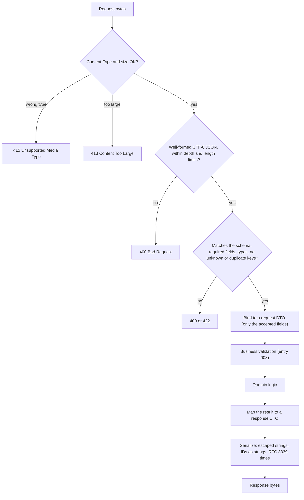

# 007 · Serialization and deserialization: JSON, schemas, pitfalls

> **One-line summary:** Serialization turns in-memory values into bytes that another process can rebuild; doing it safely means knowing exactly what the format can and can't represent, treating every incoming payload as untrusted input to be parsed, checked against a schema and bound to an explicit type, and evolving that schema so old and new code can keep talking.
> **Track:** BE · **Prerequisites:** [001 · Request → response lifecycle](../001-request-response-lifecycle/), [002 · HTTP fundamentals](../002-http-fundamentals/), [004 · HTTP status codes](../004-http-status-codes/)

## 1. The problem

Four bugs, each from a well-known class of production incident:

1. A Java service returns `{"id": 9007199254740993, "name": "Ada"}`. The browser parses it with `JSON.parse`, which stores every number as a 64-bit float. The ID becomes `9007199254740992`. The client then calls `GET /users/9007199254740992` and gets someone else's record, or a 404. Nothing threw an error.
2. `PATCH /users/42` binds the request body straight onto the `User` entity and saves it. The form only sends `name`, but an attacker sends `{"name": "x", "role": "admin"}`. The binder sets `role` too, because it was a field on the class.
3. Team A adds a field, `"nickname"`, to its response and deploys. Team B's client uses a deserializer that fails on unknown properties, and every call from B to A now fails. A change that "only added a field" caused an outage.
4. A Java service accepts a cookie containing a serialized object and calls `ObjectInputStream.readObject()` on it. An attacker sends a crafted byte stream made only of classes already on the classpath, and the act of rebuilding the object graph runs a command on the server. This is the gadget-chain attack that made Java deserialization a top-tier vulnerability class in 2015.

None of these is a parser bug. Each one comes from treating "turn bytes into objects" as plumbing instead of as a boundary with rules. This entry builds those rules up: what serialization actually preserves, what JSON can represent, how decoding should be layered, and how schemas change without breaking callers.

## 2. From first principles

### 2.1 What serialization is, and what it loses

In memory, a value is a graph: objects at addresses, fields that point to other objects, a runtime type for each one, and methods attached to that type. None of that means anything to another process. Addresses are local; the other side may not have the same classes, or even the same language.

**Serialization** (also called encoding or marshalling) maps a value to a sequence of bytes according to a **format**. **Deserialization** (decoding, unmarshalling) parses bytes back into a value. For two programs to communicate, they need to agree on two things:

- **The format:** the syntax and the data model. For JSON, this is "objects, arrays, strings, numbers, booleans, null", encoded in UTF-8.
- **The schema:** which shape of data is valid for *this* message. For example: "an object with a required string `name` and an optional integer `age`". The format allows far more than any one message should accept.

Some things never survive the trip, whatever the format:

- **Identity and sharing.** If two fields point to the same object, a tree format like JSON writes it twice, and the reader gets two separate copies. Cycles can't be written at all without an explicit ID scheme.
- **Behavior.** Methods don't travel; only data does. (Formats that try to make behavior travel, by naming the class to instantiate, are the source of bug 4. See §2.7.)
- **Types the format doesn't have.** A `LocalDate`, a `BigDecimal`, a `byte[]`, or a 64-bit integer has to be mapped onto something the format does have, and both sides have to agree on that mapping.

### 2.2 Formats: text or binary, self-describing or schema-required

| Format | Encoding | Field names on the wire? | Schema |
|---|---|---|---|
| JSON | Text (UTF-8) | Yes | Optional, external (JSON Schema, OpenAPI) |
| XML | Text | Yes (tags) | Optional (XSD) |
| CBOR, MessagePack | Binary | Yes | Optional |
| Protocol Buffers | Binary | No: fields are identified by number | Required (`.proto`) |
| Avro | Binary | No: fields are identified by position | Required (the writer's schema must be available to the reader) |

The two columns that matter are **self-describing** and **schema-required**. JSON is self-describing: you can parse any JSON document without knowing anything about it, which makes it easy to debug and to use from every language, and also means that nothing in the format stops a payload from having the wrong shape. Protocol Buffers drops field names and writes small numeric tags instead. The messages are smaller and faster to parse, but they're unreadable without the `.proto` file, and the schema is part of the contract by construction.

Public HTTP APIs almost always use JSON. Internal service-to-service traffic often uses Protocol Buffers (usually through gRPC). The rest of this entry focuses on JSON, because it's where most backend bugs live, and returns to binary formats in §2.8.

### 2.3 The JSON data model, exactly

RFC 8259 defines JSON in a few pages. It has four primitive types (string, number, boolean, null) and two structured types (object and array). That's all. Some consequences:

- **There's no integer type.** There's only "number", and the RFC doesn't say how precise it must be (§2.4).
- **There's no date, time, binary, decimal or enum type.** Each one has to be encoded as a string or a number by convention (§2.6).
- **Object keys are always strings.** A `Map<Integer, String>` becomes `{"1": "a"}`, and the reader has to know to turn the keys back into integers.
- **`null` and "absent" are different.** `{"nickname": null}` and `{}` are different documents. For a `PATCH`, the first usually means "clear the nickname" and the second "leave it alone". A binder that maps both to a Java `null` loses that distinction.
- **Encoding.** JSON exchanged between systems that aren't part of a closed ecosystem MUST be UTF-8, without a byte order mark (§8.1).
- **Strings.** Inside a string, the quotation mark, the backslash and the control characters U+0000 to U+001F MUST be escaped; every other character may appear as is (§7). Building JSON by concatenating strings skips this, which is how a name like `x","role":"admin` turns into an extra member (see the code in §4).

### 2.4 Numbers: the 2^53 boundary

The JSON grammar allows a number of any length, and RFC 8259 §6 lets implementations set their own limits on range and precision. In practice, many parsers store every number as an IEEE 754 binary64 value (a `double`). JavaScript's `JSON.parse` always does.

A binary64 value has a 53-bit significand: 52 bits stored, plus an implicit leading 1. So it can represent every integer from −2^53 to 2^53 exactly. Above 2^53, the gap between consecutive representable values is 2, then 4, and so on. 2^53 + 1 = 9,007,199,254,740,993 has no representation, and it rounds to 2^53. This is bug 1. RFC 8259 §6 states the consequence directly: integers in the range [−(2^53) + 1, 2^53 − 1] are interoperable, because every common implementation agrees on them. JavaScript exposes the upper bound as `Number.MAX_SAFE_INTEGER`.

Java's `long` is 64 bits, and database `bigint` columns, snowflake-style IDs and nanosecond timestamps all exceed 2^53 routinely. The standard fixes are:

- **Send IDs as strings.** An ID is an opaque label, not a quantity, so nothing is lost by quoting it. The Protocol Buffers JSON mapping does this for every 64-bit integer type. I-JSON (RFC 7493), a stricter profile of JSON for interoperability, recommends that numbers not exceed binary64 precision and that larger values be sent as strings.
- **Never send money as a float.** Binary floating point can't represent most decimal fractions exactly (`0.1 + 0.2` is `0.30000000000000004` in a double). Send an integer count of minor units (`"amount": 1999` for 19.99) or a decimal string (`"amount": "19.99"`), and say which in the schema.

### 2.5 Objects: duplicate keys and order

RFC 8259 §4 says the names in an object SHOULD be unique, and that when they aren't, the behavior of software that receives the object is unpredictable: many implementations keep only the last pair, some keep the first, some raise an error. So `{"role": "user", "role": "admin"}` can mean different things to different parsers.

That's harmless with one parser and dangerous with two. If a gateway or validator reads the first `role` and the application reads the last, a payload can pass a check and then do something else. This is a **parser differential**: two components that both "parse JSON" but disagree on what a document means. Other sources of differentials are case-insensitive key matching (Go's `encoding/json` accepts a case-insensitive match when there's no exact one), different number limits, and different handling of invalid UTF-8. I-JSON forbids duplicate names outright. For a security-relevant payload, reject them.

Key order carries no meaning. Never rely on it, and never compute a signature over "the JSON" without first defining a canonical form. Two serializers can produce different bytes for the same value.

### 2.6 Dates and times

JSON has no time type, so every API chooses a convention, and most bugs come from not choosing one explicitly. The robust choice is a string in RFC 3339 format (a profile of ISO 8601) with an explicit offset, usually UTC:

```json
{ "createdAt": "2026-11-26T17:45:00Z" }
```

The alternatives each have a trap:

- **A Unix timestamp number** doesn't say its unit. `1795715100` (seconds) and `1795715100000` (milliseconds) are both plausible, and confusing them puts the date in January 1970 or tens of thousands of years in the future. Nanoseconds also exceed 2^53.
- **A local time without an offset**, such as `"2026-11-26 09:45:00"`, names a wall-clock time, not an instant. It means something different in every time zone, and it's ambiguous during a daylight-saving fall-back hour.

I-JSON recommends RFC 3339 strings for dates and times. Use a date-only string (`"2026-11-26"`) for values that really are dates, such as a birthday, so no time zone gets attached to them.

### 2.7 Deserialization is parsing untrusted input

Every byte a client sends is attacker-controlled, so decoding a request isn't one step. It's a pipeline in which each layer rejects a different class of bad input:

1. **Transport checks.** Is the `Content-Type` one this endpoint accepts (otherwise `415`)? Is the body under the size limit (otherwise `413`)?
2. **Syntax.** Is it well-formed JSON in valid UTF-8, within limits on nesting depth and string and number length? A recursive-descent parser fed `[[[[…]]]]` a million levels deep overflows its stack unless it caps the depth. Malformed input is `400`.
3. **Shape (schema).** Are the required fields present, and is every field the right type? What happens to fields the schema doesn't know? Failures are `400`, or `422` if the API uses it for syntactically valid but unacceptable content (entry 004).
4. **Binding.** Map the checked data onto a type that contains *only* the fields this endpoint accepts: a request DTO, not the database entity.
5. **Semantics.** Business rules ("the end date is after the start date") belong to validation, which is entry 008.

Two decisions in this pipeline cause most of the trouble.

**Binding to the entity is mass assignment.** Bug 2 happens because the binder's notion of "settable" is "is a field on the class". The fix is structural: bind to a request type that has only `name` and `email`, or reject unknown fields, so `role` has nowhere to go. The same mistake in the other direction, serializing the entity in a response, leaks fields like `passwordHash` or `internalNotes` the moment someone adds them to the entity. The OWASP API Security Top 10 (2023) combines both under API3, *Broken Object Property Level Authorization*. A response DTO is an explicit allowlist of what leaves the service.

**Letting the payload choose the type is remote code execution.** Java's native serialization writes class names into the stream, and `ObjectInputStream.readObject()` instantiates whatever classes the stream names and runs their `readObject` methods. An attacker doesn't need to upload code. They chain together classes already on the classpath (a "gadget chain") whose deserialization logic, combined, ends in a method that runs a command. Frohoff and Lawrence's 2015 talk *Marshalling Pickles* and the `ysoserial` tool showed working chains in common libraries. The same applies to Python's `pickle` (its documentation says to unpickle only data you trust) and to JSON libraries configured to read a type name from the payload (Jackson's default typing, `@class` fields). The rule: **never let untrusted input pick which class to instantiate.** Decode untrusted data into a data-only format bound to fixed types. If native deserialization can't be removed, restrict the allowed classes with a filter (JEP 290, Java 9 and later) and treat that as a mitigation, not a fix.

### 2.8 Schemas and evolution

A schema makes the contract explicit: JSON Schema or OpenAPI for JSON, `.proto` files for Protocol Buffers. Its other job is to make **change** safe, because the two sides of a connection are never deployed at the same instant. During a rolling deploy, old and new versions of the writer and the reader all run at once, and mobile clients may run an old version for years.

Two compatibility directions matter:

- **Backward compatible:** new readers can read data written by old writers.
- **Forward compatible:** old readers can read data written by new writers.

Most changes are safe only if readers tolerate unknown fields. This is the **tolerant reader** rule, and I-JSON recommends that protocols specify that unrecognized members be ignored. That fixes bug 3. The tension with §2.7 is real: ignoring unknown fields in a *response* from a service you call is what lets that service evolve; rejecting unknown fields in a *request* to your own endpoint is what stops mass assignment and catches client typos. Choose the policy per boundary, deliberately.

Safe and unsafe changes:

| Change | Safe? | Why |
|---|---|---|
| Add an optional field | Yes, if readers ignore unknown fields | Old readers skip it; new readers use a default when it's absent |
| Add a required field | No | Old writers don't send it, so new readers reject old data |
| Remove a field | Only once no reader needs it | Old readers that require it break |
| Rename a field | No | It's a removal plus an addition |
| Change a field's type (number → string) | No | Every reader that wasn't updated fails or misreads |
| Add an enum value | Only if readers handle unknown values | An exhaustive `switch` in an old reader has no case for it |

The deploy rule that follows: **ship the reader before the writer.** Deploy code that understands the new field, then start sending it.

Protocol Buffers builds these rules into the format. Fields are identified by number, not name, so renaming a field is safe on the binary wire (though not in the JSON mapping, which uses names), but changing or reusing a number is not; a removed field's number and name should be marked `reserved` so they're never reused. Parsers keep unknown fields rather than failing, so old readers tolerate new fields by default.

### Self-check

- A JavaScript client receives `{"count": 12345678901234567890}`. What value does it see, and would sending the number as a string help?
- An endpoint validates the body with one JSON library and then deserializes it with another. What payload could pass validation and still set a field the validator rejected?
- You add a required field `currency` to a request schema and deploy the server first. What happens to requests from clients that haven't updated yet, and what would you do instead?

<details>
<summary>Answers</summary>

- It sees `12345678901234567000`: the value rounded to the nearest binary64 number, which is not the number sent, and no error is raised. Sending it as the string `"12345678901234567890"` preserves every digit; the client then keeps it as a string or parses it with `BigInt`.
- A payload with a duplicate key, for example `{"role": "user", "role": "admin"}`, if the validator keeps the first value and the deserializer keeps the last (or the reverse). Other differentials work the same way: case variants such as `"Role"` with a case-insensitive binder, or numbers that one library rejects and the other rounds. The fix is to validate the same parsed value that you bind, and to reject duplicate keys.
- Every request from an old client now fails validation, with a `400`, because it doesn't send `currency`. Add the field as optional with a documented default (or derive it), deploy, update clients, and only then make it required, if ever.

</details>

## 3. Diagram

The request side of the pipeline from §2.7, with the status code each layer returns when it rejects the input:



## 4. Code

[`Json.java`](../../code/src/main/java/foundations/e007_serialization/Json.java) is about 60 lines with no dependencies. It implements three rules from §2, one per method:

- `quote(String)` escapes a string as RFC 8259 §7 requires.
- `integer(long)` writes a number only when a binary64 parser will read it back exactly, and refuses otherwise.
- `requireOnly(body, allowed)` rejects any field the endpoint doesn't accept.
- `UserView` is a response DTO that sends its `id` as a string.
- Test: [`JsonTest.java`](../../code/src/test/java/foundations/e007_serialization/JsonTest.java).

Escaping is what keeps attacker-controlled text inside one string value:

```java
case '"' -> out.append("\\\"");  // an unescaped quote ends the string early: the injection vector
case '\\' -> out.append("\\\\"); // an unescaped backslash starts an escape sequence
...
if (c < 0x20) out.append(String.format("\\u%04x", (int) c));
```

The test `aHostileNameStaysOneStringValue` shows the difference. With the name `x","role":"admin`, plain concatenation produces `{"name":"x","role":"admin"}`, a document with a `role` member; `UserView.toJson()` produces `{"id":"1","name":"x\",\"role\":\"admin"}`, whose `name` is exactly the input.

The integer check compares both bounds explicitly:

```java
if (n < -MAX_SAFE || n > MAX_SAFE) {
    throw new IllegalArgumentException(n + " is outside ±(2^53 − 1); send it as a string");
}
```

And the test shows the rounding itself, in Java, without a browser:

```java
long a = Json.MAX_SAFE + 1; // 2^53
long b = Json.MAX_SAFE + 2; // 2^53 + 1
assertEquals((double) a, (double) b); // two different longs, one double
```

This is a teaching example, not a serializer. Use a real library (Jackson, Gson, or the JSON support in your framework) for production code. It also doesn't handle lone UTF-16 surrogates, which a Java `String` can contain but which aren't valid in UTF-8 JSON.

Run the tests:

```bash
cd code
./gradlew test --tests 'foundations.e007_serialization.*'
```

### Self-check

- Why does `integer` compare against `-MAX_SAFE` and `MAX_SAFE` instead of checking `Math.abs(n) > MAX_SAFE`?
- `UserView` always quotes the ID, even `1`. Why not emit small IDs as numbers and only large ones as strings?
- `requireOnly` throws on an unknown field. Where would you *not* want that behavior?

<details>
<summary>Answers</summary>

- `Math.abs(Long.MIN_VALUE)` overflows and returns `Long.MIN_VALUE`, which is negative, so `Math.abs(n) > MAX_SAFE` would be false and the most extreme value would pass the check. The test `integerRefusesValuesOutsideTheSafeRange` covers it.
- Then the field's JSON type would depend on its value. Every client would need to handle both a number and a string, a schema couldn't give the field one type, and code tested only on small IDs would break the first time a large one appeared. An ID is a string in the contract, at every size.
- When reading responses from a service you call, or messages from a queue other teams publish to. There, rejecting unknown fields turns every additive change on the other side into an outage (bug 3). Strict rejection belongs on requests to your own endpoint, where an unknown field is either a client mistake or an attempt to set something it shouldn't.

</details>

## 5. Trade-offs and failure modes

**Strict versus tolerant readers.** Strict decoding catches typos and blocks mass assignment, but couples readers to writers so that additive changes break them. Tolerant decoding lets services evolve independently, but silently drops misspelled fields: a client that sends `"emial"` gets a success response and no email update. A common split is strict on your own public request bodies and tolerant when consuming other services.

**Text versus binary.** JSON is readable in logs and from `curl`, works everywhere, and is larger and slower to parse than Protocol Buffers. For most public APIs, the payload size doesn't matter and readability does. For high-volume internal traffic, a schema-required binary format pays for itself in bandwidth, CPU and enforced contracts.

**Schema-first versus code-first.** Writing the schema first (OpenAPI, `.proto`) and generating code keeps clients and servers in sync and makes breaking changes visible in review. Generating the schema from code is easier to start with, but a refactor such as renaming a field in a class silently changes the public contract.

**Precision loss fails silently.** Rounding a large integer or a float amount raises no error anywhere. The only defense is the contract itself: IDs as strings, money as minor units or decimal strings, and a test with a value above 2^53.

**Serializing the entity leaks data.** The day someone adds a sensitive column, any endpoint that returns the entity directly starts returning it. Logging an object through a generic serializer leaks it the same way, into a system with weaker access control than the database. Use explicit response types and redact logs.

**Default library behavior differs, and frameworks change it.** Jackson 2 on its own fails on unknown properties and writes dates as numeric timestamps; Spring Boot 3's auto-configured `ObjectMapper` turns both of those off, and Jackson 3 changed several defaults again. Code that behaves correctly inside the framework can behave differently in a test or batch job that uses a plain `ObjectMapper`. Configure one mapper and use it everywhere.

**Denial of service through the parser.** Huge bodies, deep nesting, very long strings and numbers with thousands of digits each cost the parser memory or CPU before your code sees anything. Set a body size limit at the edge and use the parser's own limits. Since version 2.15, Jackson enforces configurable limits on nesting depth, number length and string length.

## 6. In the real world

**Callwise.** Callwise is a TypeScript app, and it uses Zod schemas at its JSON boundaries.

- [`src/app/api/chat/route.ts`](https://github.com/sanjaysathyarapu/callwise/blob/main/src/app/api/chat/route.ts) decodes the body in layers, as in §2.7. `await req.json().catch(() => null)` turns malformed JSON into `null`, and `bodySchema.safeParse(...)` then rejects it, or any body of the wrong shape, with `400 Invalid request`. The schema pins the types that matter: `assistantId` must be a UUID, and `channel` must be `"web_chat"` or `"web_voice"`.
- A Zod `z.object` **strips** unknown keys by default. That makes the chat endpoint a tolerant reader that can't be mass-assigned: extra fields are neither rejected nor passed through. `z.strictObject` would reject them instead.
- One field in that schema is `messages: z.array(z.custom<UIMessage>())`. `z.custom` without a check function accepts any value, so only the array's length is validated at runtime, not the shape of each message. The handler then reads `lastMessage.role` and `lastMessage.parts` directly. This is the boundary between "the type says so" and "the bytes say so": a TypeScript type is erased at runtime, so only a runtime check constrains what a client actually sent.
- [`src/lib/actions/assistants.ts`](https://github.com/sanjaysathyarapu/callwise/blob/main/src/lib/actions/assistants.ts) avoids mass assignment explicitly. `updateAssistantAction` validates `name`, `greeting` and `systemPrompt`, and its database update sets exactly those three columns. Columns like `tier`, `ownerId` and `twilioNumber` aren't reachable from the form, whatever the client sends.
- [`src/app/api/account/export/route.ts`](https://github.com/sanjaysathyarapu/callwise/blob/main/src/app/api/account/export/route.ts) builds an explicit export object instead of serializing database rows. It leaves out internal IDs and the password hash, and renames columns to user-facing names (`systemPrompt` becomes `instructions`). Its timestamps are JavaScript `Date` values, which `JSON.stringify` writes through `Date.prototype.toJSON` as ISO 8601 strings in UTC, such as `"2026-11-26T17:45:00.000Z"`.
- All of Callwise's IDs are UUIDs, which travel as strings anyway, so the 2^53 problem from §2.4 can't arise for them.

**A typical Spring Boot service.** Jackson does the JSON work. Controllers take and return records used as DTOs (`record CreateUserRequest(String name, String email)`), never JPA entities. `@Valid` triggers Bean Validation after binding. Spring Boot 3's auto-configured `ObjectMapper` (Jackson 2) disables `FAIL_ON_UNKNOWN_PROPERTIES` and `WRITE_DATES_AS_TIMESTAMPS`, so unknown fields are ignored and `Instant` values are written as ISO 8601 strings. To make request decoding strict, turn the first back on (`spring.jackson.deserialization.fail-on-unknown-properties=true`). `@JsonSerialize(using = ToStringSerializer.class)` on a `long` ID field writes it as a string.

**Well-known systems.** Protocol Buffers' JSON mapping writes `int64` and `uint64` fields as strings, for the reason in §2.4. Stripe represents amounts as integers in the currency's smallest unit (`1999` for $19.99). gRPC services rely on Protocol Buffers' field numbering and unknown-field handling to deploy clients and servers independently.

## 7. Interview Q&A

**Q:** What's the difference between serialization format and schema, and why do you need both?
**A:** The format defines the syntax and data model, for JSON "objects, arrays, strings, numbers, booleans and null, in UTF-8", so any parser can read any document. The schema defines which of those documents a particular message may be: required fields, types, allowed values. A format alone accepts `{"age": "banana"}` for a user; a schema rejects it. Schemas also make evolution reviewable, because a breaking change shows up as a diff in the schema rather than as a runtime failure.

**Q:** Why do some APIs return IDs as strings?
**A:** Many JSON parsers, including every JavaScript one, store numbers as IEEE 754 doubles, which represent integers exactly only up to 2^53. A 64-bit ID above that is silently rounded to a neighboring value, so the client ends up with a different ID and no error. Sending IDs as strings avoids that, and is semantically right anyway: an ID is an opaque label, not a number you do arithmetic on. The Protocol Buffers JSON mapping does this for all 64-bit integers.

**Q:** What is mass assignment, and how do you prevent it?
**A:** It's when a framework binds request fields directly onto a domain or database object, so a client can set fields the endpoint never meant to expose, like `role` or `isAdmin`, just by including them. Prevent it structurally: bind requests to a DTO that contains only the accepted fields, or reject unknown fields, and copy from the DTO to the entity explicitly. The mirror image on output, serializing the entity, leaks sensitive fields; use response DTOs for that. OWASP groups both under Broken Object Property Level Authorization.

**Q:** Why is deserializing untrusted data with Java's native serialization dangerous?
**A:** The byte stream names the classes to instantiate, and deserialization runs code in those classes, such as custom `readObject` methods, before your application ever sees the object. An attacker can chain classes that are already on the classpath so that their combined deserialization logic executes an arbitrary command; no uploaded code is needed. The fix is not to use native serialization for untrusted input at all: use a data-only format like JSON bound to fixed types, and never let the payload choose the class. Serialization filters (JEP 290) reduce the risk where it can't be removed.

**Q:** How do you add a field to an API without breaking existing clients?
**A:** Add it as optional, with a default for when it's absent, so old writers' data is still valid. Make sure readers ignore unknown fields, so old readers don't break when new writers send it. Deploy readers before writers. Never rename a field or change its type in place; add a new field, migrate, and remove the old one once nothing reads it. In Protocol Buffers, never reuse a field number, and mark removed numbers as `reserved`.

## 8. References

- RFC 8259, *The JavaScript Object Notation (JSON) Data Interchange Format*: objects and duplicate names (§4), numbers and interoperable range (§6), strings and escaping (§7), UTF-8 (§8.1). https://www.rfc-editor.org/rfc/rfc8259
- ECMA-404, *The JSON Data Interchange Syntax*. https://ecma-international.org/publications-and-standards/standards/ecma-404/
- RFC 7493, *The I-JSON Message Format*: duplicate names, number precision, must-ignore policy, dates and times. https://www.rfc-editor.org/rfc/rfc7493
- RFC 3339, *Date and Time on the Internet: Timestamps*. https://www.rfc-editor.org/rfc/rfc3339
- RFC 9110, *HTTP Semantics*: `400` (§15.5.1), `413` (§15.5.14), `415` (§15.5.16), `422` (§15.5.21). https://www.rfc-editor.org/rfc/rfc9110
- JSON Schema, Draft 2020-12. https://json-schema.org/draft/2020-12
- Protocol Buffers, *Language Guide (proto3)*: field numbers, `reserved`, unknown fields. https://protobuf.dev/programming-guides/proto3/
- Protocol Buffers, *ProtoJSON Format*. https://protobuf.dev/programming-guides/json/
- MDN, `Number.MAX_SAFE_INTEGER`. https://developer.mozilla.org/en-US/docs/Web/JavaScript/Reference/Global_Objects/Number/MAX_SAFE_INTEGER
- OWASP, *API Security Top 10 (2023)*: API3, Broken Object Property Level Authorization. https://owasp.org/API-Security/
- OWASP, *Deserialization Cheat Sheet*. https://cheatsheetseries.owasp.org/cheatsheets/Deserialization_Cheat_Sheet.html
- JEP 290, *Filter Incoming Serialization Data*. https://openjdk.org/jeps/290
- C. Frohoff and G. Lawrence, *Marshalling Pickles*, AppSecCali 2015; the `ysoserial` tool. https://github.com/frohoff/ysoserial
- Python documentation, `pickle`: the security warning. https://docs.python.org/3/library/pickle.html
- Go documentation, `encoding/json`: `Unmarshal` key matching. https://pkg.go.dev/encoding/json
- Spring Boot documentation, *Customize the Jackson ObjectMapper*. https://docs.spring.io/spring-boot/how-to/spring-mvc.html
- Zod documentation: objects (`z.object`, `z.strictObject`) and `z.custom`. https://zod.dev/api
