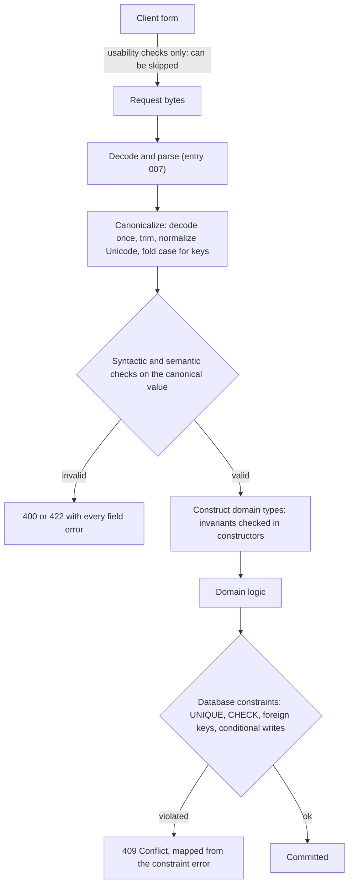
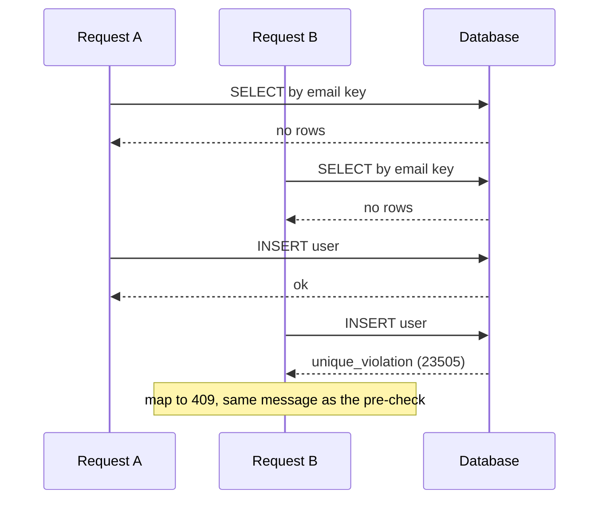

# 008 · Validation and transformation: where and why

> **One-line summary:** Validation decides whether input is acceptable and transformation turns it into the form the program uses; done right, each kind of check runs at the layer that can actually enforce it, always on the canonical form of the data, and its result is a typed value that downstream code can't receive in any unchecked form.
> **Track:** BE · **Prerequisites:** [004 · HTTP status codes](../004-http-status-codes/), [007 · Serialization and deserialization](../007-serialization/)

## 1. The problem

Entry 007 ended its decoding pipeline at "bind to a request DTO", with business rules left for this entry. Four failures show why that last step needs its own design:

1. A sign-up form has `maxlength="100"` on the name field and a JavaScript check that the email contains `@`. A script posts directly to the endpoint with a 5 MB name and the email `x`. The server stores both, because every check lived in the browser.
2. A download endpoint rejects any `file` parameter containing `..`, then URL-decodes it and opens the file. The request `?file=%2e%2e/%2e%2e/etc/passwd` passes the check, because the check saw `%2e`, not `.`. Decoding happened after validation, so the validated string is not the one that was used.
3. Sign-up checks "is this email taken?" with an exact string match. `Ada@example.com` and `ada@example.com` both register, and now two accounts receive the same password-reset email.
4. Sign-up checks "is this email taken?" correctly, then inserts. Two requests for the same new address arrive 5 ms apart. Both run the check before either inserts, both see "free", and both insert.

None of these is a missing regex. Bug 1 is a check in a place the attacker controls. Bug 2 is checks and transformations in the wrong order. Bug 3 is a missing canonical form. Bug 4 is a check that the application layer cannot make true at all.

## 2. From first principles

### 2.1 Validation, transformation, parsing

Three operations get mixed together under the word "validation":

- **Validation** is a predicate: given an input, is it acceptable, and if not, why? Its output is yes, or a list of errors. It doesn't change the input.
- **Transformation** maps an input to another representation. It comes in several kinds:
  - **Coercion:** changing the type, such as the form-field string `"42"` to the integer `42`. Every HTML form field and query parameter arrives as a string, so this always happens somewhere.
  - **Normalization:** trimming whitespace, collapsing line endings, Unicode normalization.
  - **Canonicalization:** reducing every equivalent spelling of a value to one form, so that equality checks mean what they should. `docs/../a.txt` and `a.txt` name the same file; `%2e` and `.` are the same character in a URL.
  - **Mapping to a domain type:** turning a checked `String` into an `Email`, or two dates into a `DateRange`.
- **Parsing** is both at once: a function from raw input to *either* a value of a precise type *or* errors.

The distinction matters because of what each leaves behind. A validator returns a boolean and hands the caller back the same `String`. Nothing in the type system records that the check happened, so the next function that receives the string has to trust that someone checked it, or check again. A parser returns an `Email`. If the only way to construct an `Email` is through the check, then every function that takes an `Email` parameter is guaranteed a valid one, and the check never needs repeating. Alexis King's essay *Parse, don't validate* (2019) names this pattern: push checks to the boundary and have them produce types that carry the evidence. In Java, a record with a compact constructor does this directly (see §4).

### 2.2 Three kinds of checks

Checks differ in what information they need, and that decides where they can run.

| Kind | Example | Needs | Can run in |
|---|---|---|---|
| **Syntactic** (format) | `age` is an integer; `email` is at most 254 characters; `currency` is one of `USD`, `EUR` | The field alone | Any layer, including the client |
| **Semantic** (meaning, across fields) | `end` is not before `start`; `discount` ≤ `price` | The whole request | Any layer that sees the whole request |
| **State-dependent** (against stored data) | `email` isn't already registered; the item is in stock; the user owns this order | The current state of the system | Only where that state is authoritative: the database or the owning service |

The OWASP Input Validation Cheat Sheet draws the first line, between syntactic and semantic validation, and recommends both. The third row is where most real bugs live, because a state-dependent check is only true *at the moment it runs* (§2.6).

### 2.3 Where each check belongs

A **trust boundary** is any point where data crosses from a less trusted component to a more trusted one: browser to server, public API to internal service, message queue to consumer. Validation has to happen on the trusted side of each boundary, because anything on the untrusted side can be skipped.

That gives each layer a distinct job:

1. **The client** validates for **usability**: instant feedback, no round trip for an obvious typo. It is never a security control. `curl` doesn't run your JavaScript, and a browser's developer tools can delete a `maxlength` attribute. OWASP says it directly: client-side validation can be circumvented, so validate on the server. This is bug 1.
2. **The server boundary** (the controller, route handler or server action) parses the request into a request DTO and runs syntactic and semantic checks. This is where `400` or `422` responses come from (entry 004). Checks here are cheap and need no I/O, so they run before anything expensive, like a database call or a model invocation.
3. **The domain model** enforces its own **invariants**: the facts that must hold for an object to exist at all, such as "a date range has `start ≤ end`". These are checked in the constructor, so they hold no matter which endpoint, job or test created the object. This overlaps with the boundary checks on purpose: the boundary check gives a good error message, and the constructor check guarantees nothing else got through.
4. **The database** enforces what only it can guarantee: `NOT NULL`, `UNIQUE`, foreign keys and `CHECK` constraints. These are the only checks that hold across concurrent requests, every code path, and every future service that writes to the same table.

The overlap between layers 2–4 is deliberate defense in depth, but it should be **defined once and enforced at several points**, not reimplemented. If the boundary allows 100 characters and the column allows 60, users see a database error for a 70-character name. Share one schema or one constant between the layers that need it.

### 2.4 Canonicalize first, then validate, then use

A check is only meaningful for the exact string it examined. If anything transforms the data after the check, the program uses a value nobody checked. MITRE catalogs this as CWE-180, *Incorrect Behavior Order: Validate Before Canonicalize*. The rule:

> Decode and canonicalize to the single form the program will use. Validate that form. Use that same value, with no further transformation.

Common transformations that must come before the check:

- **Percent-decoding** (RFC 3986 §2.1). Bug 2 is the textbook case. Its variant is **double decoding**: `%252e` decodes to `%2e`, and a second decode turns that into `.`. If a framework has already decoded a parameter and the application decodes it again, a check between the two decodes is bypassed.
- **Path normalization.** `docs/../../etc/passwd` doesn't start with `..`, but it resolves outside the base directory. The correct check resolves and normalizes the full path, then checks that the result is still inside the base directory (§4). A string check for `..` is both too strict (it rejects the harmless `a..b.txt`) and too weak (it misses encoded and absolute forms).
- **Unicode normalization** (UAX #15). The character `é` can be one code point (U+00E9, the NFC form) or two (`e` plus the combining accent U+0301, the NFD form). They look identical and compare unequal. NFKC goes further and folds compatibility characters: full-width `ＡＤＭＩＮ` becomes `ADMIN`, and the ligature `fi` becomes `fi`. If a username blocklist checks for `admin` before NFKC normalization and the account system compares names after it, `ＡＤＭＩＮ` passes the blocklist and then collides with `admin`.
- **Case folding.** Decide which comparisons are case-insensitive and fold with a fixed locale. In Java, `"I".toLowerCase()` under a Turkish default locale returns the dotless `ı`, so a case-insensitive key computed with the default locale differs between servers. Use `toLowerCase(Locale.ROOT)`.
- **Trimming.** `" ada@example.com"` should either be trimmed before the format check or rejected; it should never pass the check untrimmed and get trimmed later on one code path but not another.

Canonicalization also fixes bug 3. Equality is only meaningful between canonical forms, so define one **comparison key** per identifier and use it everywhere the identifier is compared: the uniqueness check, the unique index, and the login lookup. For email this involves a real choice. RFC 5321 §2.4 says the local part (before the `@`) MUST be treated as case-sensitive by mail software, but also discourages relying on that, and in practice almost every provider treats it as case-insensitive. Domain names are case-insensitive. A common, defensible design is to store the address as the user typed it, for display and for sending, and to compare on a lowercased key.

### 2.5 Allowlists, coercion and limits

**Allowlist, don't denylist.** A denylist enumerates bad inputs (`<script`, `..`, `' OR 1=1`) and fails on the first encoding or spelling its author didn't think of. An allowlist states what is acceptable: an enum of currencies, a regex anchored at both ends, a range of integers. Anything not described is rejected. Where the set of valid values is small, as with sort fields or status filters, map the input to a known value and never pass the raw string through.

**Coercion has to be strict and explicit.** Lenient conversions accept more than you meant:

| Input | JavaScript | Java |
|---|---|---|
| `Number("")` / `Integer.parseInt("")` | `0` | throws `NumberFormatException` |
| `Number(" 42 ")` / `Integer.parseInt(" 42")` | `42` | throws |
| `Number("0x1A")` | `26` | (n/a) |
| `Number("1e3")` | `1000` | (n/a) |
| `parseInt("42abc")` | `42` | (n/a) |
| `Boolean("false")` / `Boolean.parseBoolean("yes")` | `true` | `false` |

An empty quantity field silently becoming `0`, or the string `"false"` becoming `true`, is a transformation that destroyed information before any check ran. Schema libraries inherit these behaviors when they coerce: Zod's `z.coerce.number()` applies JavaScript's `Number()`, so an empty string coerces to `0` and passes a `.min(0)` check. Treat "missing", "empty" and "zero" as three different inputs, and reject what doesn't convert exactly.

**Every input needs a bound.** Strings need a maximum length, arrays a maximum count, numbers a range, files a size and a type. An unbounded field is a storage problem at best and a denial-of-service vector at worst. Put a size limit at the edge, before parsing, as entry 007 described, and per-field limits in the schema.

**Regexes are code, and they can be slow.** Java's `java.util.regex` and JavaScript's `RegExp` are backtracking engines. A pattern with nested quantifiers, such as `^(a+)+$`, takes time exponential in the input length on a string like `aaaa…a!`, because the engine tries every way of splitting the `a`s between the inner and outer `+`. This is ReDoS (regular-expression denial of service). Keep patterns simple, bound the input length *before* matching, and prefer a small parser to a clever regex.

**Validation is not escaping.** Input validation reduces the attack surface, but it is not the defense against injection. A perfectly valid surname is `O'Brien`, and a perfectly valid comment contains `<`. The defenses are at the point of use: parameterized queries for SQL, context-aware output encoding for HTML, and argument arrays rather than shell strings for processes. OWASP's cheat sheet makes the same point: input validation should not be the primary defense against XSS or SQL injection. Validate to reject what is *wrong*; encode on output so that what is *right* can't be misinterpreted.

### 2.6 State-dependent checks and the race

Bug 4 is a time-of-check to time-of-use race (CWE-367). Two requests interleave like this:

1. Request A: `SELECT … WHERE email_key = 'ada@example.com'` returns no rows.
2. Request B: the same query returns no rows.
3. Request A inserts.
4. Request B inserts. There are now two accounts.

No amount of application code fixes this, because the fact being checked ("no row exists") can change between the check and the write. The fix is to let the component that owns the state make the check and the write atomic:

- **A `UNIQUE` constraint** (or unique index) on the comparison key. The database rejects the second insert; in PostgreSQL this is SQLSTATE `23505`, `unique_violation`. Catch that specific error and map it to the same friendly message as the pre-check, usually with `409 Conflict`.
- **A conditional write** for other invariants: `UPDATE stock SET qty = qty - 1 WHERE id = ? AND qty >= 1`, then check that one row was updated.
- **A `CHECK` constraint** for row-level rules the database can evaluate, such as `CHECK (end_date >= start_date)`.

Keep the pre-check anyway. It produces a clear error in the common case without relying on parsing a database error. But treat it as a usability feature, like client-side validation: the constraint is the guarantee.

### 2.7 Reporting errors

Validation output is part of the API contract, so design it:

- **Collect, don't stop at the first error,** for syntactic and semantic checks on user-facing forms. Returning all field errors at once saves the user a round trip per mistake. State-dependent checks usually run after the cheap ones pass.
- **Make errors machine-readable.** Name the field, give a stable code, and add a human message. RFC 9457, *Problem Details for HTTP APIs*, defines a standard JSON shape (`type`, `title`, `status`, `detail`, plus extension members such as a list of field errors).
- **Pick the status code consistently** (entry 004): `400` for a malformed request, `422` if the API uses it for well-formed but invalid content, `409` for a conflict with current state, `413` for too large, `415` for the wrong media type.
- **Don't reflect raw input into HTML error pages** without encoding it, or the error page becomes an XSS vector. And don't leak internals: "email already registered" on a sign-up form is usually an acceptable trade-off, but on a password-reset form it enables account enumeration.

### Self-check

- A form already validates the email with a regex in the browser. Why does the server need to check it again, and what should the browser check still be used for?
- An endpoint receives `name=%41dmin` and checks it against a blocklist of reserved names before decoding. What goes wrong, and what is the correct order?
- You add `UNIQUE (email_key)` to the users table. Is the "is this email taken?" query in the sign-up handler now redundant?

<details>
<summary>Answers</summary>

- Anything in the browser is under the client's control: a script can post to the endpoint directly, and the page's JavaScript can be edited. The server is on the trusted side of the boundary, so only its checks are enforcement. The browser check is still worth keeping as a usability feature: it gives immediate feedback without a round trip.
- `%41` is `A`, so the decoded value is `Admin`, which the check never saw. If reserved names are also compared case-insensitively later, it collides with `admin` too. The correct order is: decode, normalize (Unicode and case, for the comparison key), validate the result, then use exactly that value.
- No, but its role changes. The constraint is what guarantees uniqueness under concurrency; the query only lets the handler return a friendly message in the common case. The handler must also catch the unique-violation error from the insert, because two concurrent requests can both pass the query.

</details>

## 3. Diagram

Where each kind of check runs, and what each layer answers when the check fails:



The race from §2.6, and why only the constraint stops it:



## 4. Code

[`Inputs.java`](../../code/src/main/java/foundations/e008_validation/Inputs.java) is about 55 lines with no dependencies. Each piece is a parser in the sense of §2.1: it returns a value that can only exist if the check passed, or it throws.

- `Email` is a record whose compact constructor is the check, so no unchecked `Email` can exist. `Email.parse` canonicalizes (strips whitespace) and then constructs; `key()` is the comparison key from §2.4.
- `DateRange` holds a cross-field invariant that no single field can check.
- `resolveInside(base, userPath)` canonicalizes a client-supplied path and only then checks that it stays inside the base directory.
- Test: [`InputsTest.java`](../../code/src/test/java/foundations/e008_validation/InputsTest.java).

The order inside `Email` is the whole point:

```java
public static Email parse(String raw) {
    return new Email(raw == null ? null : raw.strip()); // canonicalize, then the constructor validates
}
```

The constructor rejects whitespace anywhere, so `new Email(" ada@example.com")` throws. There is no way to get an `Email` that one code path trimmed and another didn't. The shape check is deliberately modest (a non-empty local part of at most 64 characters, one `@` position, a dot in the domain, no whitespace, at most 254 characters). Fully validating RFC 5322 address syntax with a regex is a well-known trap; the only real proof that an address works is a confirmation email to it. The limits come from RFC 5321 §4.5.3.1: 64 octets for the local part, and a 256-octet path that includes the two angle brackets, leaving 254. The code counts Java `char`s, which equals octets only for ASCII.

The path check normalizes first and compares path elements, not strings:

```java
Path root = base.toAbsolutePath().normalize();
Path target = root.resolve(userPath).normalize();
if (!target.startsWith(root)) throw new IllegalArgumentException("path escapes the base directory");
```

`Path.resolve` returns its argument unchanged when the argument is absolute, so `"/etc/passwd"` resolves to `/etc/passwd` and fails the check. The test `validatingBeforeDecodingLetsTraversalThrough` reproduces bug 2: `%2e%2e/etc/passwd` contains no `..`, so a string check on it passes; `URLDecoder.decode` then produces `../etc/passwd`, which `resolveInside` rejects.

This doesn't follow symbolic links: a link inside the base directory that points outside it would pass. When the file already exists, compare `toRealPath()` results as well, which resolves links on the actual file system.

Run the tests:

```bash
cd code
./gradlew test --tests 'foundations.e008_validation.*'
```

### Self-check

- Why does `resolveInside` use `Path.startsWith(Path)` instead of `target.toString().startsWith(root.toString())`?
- `Email` exposes a public constructor. Doesn't that let callers skip `parse`?
- `key()` uses `Locale.ROOT`. What would break, and where, if it used `toLowerCase()` with no argument?

<details>
<summary>Answers</summary>

- `Path.startsWith` compares whole name elements, so `/srv/uploads2/x` does not start with `/srv/uploads`. A string prefix check says it does, and `../uploads2/x` would escape into a sibling directory. The test `resolveInsideRejectsEveryEscape` covers it.
- A caller can skip `parse`, but not the check: the compact constructor runs on every construction, and it rejects anything `parse` would have rejected, including untrimmed input. `parse` adds only the canonicalization step. The invariant lives in the one place every `Email` must pass through.
- `toLowerCase()` uses the JVM's default locale. On a server whose default locale is Turkish, `IVY@example.com` would get the key `ıvy@example.com` (dotless ı), while the same address on another server gets `ivy@example.com`. Lookups and uniqueness checks would then disagree between servers. The test `keyIsCaseInsensitiveInEveryLocale` sets a Turkish default locale to show it.

</details>

## 5. Trade-offs and failure modes

**Strictness versus usability.** Every rule rejects someone. Name rules that require a first and last name, ASCII letters only, or a minimum length reject real names. Phone and postal-code formats vary by country. Validate what the system actually depends on (it must fit the column; it must be deliverable), and avoid rules that encode assumptions about the user.

**Duplicated rules drift.** The same limit written in the client, the DTO and the database migration will eventually disagree. The failure is subtle: a value the API accepts fails at the database with a `500`. Define limits once (a shared schema, a constant, or a schema generated from one source) and test that the layers agree.

**Validating too late is expensive; validating too early is incomplete.** Cheap syntactic checks belong before I/O and model calls, so invalid requests cost almost nothing. State-dependent checks can't run early, and pretending they can (a pre-check without a constraint) produces races. Order checks from cheapest to most expensive, and put each one at the earliest layer that can enforce it correctly.

**Annotation-driven validation hides order.** Frameworks like Bean Validation make syntactic checks declarative, which is good. But annotations on fields can't express cross-field rules without a class-level constraint, and it's easy to forget `@Valid` on a nested object, in which case its fields are never checked. Transformations such as trimming then end up scattered across setters, deserializers and service code, with no single place that defines the order.

**Silent transformation hides bad data.** Clamping an out-of-range page size to the maximum, truncating an overlong name, or coercing an empty field to zero all "succeed", but the client never learns its input was wrong, and the stored data differs from what was sent. Prefer rejecting with a clear error, except for documented, harmless normalizations such as trimming.

**Error messages are an information channel.** Detailed errors help legitimate users and attackers alike. Field-level format errors are safe to return. Errors that reveal state ("this email is registered", "this coupon belongs to another account") need a deliberate decision per endpoint.

## 6. In the real world

**Callwise.** Callwise is a TypeScript app that validates at its server boundaries with Zod schemas, using `safeParse`, whose `data` field is the parsed and transformed value.

- [`src/lib/auth/actions.ts`](https://github.com/sanjaysathyarapu/callwise/blob/main/src/lib/auth/actions.ts) defines `signupSchema` with `z.string().trim().min(1, "Enter your name.").max(100)` and `z.string().trim().email(...)`. Zod runs `.trim()` and the checks in the order they're chained, so the length and format checks see the trimmed value, and the action then uses `parsed.data`, not the raw form field: canonicalize, validate, use the same value.
- The same action canonicalizes the email to lowercase before both the uniqueness pre-check (`lower(users.email) = …`) and the insert, and the login path in [`src/lib/auth/config.ts`](https://github.com/sanjaysathyarapu/callwise/blob/main/src/lib/auth/config.ts) compares `lower(users.email)` against the lowercased input. That's one comparison key used on both paths, the fix for bug 3. Callwise lowercases the whole address, including the local part, which is the common pragmatic choice described in §2.4.
- The `users.email` column is declared `.unique()` in the Drizzle schema, so the database is the real guarantee against bug 4. The sign-up action's pre-check returns a friendly message in the common case; the insert itself isn't wrapped, so if two sign-ups for one address race, the second fails with the database's unique-violation error rather than the friendly message.
- [`src/lib/actions/assistants.ts`](https://github.com/sanjaysathyarapu/callwise/blob/main/src/lib/actions/assistants.ts) and the document upload route enforce quotas (`MAX_ASSISTANTS_PER_USER`, `MAX_DOCUMENTS_PER_ASSISTANT`) with count-then-insert, which is the same check-then-act shape. Concurrent requests could exceed a quota by a few rows. That's an acceptable trade-off for a soft product limit, and it would not be for a balance or an inventory count, where the check must be a constraint or a conditional write.
- [`src/app/api/assistants/[id]/documents/route.ts`](https://github.com/sanjaysathyarapu/callwise/blob/main/src/app/api/assistants/%5Bid%5D/documents/route.ts) orders its checks from cheap to expensive: ownership, rate limit and document count, then file size (`MAX_FILE_BYTES`, 4 MB) before any text extraction, then the expensive embedding call last. [`src/lib/rag/extract.ts`](https://github.com/sanjaysathyarapu/callwise/blob/main/src/lib/rag/extract.ts) lowercases the filename before matching an allowlist of extensions, and the actual parse of the PDF or DOCX is the real content check: a renamed file fails there, and the route returns `422`. The route checks emptiness and length on the text *after* normalization and trimming, so a whitespace-only paste, which passes `z.string().min(1)`, is still rejected.

**A typical Spring Boot service.** Jakarta Bean Validation (Hibernate Validator, via `spring-boot-starter-validation`) handles syntactic checks with annotations on request records: `@NotBlank`, `@Size(max = 100)`, `@Email`, `@Pattern`. `@Valid` on a `@RequestBody` parameter runs them after Jackson binds the body; a failure throws `MethodArgumentNotValidException`, which Spring turns into a `400`, and many services map it to an RFC 9457 problem-details body listing every field error. Cross-field rules use a class-level custom constraint. Invariants live in domain constructors, and uniqueness lives in a database constraint, with `DataIntegrityViolationException` mapped to `409`.

**Well-known systems.** PostgreSQL's `CHECK`, `UNIQUE` and exclusion constraints let the database enforce invariants that application code can only approximate under concurrency. OpenAPI and JSON Schema let API gateways reject malformed requests before they reach a service, which is useful, but the service still validates, because the gateway isn't the only way in.

## 7. Interview Q&A

**Q:** Where should input validation happen in a web application?
**A:** On the trusted side of every trust boundary, with each kind of check at the layer that can enforce it. Client-side checks are for usability only, because the client is under the attacker's control. The server boundary parses requests into DTOs and runs syntactic and cross-field checks, returning `400` or `422`. Domain objects enforce their own invariants in constructors, so they hold for every caller. The database enforces uniqueness, foreign keys and `CHECK` constraints, which are the only checks that stay true under concurrency. Define each rule once and share it across layers so they don't drift.

**Q:** What does "parse, don't validate" mean?
**A:** Instead of a function that checks input and returns a boolean, leaving the caller with the same unchecked type, write a function that returns a more precise type, or fails. For example, `Email.parse(String)` returns an `Email` whose constructor enforces the format. Downstream code takes `Email` parameters, so it can't receive invalid data and never needs to recheck. The check happens once, at the boundary, and the type system carries the evidence from there.

**Q:** Why must you canonicalize before validating?
**A:** A check is only valid for the exact value it examined. If the input is decoded, normalized or resolved after the check, the program uses a value nobody checked. The classic case is path traversal: `%2e%2e/` contains no `..` until it's decoded, and `a/../../b` doesn't start with `..` until it's normalized. So decode and normalize to the one form the program will use, validate that form, and use that exact value with no further transformation. MITRE tracks the mistake as CWE-180.

**Q:** Your sign-up endpoint checks that an email isn't taken, but you still get duplicate accounts. Why, and how do you fix it?
**A:** Either the comparison isn't on a canonical key, so `Ada@x.com` and `ada@x.com` look different, or two requests raced: both ran the check before either inserted. That's a time-of-check to time-of-use race, and application code can't close it, because the state can change between the check and the write. Fix both: compare on a normalized key, and put a `UNIQUE` constraint on that key so the database rejects the second insert. Catch the unique-violation error and return `409` with the same message as the pre-check, which you keep only for a friendlier common case.

**Q:** Is input validation enough to prevent SQL injection and XSS?
**A:** No. Validation rejects input that is wrong for the field, but much legitimate input contains characters that are dangerous in some other context, like the apostrophe in `O'Brien` or a `<` in a comment. The defenses belong at the point of use: parameterized queries for SQL and context-aware output encoding for HTML. Validation reduces attack surface and catches garbage early; it is a second layer, not the primary control. OWASP's guidance says the same.

## 8. References

- OWASP, *Input Validation Cheat Sheet*: syntactic and semantic validation, allowlisting, client-side validation, relation to XSS and SQL injection. https://cheatsheetseries.owasp.org/cheatsheets/Input_Validation_Cheat_Sheet.html
- OWASP, *Regular expression Denial of Service (ReDoS)*. https://owasp.org/www-community/attacks/Regular_expression_Denial_of_Service_-_ReDoS
- MITRE, CWE-20 *Improper Input Validation*. https://cwe.mitre.org/data/definitions/20.html
- MITRE, CWE-22 *Improper Limitation of a Pathname to a Restricted Directory ('Path Traversal')*. https://cwe.mitre.org/data/definitions/22.html
- MITRE, CWE-180 *Incorrect Behavior Order: Validate Before Canonicalize*. https://cwe.mitre.org/data/definitions/180.html
- MITRE, CWE-367 *Time-of-check Time-of-use (TOCTOU) Race Condition*. https://cwe.mitre.org/data/definitions/367.html
- A. King, *Parse, don't validate*, 2019. https://lexi-lambda.github.io/blog/2019/11/05/parse-don-t-validate/
- RFC 3986, *Uniform Resource Identifier (URI): Generic Syntax*: percent-encoding (§2.1), normalization and comparison (§6). https://www.rfc-editor.org/rfc/rfc3986
- RFC 5321, *Simple Mail Transfer Protocol*: local-part case sensitivity (§2.4), size limits (§4.5.3.1). https://www.rfc-editor.org/rfc/rfc5321
- RFC 9457, *Problem Details for HTTP APIs*. https://www.rfc-editor.org/rfc/rfc9457
- RFC 9110, *HTTP Semantics*: `400` (§15.5.1), `409` (§15.5.10), `422` (§15.5.21). https://www.rfc-editor.org/rfc/rfc9110
- Unicode Standard Annex #15, *Unicode Normalization Forms*. https://www.unicode.org/reports/tr15/
- PostgreSQL documentation, *Constraints* and *PostgreSQL Error Codes* (`23505`). https://www.postgresql.org/docs/current/ddl-constraints.html · https://www.postgresql.org/docs/current/errcodes-appendix.html
- Jakarta Bean Validation 3.0 specification. https://jakarta.ee/specifications/bean-validation/3.0/
- Spring Framework documentation, *Validation* for web MVC. https://docs.spring.io/spring-framework/reference/web/webmvc/mvc-config/validation.html
- Java SE 21 API: `java.nio.file.Path` (`resolve`, `normalize`, `startsWith`, `toRealPath`) and `String.toLowerCase(Locale)`. https://docs.oracle.com/en/java/javase/21/docs/api/java.base/java/nio/file/Path.html
- Zod documentation: strings, coercion (`z.coerce`), `safeParse`. https://zod.dev/api
